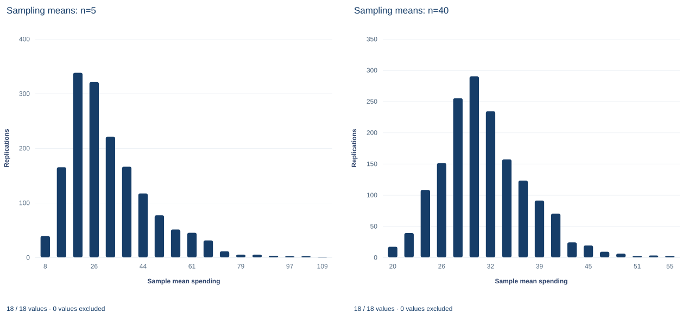

# Lab 08 · Why Do Averages Vary Less Than Observations?

**Sampling distributions, the standard error and the square-root law**

## Start with the supplied workbook

1. Download [spending_population.xlsx](spending_population.xlsx) and the [Python lab](lab.py). The workbook holds the fixed population used throughout this chapter.
2. Import `spending_population.xlsx` into OpenEconometrics and keep that file name as the dataset name. The `Data` sheet holds one row per person; the `Dictionary` sheet explains each column and its unit. No cell is blank.
3. Open the complete `lab.py` in a new Python document and run the whole file. It draws repeated samples from the population and displays a table of the sample means, a histogram of the means for samples of five, and the reported numbers.

For ordinary Python, keep `lab.py` and the workbook in the same folder and run the script there, or call `from lab import run_lab` and then `run_lab(data_path="/path/to/spending_population.xlsx")`. The sampling step draws from the workbook; it never changes or replaces it. If you want to try a transformation, work on a copy of the loaded table.

Daily spending in this population varies a great deal from person to person: the standard deviation is 34.90 currency units around a mean of 31.25. Draw five people at random and average their spending, and that average still moves a lot from one draw to the next, by about 15 units. Draw forty people and the average moves by only about 5.5 units. Averages are steadier than the observations they are built from. This lab asks why, and by exactly how much.

The workbook holds **1,000 original synthetic people**, each with one value of daily spending in a hypothetical currency. Here the 1,000 rows are not a sample of something larger: they are the whole population, and the lab samples from them. The [LaTeX table](table.tex) collects the reported numbers.

## 1. Keep three sizes apart

Three counts appear in this lab, and confusing them is the most common error in reading sampling experiments.

| Symbol | Value | What it counts |
|---|---:|---|
| $N$ | 1,000 | People in the population, the rows of the workbook |
| $n$ | 5 or 40 | People drawn into one sample |
| $B$ | 1,600 | Samples drawn for each sample size, called replications |

The precision of one sample mean depends on $n$. How well the experiment describes the behavior of sample means depends on $B$. The population size $N$ matters only for choosing the variance formula.

## 2. Describe the population

The workbook has two columns:

| Column | What it records | Unit |
|---|---|---|
| `person_id` | A label from 1 to 1,000 that distinguishes people | Identifier, no arithmetic meaning |
| `spending` | That person's spending on one day; every value is positive | hypothetical currency per day |

Because the file holds the entire population, its mean and standard deviation are population parameters, not estimates:

$$
\mu=\frac{1}{N}\sum_{j=1}^{N}x_j,\qquad
\sigma=\sqrt{\frac{1}{N}\sum_{j=1}^{N}(x_j-\mu)^2}.
$$

Here $x_j$ is the spending of person $j$. The standard deviation divides by $N$, not $N-1$. The $N-1$ divisor corrects for estimating a mean from a sample; when every member of the population is in hand, there is nothing to correct.

```python
raw = load_data()  # reader defined in the complete lab.py
mu = raw.spending.mean()
sigma = raw.spending.std(ddof=0)  # whole population: divide by N
print(round(mu, 4), round(sigma, 4))
```

It prints $\mu = 31.2451$ and $\sigma = 34.9047$ currency units per day. A standard deviation larger than the mean, for a variable that cannot be negative, signals a long right tail: most people spend modest amounts and a few spend a great deal. Only 322 of the 1,000 people spend more than the mean. This population is far from normal, which makes it a demanding test for the ideas below.

## 3. Set up the sampling experiment

One **replication** draws $n$ people from the population **with replacement** and records the mean of their spending, $\bar X$. With replacement means each person drawn is put back before the next draw, so the same person can appear twice and every draw faces the same 1,000 values. That makes the $n$ draws independent and identically distributed, each with mean $\mu$ and standard deviation $\sigma$.

The lab runs 1,600 replications with $n=5$ and another 1,600 with $n=40$. The random draws are fixed inside `lab.py`, so every run gives the same samples.

The 1,600 sample means approximate the **sampling distribution** of $\bar X$: the distribution of the sample mean across all possible samples of size $n$. The population distribution describes how individual people's spending varies; the sampling distribution describes how an average of $n$ people's spending varies across samples. Both are in currency per day, which makes them easy to confuse.

## 4. Why averages vary less

Two results describe the sampling distribution of the mean of $n$ independent draws:

$$
E[\bar X]=\mu,\qquad
\operatorname{Var}(\bar X)=\frac{\sigma^2}{n},\qquad
SE(\bar X)=\frac{\sigma}{\sqrt n}.
$$

The first says the sample mean is centered on the population mean. The second follows from writing $\bar X=(X_1+\dots+X_n)/n$. The variance of a sum of independent draws is the sum of their variances, $n\sigma^2$, because every covariance between different draws is zero. Dividing the sum by $n$ divides its variance by $n^2$, leaving $\sigma^2/n$. The **standard error** is the square root, the standard deviation of the sample mean across samples.

The intuition is cancellation. In a sample of forty, an unusually heavy spender is usually offset in part by light spenders, so the average stays nearer $\mu$ than most individuals do. The more draws, the more cancellation.

With the population values,

$$
SE_{5}=\frac{34.9047}{\sqrt5}=15.61,\qquad SE_{40}=\frac{34.9047}{\sqrt{40}}=5.52
$$

currency units per day.

**Pause before running.** Moving from $n=5$ to $n=40$ multiplies the sample size by eight. Will it divide the standard error by eight? Commit to an answer before reading the output.

## 5. Run the experiment

The complete file builds both experiments inside `analyze`, which returns the summary, a table, the chart panels and its internal checks:

```python
import openecon as oe

summary, sampling_table, panels, checks, models = analyze(raw)
display(sampling_table)
```

The table reads, in currency units per day:

| Sample size $n$ | Replications $B$ | Mean of the 1,600 sample means | SD of the 1,600 sample means | Theoretical standard error $\sigma/\sqrt n$ |
|---:|---:|---:|---:|---:|
| 5 | 1,600 | 31.15 | 15.02 | 15.61 |
| 40 | 1,600 | 31.42 | 5.51 | 5.52 |

Read the columns in pairs. The mean of the sample means sits close to $\mu = 31.25$ for both sample sizes, as $E[\bar X]=\mu$ predicts. Larger samples are not more accurate on average; both are centered on the same target.

The spread is where sample size matters. The standard deviation of the 1,600 means falls from 15.02 at $n=5$ to 5.51 at $n=40$, close to the theoretical 15.61 and 5.52. That answers the pause question. Multiplying $n$ by eight divides the standard error by $\sqrt8\approx2.83$, not by eight: $15.61/2.83 = 5.52$. Halving a standard error requires four times as many observations, which is why precision becomes expensive.

## 6. Two kinds of error: sampling and Monte Carlo

The empirical and theoretical columns do not match exactly. The theoretical standard error is an exact property of $\bar X$ under the experiment. The empirical standard deviation comes from only 1,600 replications, so it is itself an estimate with **Monte Carlo error**: another 1,600 draws would give a slightly different value. The same holds for the mean of the sample means, 31.15 and 31.42 rather than 31.25.

Increasing $n$ and increasing $B$ are different operations:

- **Larger $n$** makes each sample mean more precise. Its standard error $\sigma/\sqrt n$ shrinks.
- **Larger $B$** makes the experiment describe the sampling distribution more accurately. It does not change $\sigma/\sqrt n$ at all.

A study that collects one sample of 40 people has one mean with standard error 5.52, however many replications a teaching simulation uses to illustrate it.

## 7. Read the two histograms



Each panel counts how many of the 1,600 replications produced a sample mean in each of 18 bins, so each panel's bars add up to 1,600. These are distributions of averages, not of people. Check the horizontal axes before comparing the panels, because their scales differ. The $n=5$ panel runs from about 5 to about 112 currency units, with bins about 5.9 units wide. Its tallest bar, 338 replications, sits near 20, below the population mean, and a long right tail stretches past 100: a sample of five that happens to include one heavy spender produces a large mean. The $n=40$ panel runs from about 19 to about 56, with bins about 2.1 units wide. Its tallest bar, 290 replications, sits near 30, and the bars are much more nearly symmetric, though the right tail is still longer than the left.

That change in shape is the **central limit theorem** at work. Under conditions that hold here (independent draws from a population with finite variance), the distribution of the standardized mean $(\bar X-\mu)/(\sigma/\sqrt n)$ approaches the standard normal as $n$ grows. The theorem concerns averages; the population is just as skewed after the experiment as before. Nor does the theorem say how large $n$ must be: with a population this skewed, forty draws still leave visible asymmetry.

## A case from the literature

Health economists face the lab's question when they estimate mean costs from trial data whose skewness can be large. Nixon et al. (2010) compared two ways of estimating the uncertainty of incremental net benefit in cost-effectiveness analyses run alongside randomized trials: standard errors based on the central limit theorem and the nonparametric bootstrap. They used a Monte Carlo simulation, repeated while varying the sample size and the skewness of costs in the population. Even with highly skewed data, both methods estimated the true standard errors accurately once samples were moderate to large ($n>50$), and both did well for small samples with low skewness. With small samples and highly skewed data, the central limit theorem approach gave slightly more accurate standard errors. They concluded that either method is generally appropriate and that the central limit theorem approach is easier to implement.

The lab's experiment has the same structure on a smaller scale: a known skewed population, repeated samples, and a comparison of empirical with theoretical standard errors. Boos and Hughes-Oliver (2000) review the role of skewness in deciding how large $n$ must be for intervals based on the normal and t distributions to have appropriate coverage. Koehler et al. (2009) argue that simulation studies should report their Monte Carlo error and justify their number of replications, the distinction drawn in Section 6. The lab's population is synthetic, so its numbers describe this population only.

## 8. Decide what the evidence supports

The experiment supports the formulas of Section 4 for this population and sampling scheme, and shows how the shape of the sampling distribution changes with $n$. Its limits:

- **Sampling is with replacement.** Drawing without replacement from a finite population makes draws slightly dependent and reduces the variance of $\bar X$; the formula would then need a finite-population correction. With $n$ small relative to $N$, that correction is small but not zero.
- **$\sigma$ is known only because the whole population is in the file.** In ordinary work the population is unseen, $\sigma$ must be estimated by the sample standard deviation with divisor $n-1$, and the standard error becomes an estimate too. Lab 09 takes up that case.
- **The records are synthetic.** They illustrate how averages behave; they say nothing about spending in any real population.

## 9. Write the conclusion in full

A complete statement for the worked example reads: "In a synthetic population of 1,000 people with mean daily spending 31.25 currency units and population standard deviation 34.90 (divisor $N$), 1,600 samples of five drawn with replacement gave sample means with standard deviation 15.02, against a theoretical standard error of 15.61. For 1,600 samples of forty, the corresponding values were 5.51 and 5.52. Both sets of sample means were centered near the population mean. Multiplying the sample size by eight divided the standard error by $\sqrt8$, and the remaining gaps between empirical and theoretical values reflect the finite number of replications."

## Student exercises

1. Compute the population standard deviation with divisor $N$ and with divisor $N-1$. How large is the difference here, and when would the choice of divisor matter more?
2. Using $\sigma$, compute the theoretical standard error of the mean for samples of 10 and of 160 people. What is the smallest sample size whose standard error is at most 2 currency units?
3. For each sample size, divide the empirical standard deviation of the sample means by the theoretical standard error. Then divide the empirical value at $n=5$ by the one at $n=40$ and compare the result with $\sqrt8$. Explain the discrepancies.
4. The Monte Carlo standard error of the average of $B$ replicated means is $\sigma/\sqrt{nB}$. Compute it for both experiments and express each gap between the mean of the sample means and $\mu$ in those units. Are the gaps larger than Monte Carlo error alone would explain? What would the two Monte Carlo standard errors be with $B = 6{,}400$?
5. Suppose the samples were drawn without replacement. Multiply each with-replacement standard error by the finite-population correction $\sqrt{(N-n)/(N-1)}$ and report the results. How large would $n$ have to be for the correction to cut the standard error by 10%?
6. A report says: "When we took larger samples, spending became less variable, so larger samples make the population more equal." Explain what is wrong and rewrite the sentence so that it distinguishes the population distribution from the sampling distribution.

## Further reading

- Boos, D. D., and Hughes-Oliver, J. M. (2000). How large does *n* have to be for *Z* and *t* intervals? *The American Statistician*, 54(2), 121–128. https://doi.org/10.1080/00031305.2000.10474524
- Koehler, E., Brown, E., and Haneuse, S. J.-P. A. (2009). On the assessment of Monte Carlo error in simulation-based statistical analyses. *The American Statistician*, 63(2), 155–162. https://doi.org/10.1198/tast.2009.0030
- Nixon, R. M., Wonderling, D., and Grieve, R. D. (2010). Non-parametric methods for cost-effectiveness analysis: The central limit theorem and the bootstrap compared. *Health Economics*, 19(3), 316–333. https://doi.org/10.1002/hec.1477
