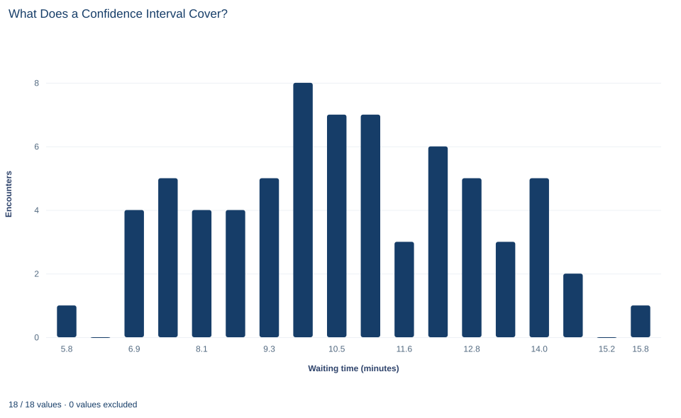

# Lab 09 · What Does a Confidence Interval Cover?

**Confidence intervals for a mean, Student's t and the meaning of confidence**

## Start with the supplied workbook

1. Download [service_waits.xlsx](service_waits.xlsx) and the [Python lab](lab.py). The workbook holds the fixed waiting times used throughout this chapter.
2. Import `service_waits.xlsx` into OpenEconometrics and keep that file name as the dataset name. The `Data` sheet holds one row per service encounter; the `Dictionary` sheet explains each column, its unit and its blank cells.
3. Open the complete `lab.py` in a new Python document and run the whole file. It reads the imported dataset and displays the one-sample t procedure tables, a histogram of the observed waits and the reported numbers.

For ordinary Python, keep `lab.py` and the workbook in the same folder and run the script there, or call `from lab import run_lab` and then `run_lab(data_path="/path/to/service_waits.xlsx")`. Leave blank cells blank. If you want to try a transformation, work on a copy of the loaded table so the distributed workbook stays unchanged.

A service desk records how long customers wait. In this file the average observed wait is 10.60 minutes. That number came from one particular set of encounters; another week would give a different average. How far from 10.60 could the long-run mean wait plausibly be? A 95% confidence interval answers with a range, here 10.05 to 11.15 minutes. This lab is about what that range claims, what "95%" refers to, and what the interval does not say, in particular about how long any individual customer will wait.

The workbook holds **72 original synthetic service encounters**, each with a waiting time in minutes. Two waiting times are blank. The records are teaching data generated for this chapter, not measurements from a real service desk. The [LaTeX table](table.tex) collects the reported numbers.

## 1. Define the target and the sample

The workbook has two columns:

| Column | What it records | Unit |
|---|---|---|
| `encounter_id` | A label from 1 to 72 that distinguishes encounters | Identifier, no arithmetic meaning |
| `minutes` | How long the customer waited before being served | minutes |

The quantity we want to learn about is $\mu$, the **population mean waiting time**: the average wait across the whole stream of encounters that these 72 are taken to represent. It is a fixed number, and it is unknown. The sample mean $\bar x$ is our estimate of it.

Encounters 11 and 41 have a blank `minutes` cell. A blank is not a zero-minute wait; it means the wait was not recorded. The lab therefore uses the **70 encounters with an observed wait**, and the counts reconcile: 70 + 2 = 72. Both confidence levels below use exactly these 70 rows.

## 2. From standard deviation to standard error

Individual waits vary. Their sample standard deviation is

$$
s=\sqrt{\frac{1}{n-1}\sum_{i=1}^{n}(x_i-\bar x)^2}=2.30\text{ minutes},
$$

where $x_i$ is the wait of encounter $i$ and $n=70$. That number describes how much one customer's wait typically differs from the average.

The sample mean varies much less, because it averages 70 waits. Lab 08 showed that the standard deviation of a sample mean is $\sigma/\sqrt n$. Here $\sigma$ is unknown, so we estimate it by $s$ and obtain the **estimated standard error**

$$
\widehat{SE}(\bar x)=\frac{s}{\sqrt n}=\frac{2.3019}{\sqrt{70}}=\frac{2.3019}{8.3666}=0.2751\text{ minutes}.
$$

The standard error is in minutes, like the mean. It measures uncertainty about the average, not variation among customers.

## 3. Build the interval

A two-sided confidence interval for $\mu$ is

$$
\bar x\ \pm\ t_{1-\alpha/2,\;n-1}\,\frac{s}{\sqrt n}.
$$

The pieces are the estimate $\bar x$, the estimated standard error $s/\sqrt n$, and a critical value $t_{1-\alpha/2,\,n-1}$ taken from Student's t distribution with $n-1$ degrees of freedom. For a 95% interval, $\alpha=0.05$, and the critical value cuts off 2.5% in each tail.

Why Student's t and not the normal value 1.96? If the waits are independent draws from a normal distribution, the ratio $(\bar x-\mu)/(s/\sqrt n)$ follows a t distribution with $n-1$ degrees of freedom exactly. Its tails are a little heavier than the normal's because $s$ is itself estimated and sometimes too small. With 69 degrees of freedom the difference is modest: the 95% critical value is 1.995 rather than 1.96.

The worked calculation for the 95% interval is

$$
10.6012\ \pm\ 1.995\times0.2751 = 10.6012\ \pm\ 0.549 = [10.05,\ 11.15]\text{ minutes}.
$$

The interval is centered on the sample mean. Its **half-width**, 0.549 minutes, is the critical value times the standard error, and it is often called the margin of error.

**Pause before running.** On the same 70 rows, will a 99% interval be narrower or wider than the 95% interval? Decide which piece of the formula changes, and which pieces stay the same.

## 4. Run the procedure

The complete file keeps the observed waits explicitly and calls the one-sample t procedure. The hypothesized value `mu=10` matters only for the test part of the output; the interval for the mean does not depend on it.

```python
import openecon as oe

raw = load_data()  # reader defined in the complete lab.py
observed = raw.dropna(subset=["minutes"])
result = oe.ttest(observed, "minutes", mu=10, missing="raise")
display(result)
mean_interval = result["statistics"].loc["minutes", ["ci_low", "ci_high"]]
```

The procedure returns several tables. The `statistics` table describes the mean and gives its interval; the `test` table reports a t statistic and an interval for the **difference** $\mu-10$, which is the same interval shifted down by 10 minutes. Read the mean interval from `statistics`. For the 99% interval, change only the confidence level:

```python
wide = oe.ttest(observed, "minutes", mu=10, alpha=0.01, missing="raise")
print(wide["statistics"].loc["minutes", ["ci_low", "ci_high"]])
```

The two calls give:

| Quantity | Value |
|---|---:|
| Encounters in the file | 72 |
| Missing waits | 2 |
| Observed waits, $n$ | 70 |
| Mean wait, $\bar x$ | 10.60 minutes |
| Standard deviation of waits, $s$ | 2.30 minutes |
| Standard error of the mean | 0.275 minutes |
| Degrees of freedom | 69 |
| 95% interval for $\mu$ | 10.05 to 11.15 minutes |
| 99% interval for $\mu$ | 9.87 to 11.33 minutes |

The 99% interval is wider, which answers the pause question. The estimate, the standard error and the degrees of freedom are unchanged; only the critical value grows, from 1.995 to 2.649, because a 99% interval must leave just 0.5% in each tail. Asking for more confidence on the same data costs precision.

## 5. What "95% confidence" means

The confidence level is a property of the **procedure**, not of one interval. Imagine drawing a new set of encounters again and again from the same stream, and building a 95% interval from each. If the assumptions hold, about 95% of those intervals would contain the fixed mean $\mu$, and about 5% would miss it.

The interval computed here, 10.05 to 11.15 minutes, is one of those many possible intervals. It either contains $\mu$ or it does not, and we cannot tell which. So it is not correct to say "there is a 95% probability that $\mu$ lies between 10.05 and 11.15." In this framework $\mu$ is fixed and the endpoints are what vary from sample to sample. The 95% describes how often the method succeeds, which is why we can be confident in the interval without assigning a probability to this particular one.

Three misreadings are common:

- **It is not a range for individual waits.** The interval is about the mean. Individual waits in this file spread over several minutes on either side of it.
- **It is not where 95% of future sample means will fall.** Future means scatter around $\mu$, not around this sample's $\bar x$.
- **A wider interval is not a worse estimate.** The 99% interval uses the same estimate and makes a more cautious claim.

## 6. Read the histogram



The histogram shows the 70 individual waits, not sample means. It uses 18 bins about 0.59 minutes wide, and its bars add up to 70; the two blank encounters do not appear. The waits spread fairly evenly from about 6.6 to about 14.9 minutes, with no sharp peak: the tallest bar holds only 8 encounters, near 9.9 minutes. A single encounter sits at each extreme, one near 5.5 minutes and one near 16 minutes, each separated from the rest by an empty bin.

Compare that spread with the 95% interval for the mean, which is only about 1.1 minutes wide. The difference is the point of the chapter: the interval is narrow because it describes an average of 70 waits, while the histogram shows how much single waits differ. The histogram also lets you judge the normality assumption informally. The shape is roughly symmetric without long tails, so the t interval's approximation is not strained, but 70 points cannot establish normality.

## A case from the literature

Section 5 lists a misreading that experienced researchers also make. Cumming et al. (2004) invited authors of journal articles in psychology, behavioral neuroscience and medicine to a website, where they marked on a figure where they judged replication means would plausibly fall. Responses from 263 researchers suggested that many underestimate how much future replications vary. A majority held what the authors call the confidence-level misconception, that a 95% interval will on average capture 95% of replication means; the average is in fact 83.4%. Cumming and Maillardet (2006) then studied how that percentage is distributed, for known and unknown $\sigma$, for various sample sizes and for robust intervals. The distribution is strongly negatively skewed: most 95% intervals capture around 90% or more of replication means, but some capture far fewer, depending on where the interval falls relative to the population mean.

The reason is the one given in Section 5. Future means scatter around $\mu$, not around this sample's $\bar x$, and $\bar x$ itself missed $\mu$ by an unknown amount. The interval belongs to a theory of estimation that Neyman (1937) outlined for learning constants of a population, such as its mean, from a sample when the population cannot be studied exhaustively; Student (1908) addressed the probable error of a mean. The lab's waits are synthetic, and these studies concern how readers interpret intervals, which is the skill this lab trains.

## 7. Decide what the evidence supports

The interval supports a statement about the mean wait of the population these 70 encounters represent, under the stated assumptions. It rests on three of them.

- **Independence.** Each wait is treated as independent of the others. Real queues are often dependent: a busy hour makes several consecutive waits long. Positive dependence makes $s/\sqrt n$ too small and the interval too narrow.
- **Normality, or enough data.** Exact 95% coverage requires independent normal observations. With other shapes the t interval is an approximation whose quality depends on the sample size and on how skewed the waits are; that needs separate justification.
- **The sample represents the target.** Two waits are missing. If unrecorded waits tend to be unusually long or short, the 70 observed waits are a selected sample and the interval is centered in the wrong place. A narrow interval cannot repair biased selection, nonresponse or a vaguely defined population.

Predicting how long the **next** customer will wait is a different question. It must combine the variation of individual waits with the uncertainty about the mean, so it gives a much wider range than the confidence interval.

## 8. Write the conclusion in full

A complete statement for the worked example reads: "Of 72 synthetic service encounters, 70 have a recorded waiting time and 2 do not. The mean observed wait is 10.60 minutes (standard deviation 2.30 minutes, standard error 0.275 minutes). Treating the 70 waits as independent observations from an approximately normal population, the 95% Student-t confidence interval for the population mean wait is 10.05 to 11.15 minutes, and the 99% interval is 9.87 to 11.33 minutes. These intervals concern the mean wait, not the range of individual waits."

## Student exercises

1. Compute the half-width of the 99% interval from its critical value and the standard error, and the ratio of the 99% width to the 95% width. If $s$ stayed at 2.30 minutes, roughly how many observed encounters would be needed to halve the 95% half-width?
2. Convert every wait from minutes to seconds. Without rerunning the procedure, give the new mean, standard error and 95% interval, and say which quantities do not change.
3. Compute a 90% interval for the mean wait on the same 70 rows. Place it beside the 95% and 99% intervals and describe the pattern.
4. Count how many of the 70 observed waits fall inside the 95% confidence interval. Then compute the range $\bar x \pm t_{0.975,69}\, s\sqrt{1+1/n}$, a 95% prediction range for one new wait, and count the observed waits inside it. Explain why the two counts differ so much.
5. The output also tests the hypothesis that the mean wait is 10 minutes. Using only the two intervals in Section 4, say what you can conclude about the two-sided p value of that test. Then check your conclusion against the `test` table.
6. Rewrite this sentence so that it is correct: "There is a 95% chance that the true mean wait is between 10.05 and 11.15 minutes, so 95% of customers wait that long."

## Further reading

- Cumming, G., and Maillardet, R. (2006). Confidence intervals and replication: Where will the next mean fall? *Psychological Methods*, 11(3), 217–227. https://doi.org/10.1037/1082-989X.11.3.217
- Cumming, G., Williams, J., and Fidler, F. (2004). Replication and researchers' understanding of confidence intervals and standard error bars. *Understanding Statistics*, 3(4), 299–311. https://doi.org/10.1207/s15328031us0304_5
- Neyman, J. (1937). Outline of a theory of statistical estimation based on the classical theory of probability. *Philosophical Transactions of the Royal Society of London. Series A, Mathematical and Physical Sciences*, 236(767), 333–380. https://doi.org/10.1098/rsta.1937.0005
- Student. (1908). The probable error of a mean. *Biometrika*, 6(1), 1–25. https://doi.org/10.1093/biomet/6.1.1
