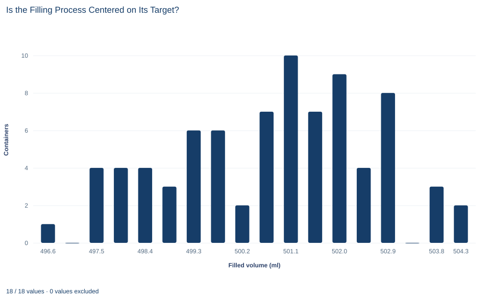

# Lab 10 · Is the Filling Process Centered on Its Target?

**The one-sample t test, p values and practical importance**

## Start with the supplied workbook

1. Download [filling_volumes.xlsx](filling_volumes.xlsx) and the [Python lab](lab.py). The workbook holds the fixed fill volumes used throughout this chapter.
2. Import `filling_volumes.xlsx` into OpenEconometrics and keep that file name as the dataset name. The `Data` sheet holds one row per filled container; the `Dictionary` sheet explains each column and its unit. No cell is blank.
3. Open the complete `lab.py` in a new Python document and run the whole file. It reads the imported dataset and displays the one-sample t test tables, a histogram of the fill volumes and the reported numbers.

For ordinary Python, keep `lab.py` and the workbook in the same folder and run the script there, or call `from lab import run_lab` and then `run_lab(data_path="/path/to/filling_volumes.xlsx")`. If you want to try a transformation, work on a copy of the loaded table so the distributed workbook stays unchanged.

A filling machine is meant to put 500 milliliters into each container. In a check of 80 containers, the average fill is 500.76 ml, about three-quarters of a milliliter above target. Is that evidence that the machine is off-center, or could a sample of 80 containers drift that far from 500 by chance alone? And if the machine is off-center, does a deviation of that size matter?

The first question is statistical, and the one-sample t test answers it, here with a p value of about 0.0004. The second is operational, and no p value can answer it. The workbook holds **80 original synthetic containers**, each with one measured fill volume. The records were generated for teaching; they are not readings from a real production line. The [LaTeX table](table.tex) collects the reported numbers.

## 1. Set out the question and the data

The workbook has two columns:

| Column | What it records | Unit |
|---|---|---|
| `container_id` | A label from 1 to 80 that distinguishes containers | Identifier, no arithmetic meaning |
| `milliliters` | The volume of liquid measured in that container | milliliters |

All 80 volumes are recorded, so every calculation uses all 80 rows. The quantity of interest is $\mu$, the **mean fill volume of the process**: the long-run average the machine delivers under the same conditions. The 80 containers are treated as a sample from that process, and their mean $\bar x$ estimates $\mu$. The 500 ml target is a specification fixed in advance.

## 2. State the hypotheses before looking

A test compares the data with a definite claim about the population, the **null hypothesis**. Here the claim is that the process is centered on target:

$$
H_0:\ \mu=500\text{ ml},\qquad H_1:\ \mu\neq500\text{ ml}.
$$

The alternative $H_1$ is **two-sided**. Underfilling short-changes customers and overfilling wastes product, so a departure in either direction is of interest. That choice is made from the purpose of the check, before the data are examined. Choosing the direction after seeing which way the mean fell would make the reported p value too small.

The null is not a belief that the process is perfect. It is a reference point that tells us what sample means to expect.

## 3. Measure the deviation in standard errors

The raw deviation is $\bar x - 500 = 0.755$ ml. Whether that is large depends on how much sample means of 80 containers naturally vary. The standard error measures exactly that:

$$
\widehat{SE}(\bar x)=\frac{s}{\sqrt n}=\frac{1.8324}{\sqrt{80}}=\frac{1.8324}{8.944}=0.2049\text{ ml},
$$

where $s = 1.83$ ml is the sample standard deviation of the 80 fills. The **t statistic** divides the deviation by its standard error:

$$
t=\frac{\bar x-500}{s/\sqrt n}=\frac{0.7553}{0.2049}=3.69.
$$

The numerator and the denominator are both in milliliters, so $t$ has no unit. It says the sample mean lies about 3.7 standard errors above the target. Under $H_0$, and if the fills are independent draws from a normal distribution, $t$ follows Student's t distribution with $n-1=79$ degrees of freedom.

## 4. Turn the statistic into a p value

The **two-sided p value** is the probability, computed as if $H_0$ were true, of a t statistic at least as far from zero as the one observed, in either direction:

$$
p=2\,P\!\left(T_{79}\ge|t_{\text{obs}}|\right).
$$

The factor 2 counts both tails, because the alternative is two-sided. A small p value means that a sample mean this far from 500 would be rare if the process really were centered on 500: either something rare happened, or the null is wrong.

**Pause before running.** The observed deviation is positive. Does a two-sided test therefore ignore the possibility of underfilling? Decide before reading on.

## 5. Run the test

The complete file passes the whole column to the one-sample t procedure with the target as `mu`:

```python
import openecon as oe

raw = load_data()  # reader defined in the complete lab.py
result = oe.ttest(raw, "milliliters", mu=500, missing="raise")
display(result)
test_row = result["test"].loc["one_sample"]
print(test_row[["statistic", "df", "p_value", "mean_difference", "std_error"]])
```

The `statistics` table describes the mean and gives its interval; the `test` table gives the t statistic, its p values and an interval for the difference $\mu-500$. Both intervals can be pulled out directly:

```python
mean_interval = result["statistics"].loc["milliliters", ["ci_low", "ci_high"]]
difference_interval = result["test"].loc["one_sample", ["ci_low", "ci_high"]]
print(mean_interval.round(3), difference_interval.round(3))
```

Together, the output reads:

| Quantity | Value |
|---|---:|
| Containers, $n$ | 80 |
| Target | 500 ml |
| Mean fill, $\bar x$ | 500.76 ml |
| Difference from target | +0.755 ml |
| Standard deviation of fills, $s$ | 1.83 ml |
| Standard error of the mean | 0.205 ml |
| t statistic | 3.69 |
| Degrees of freedom | 79 |
| Two-sided p value | 0.0004 |
| 95% interval for the mean fill | 500.35 to 501.16 ml |
| 95% interval for the difference from target | 0.35 to 1.16 ml |

The estimate comes first: the 80 containers average 0.755 ml above target, with a standard error of 0.205 ml. The test condenses that comparison into one number. A t of 3.69 on 79 degrees of freedom gives a two-sided p value of 0.0004. If the process were centered on 500 ml, a sample of 80 containers would land this far from target, in either direction, about 4 times in 10,000. The data are strong evidence that the process mean is not exactly 500 ml.

The two intervals say the same thing in two coordinates: the mean interval excludes 500, and the difference interval excludes zero. A two-sided 5% test and a 95% interval built from the same standard error and degrees of freedom always agree in this way.

The pause question has a clear answer. The two-sided test does not ignore underfilling: a mean 0.755 ml below target would have produced the same $|t|$ and the same p value. The sign of $t$ tells you which direction the data point; the two-sided p value treats both directions as evidence against $H_0$.

## 6. Separate statistical evidence from operational importance

A small p value says the deviation is hard to explain by sampling variation. It does not say the deviation is large. The t statistic grows with $\sqrt n$: with the same mean and standard deviation from many more containers, $t$ would be larger and $p$ smaller, although the machine would be no further off target. A large enough sample makes any nonzero deviation "significant."

So the operational question needs its own input: a **tolerance**, the largest deviation from target that does not matter in practice, set from costs, regulations or customer requirements before the analysis. Compare it with the interval for the difference, which is in milliliters and shows the range of deviations compatible with the data.

Three outcomes are possible. If the whole interval lies above the tolerance, the deviation is both real and important. If the whole interval lies inside the tolerance band, the deviation is real but negligible. If the interval straddles the tolerance, the data cannot yet tell. Showing that a process is within tolerance is an **equivalence** question, which needs a prespecified margin and its own procedure; failing to reject $H_0$ would never prove it.

## 7. Read the histogram



The histogram shows the 80 individual fill volumes in 18 bins about 0.45 ml wide; the bars add up to 80. The volumes run from about 496.4 to about 504.5 ml. Between about 497.3 and 500 ml the bars are low and fairly even, three to six containers each. Most containers fall between about 500.4 and 503.1 ml, where five of six bins hold seven to ten containers; the tallest, near 501.1 ml, holds ten. The bin just above the target, from 500.0 to about 500.4 ml, holds only two, and empty bins appear near 497.0 and 503.4 ml.

The chart is a reminder of what the test is about. Many containers sit below the 500 ml mark even though the estimated mean is above it. The test concerns the **process mean**, not individual containers. Whether a given container is underfilled depends on the spread of fills as well as their center, and it needs a different calculation.

## A case from the literature

Section 6 warns that a large enough sample makes any nonzero deviation significant. Lin et al. (2013) described the consequences in information systems research, where internet data often provide well over 10,000 observations. In very large samples, they note, p values go quickly to zero, and relying on them alone can lead researchers to claim support for results of no practical significance. Their survey of large-sample research in the field found that a significant number of papers supported their hypotheses with only a low p value and the sign of a regression coefficient. They recommended a series of remedies and illustrated them with more than 300,000 camera sales on eBay.

The filling check has the same structure on a small scale. The t statistic grows with $\sqrt n$ while a deviation of 0.755 ml stays the same size, so the operational question needs a tolerance and the interval for the difference. Greenland et al. (2016) give an explanatory list of 25 misinterpretations of p values, confidence intervals and power, written for readers who want to spot them. To show that a deviation is negligible rather than merely not significant, Lakens (2017) describes equivalence tests such as the two one-sided tests procedure, with bounds based on the smallest effect of interest and specified in advance; Schuirmann (1987) compared that procedure with the power approach for assessing the equivalence of average bioavailability. The lab's containers are synthetic and say nothing about any real machine.

## 8. Decide what the evidence supports

The test supports the claim that the mean of the process that generated these 80 containers differs from 500 ml, with the difference estimated at 0.755 ml. Its validity rests on assumptions, and its meaning has limits.

- **Independence.** Each fill is treated as independent of the others. A real production run is a time series: a nozzle drifting or a calibration change makes consecutive fills alike. Positive dependence makes $s/\sqrt n$ too small and the p value too small.
- **Normality, approximately.** The t reference distribution is exact for independent normal data; with 80 containers and no extreme outliers it is a reasonable approximation.
- **The p value is not the probability that $H_0$ is true.** It is computed by assuming that $H_0$ is true, so it cannot also measure how likely $H_0$ is.
- **The p value is not the probability that a container is underfilled**, nor a measure of how far off the machine is.

## 9. Write the conclusion in full

A complete statement for the worked example reads: "In a sample of 80 synthetic containers, the mean fill was 500.76 ml (standard deviation 1.83 ml), 0.755 ml above the 500 ml target. A two-sided one-sample t test of a process mean of 500 ml gives $t = 3.69$ with 79 degrees of freedom and $p = 0.0004$, and the 95% interval for the difference from target is 0.35 to 1.16 ml. The data are strong evidence that the process is not centered exactly on target. Whether a deviation of this size matters depends on a tolerance that the test does not supply."

## Student exercises

1. Test the null hypothesis that the process mean is 501 ml, by hand from the mean and standard error, and then with `oe.ttest`. Report $t$ and the two-sided p value, and explain how the result relates to the 95% interval for the mean.
2. Suppose the check had been designed in advance to detect overfilling only, so that $H_1: \mu > 500$. Report the one-sided p value from the `test` table. What would the p value be for $H_1: \mu < 500$, and why is it so close to one?
3. Express the deviation from target and its standard error in liters. What happens to the t statistic, the degrees of freedom and the p value?
4. Count the containers that hold less than 500 ml. Then, treating fills as normal with mean 500.76 ml and standard deviation 1.83 ml, use the method of Lab 07 to find the fraction expected below 500 ml. Compare the two and explain why neither contradicts the test.
5. Using the 95% interval for the difference, state what the data say about the deviation if the operational tolerance is 1 ml, and if it is 0.25 ml. In which case can you conclude that the deviation matters in practice?
6. Rewrite this report so that it is correct: "The p value is 0.0004, so there is only a 0.04% chance the machine is correctly calibrated, and the overfilling is large."

## Further reading

- Greenland, S., Senn, S. J., Rothman, K. J., Carlin, J. B., Poole, C., Goodman, S. N., and Altman, D. G. (2016). Statistical tests, P values, confidence intervals, and power: A guide to misinterpretations. *European Journal of Epidemiology*, 31(4), 337–350. https://doi.org/10.1007/s10654-016-0149-3
- Lakens, D. (2017). Equivalence tests: A practical primer for *t* tests, correlations, and meta-analyses. *Social Psychological and Personality Science*, 8(4), 355–362. https://doi.org/10.1177/1948550617697177
- Lin, M., Lucas, H. C., and Shmueli, G. (2013). Research commentary—Too big to fail: Large samples and the *p*-value problem. *Information Systems Research*, 24(4), 906–917. https://doi.org/10.1287/isre.2013.0480
- Schuirmann, D. J. (1987). A comparison of the two one-sided tests procedure and the power approach for assessing the equivalence of average bioavailability. *Journal of Pharmacokinetics and Biopharmaceutics*, 15(6), 657–680. https://doi.org/10.1007/BF01068419
