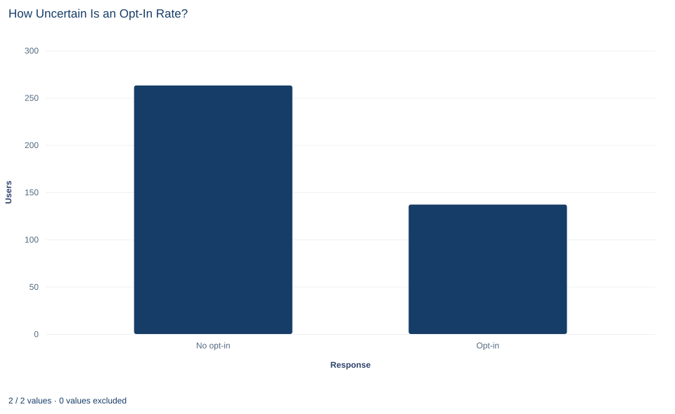

# Lab 11 · How Uncertain Is an Opt-In Rate?

**Inference for one proportion: the z test, Wald and Wilson intervals**

## Start with the supplied workbook

1. Download [app_opt_in.xlsx](app_opt_in.xlsx) and the [Python lab](lab.py). The workbook holds the fixed responses used throughout this chapter.
2. Import `app_opt_in.xlsx` into OpenEconometrics and keep that file name as the dataset name. The `Data` sheet holds one row per invited user; the `Dictionary` sheet explains each column and its coding. No cell is blank.
3. Open the complete `lab.py` in a new Python document and run the whole file. It reads the imported dataset and displays the one-sample proportion test, a bar chart of the two response counts and the reported numbers.

For ordinary Python, keep `lab.py` and the workbook in the same folder and run the script there, or call `from lab import run_lab` and then `run_lab(data_path="/path/to/app_opt_in.xlsx")`. If you want to try a transformation, work on a copy of the loaded table so the distributed workbook stays unchanged.

An app asks new users whether they want to opt in to notifications. A planning document assumes that 40% of invited users will say yes. In this file, 137 of 400 invited users opted in, a rate of 0.3425. Is that shortfall larger than the luck of the draw would produce if the true rate were 0.40? And what range of opt-in rates is compatible with these 400 responses?

The two questions call for two tools, a test and a confidence interval, and for a proportion they use the uncertainty in slightly different ways. The workbook holds **400 original synthetic invited users**, each with a single yes-or-no response. The records were generated for teaching; they do not measure any real app. The [LaTeX table](table.tex) collects the reported numbers.

## 1. A proportion is a mean of zeros and ones

The workbook has two columns:

| Column | What it records | Coding |
|---|---|---|
| `user_id` | A label from 1 to 400 that distinguishes invited users | Identifier, no arithmetic meaning |
| `opt_in` | Whether that user agreed to notifications when invited | 1 = opted in, 0 = did not |

Every user has a recorded response, so the analysis uses all 400 rows. With the response coded as $y_i = 1$ for yes and $y_i = 0$ for no, the sample proportion is simply the mean of the column:

$$
\hat p=\frac{1}{n}\sum_{i=1}^{n}y_i=\frac{137}{400}=0.3425.
$$

The denominator is the number of users **invited and observed**, 400, not the number who opted in. A user who declined counts just as much as one who agreed; leaving the zeros out would make the rate 1. Every proportion in a report should say what its denominator is.

The population quantity is $p$, the probability that an invited user from the same population opts in. Each response is treated as a Bernoulli observation: 1 with probability $p$, 0 otherwise. A Bernoulli variable has mean $p$ and variance $p(1-p)$, so its spread is determined by its mean. That fact drives everything below.

## 2. State the benchmark as a hypothesis

The planning figure becomes the null hypothesis, with a two-sided alternative because a rate either above or below plan would matter:

$$
H_0:\ p=p_0=0.4,\qquad H_1:\ p\neq0.4.
$$

If $H_0$ were true, the expected counts among 400 users would be $400\times0.4=160$ opt-ins and $400\times0.6=240$ refusals. The observation of 137 opt-ins is 23 fewer than that.

## 3. Build the test statistic under the null

Because the users are treated as independent, the variance of $\hat p$ is the Bernoulli variance divided by $n$. A test asks what would happen if $H_0$ were true, so the variance is evaluated at $p_0$:

$$
SE_0=\sqrt{\frac{p_0(1-p_0)}{n}}=\sqrt{\frac{0.4\times0.6}{400}}=0.02449.
$$

The **z statistic** measures the distance from the benchmark in null standard errors:

$$
z=\frac{\hat p-p_0}{SE_0}=\frac{0.3425-0.4}{0.02449}=\frac{-0.0575}{0.02449}=-2.35.
$$

The negative sign says the observed rate is below the benchmark. With 400 users and expected counts of 160 and 240, the sampling distribution of $\hat p$ under $H_0$ is close to normal, so $z$ is compared with the standard normal distribution. The two-sided p value is $2P(Z\ge|z|)$.

**Pause before running.** The test's standard error uses 0.4, while the standard Wald interval below uses the observed rate 0.3425. Why would the two calculations use different values of $p$ inside the same formula?

## 4. Run the test

The complete file passes the response column to the one-sample proportion procedure, naming the benchmark and the code that counts as a "yes":

```python
import openecon as oe

raw = load_data()  # reader defined in the complete lab.py
result = oe.prtest(raw, "opt_in", p=0.4, positive=1, missing="raise")
display(result)
print(result.attrs["std_error_null"], result.attrs["z"], result.attrs["p_value"])
```

The displayed row gives the sample size, the proportion, a standard error, a 95% interval, $z$ and the two-sided p value. The attributes keep the null standard error used by the test. Collected in one place:

| Quantity | Value |
|---|---:|
| Invited users, $n$ | 400 |
| Opted in | 137 |
| Sample proportion, $\hat p$ | 0.3425 |
| Benchmark, $p_0$ | 0.40 |
| Null standard error, $SE_0$ | 0.0245 |
| z statistic | −2.35 |
| Two-sided p value | 0.019 |
| Standard error at $\hat p$ (displayed row) | 0.0237 |
| 95% Wald interval (displayed row) | 0.296 to 0.389 |
| 95% Wilson interval (computed separately) | 0.298 to 0.390 |

The test result: if the true opt-in rate were 0.40, a sample of 400 would land at least 2.35 null standard errors from the benchmark, in either direction, with probability 0.019. At a 5% significance level, the data reject the planning figure, and the sign of $z$ says the rate is lower than assumed.

Notice the two standard errors in the table. The displayed row reports 0.0237, computed from the observed rate, while the test used 0.0245, computed from the benchmark. That is the answer to the pause question. A test asks how the data would behave **if $H_0$ were true**, so it uses the variance implied by $p_0$. An interval does not assume any particular value of $p$; it estimates the variance from the data. Since a proportion's variance depends on its mean, the two calculations give different standard errors.

## 5. Two confidence intervals, two constructions

The procedure's displayed interval is the **Wald interval**, the familiar estimate plus or minus a critical value times a plug-in standard error:

$$
\hat p\ \pm\ 1.96\sqrt{\frac{\hat p(1-\hat p)}{n}}
=0.3425\pm1.96\times0.02373
=0.3425\pm0.0465,
$$

giving 0.296 to 0.389. It is simple and symmetric, but it misbehaves when $\hat p$ is near 0 or 1 or when $n$ is small: its coverage can fall well below 95%, and its limits can even leave the interval from 0 to 1.

The **Wilson interval** is built differently. It collects every value $p$ that a two-sided 5% z test, with its standard error computed at that same $p$, would not reject. Solving that inequality for $p$ gives

$$
\frac{\hat p+\dfrac{z^2}{2n}}{1+\dfrac{z^2}{n}}
\ \pm\
\frac{z\sqrt{\dfrac{\hat p(1-\hat p)}{n}+\dfrac{z^2}{4n^2}}}{1+\dfrac{z^2}{n}},
$$

where $z=1.96$ is the critical value. The center is pulled slightly toward 0.5, and the limits always stay between 0 and 1. The lab computes it directly:

```python
import math

n = len(raw)
k = int(raw.opt_in.sum())
p_hat = k / n
z_crit = 1.959963984540054
center = (p_hat + z_crit**2 / (2 * n)) / (1 + z_crit**2 / n)
half = z_crit * math.sqrt(p_hat * (1 - p_hat) / n + z_crit**2 / (4 * n**2)) / (1 + z_crit**2 / n)
print(k, n, round(center - half, 4), round(center + half, 4))
```

It prints 137, 400 and the limits 0.2977 and 0.3903. The Wilson center is 0.3440, a little above 0.3425, and the half-width 0.0463. With 400 users and a rate far from 0 and 1, the two intervals differ only in the third decimal. They are still different procedures, so a report should name the one it uses rather than write "the 95% interval." Both intervals exclude 0.40, which agrees with the test.

## 6. Read the bar chart



The chart has two bars: 263 users who did not opt in and 137 who did. Together they make the denominator, 400. The opt-in bar is a little more than half the height of the other, which is what a rate near one third looks like.

The chart shows counts, so it carries no uncertainty. It cannot tell you whether 137 is compatible with a true rate of 0.40; that judgment needs the standard error, which depends on the total of the two bars. Plotting only the opt-in bar, or only the rate, would hide the total that the test depends on.

## A case from the literature

A poll reports a proportion, the share of respondents who back a candidate, with a margin of error. Shirani-Mehr et al. (2018) asked how well those margins, which typically capture only sampling variability, describe the real error of polls. They compared 4,221 polls for 608 state-level presidential, senatorial and gubernatorial elections between 1998 and 2014, all fielded in the final three weeks of a campaign, with the election results. The root mean square error was about 3.5 percentage points, roughly twice what most reported margins imply. About 2 points of it was a bias shared by the polls of the same election, which the authors connect to common difficulties in reaching some groups and to similar rules for deciding who will vote. The variance was also larger than simple random sampling implies.

The lesson for this lab is what an interval covers. The Wald and Wilson intervals measure only the variation that comes from drawing independent respondents at random. Neither can detect a sample that represents the wrong population or respondents who are not independent, and with a large sample those problems can matter far more than the choice of formula. The choice still matters in small samples: Agresti and Coull (1998) found that the Wald interval's coverage tends to be too low, while the score interval they attribute to Wilson (1927) stays close to the nominal level even for very small samples. Brown et al. (2001) found the Wald interval's erratic coverage more persistent than is commonly appreciated.

## 7. Decide what the evidence supports

The analysis supports a statement about the opt-in probability in the population these 400 invited users represent: it is estimated at 0.3425, and the benchmark of 0.40 is rejected at the 5% level. It depends on assumptions that a real study would have to defend.

- **Independent users.** Each row must be a separate user answering once. If one person appears several times, or friends invited together respond alike, the effective number of independent responses is smaller than 400 and both the standard error and the p value are understated.
- **Complete, unselected responses.** Here every invited user has a recorded answer. If some outcomes were missing and missingness were related to the answer, the observed rate would be biased, and no interval formula would fix it.
- **Enough data for the normal approximation.** The z test and the Wald interval rely on a large-sample approximation that is good here, with expected counts of 160 and 240. With sparse counts they can be badly wrong; an exact binomial calculation or the Wilson interval is then safer.
- **An interval is not a probability distribution for $p$.** The 95% describes how often the procedure covers the true rate across repeated samples, not the chance that $p$ lies in this particular interval.

## 8. Write the conclusion in full

A complete statement for the worked example reads: "Of 400 synthetic invited users, 137 opted in, a rate of 0.3425. A two-sided one-sample z test of the planning benchmark 0.40, using the null standard error 0.0245, gives $z = -2.35$ and $p = 0.019$, so the data are inconsistent with the benchmark at the 5% level and point to a lower rate. The 95% Wilson interval for the opt-in probability is 0.298 to 0.390, and the 95% Wald interval is 0.296 to 0.389."

## Student exercises

1. Keeping 400 users and the benchmark 0.40, find the largest number of opt-ins below 160 for which the two-sided z test still rejects at the 5% level, and the smallest number above 160 that would also lead to rejection.
2. Express the gap between the observed rate and the benchmark in percentage points and as a percentage of the benchmark. Which of the two would you put in a report, and why should the unit always be stated?
3. Compute a 99% Wald interval by hand. Does it contain 0.40? Explain what that tells you about the p value of the test, and why the Wald interval and the test do not have to agree exactly.
4. Suppose only 10 users had been invited and 1 opted in. Compute the 95% Wald and Wilson intervals with the formulas of Section 5, and the expected counts under a benchmark of 0.40. What goes wrong with the Wald interval, and why would the z test be inappropriate here?
5. Suppose the 400 rows came from 100 users, each recorded four times, and each user always gave the same answer. How many independent responses would the data really contain, and what would the null standard error become? Explain why treating the rows as independent overstates the evidence.
6. Rewrite this sentence so that it is correct: "The opt-in rate is 34%, which is 6% below the benchmark, so there is a 98% chance that the true rate is under 40%."

## Further reading

- Agresti, A., and Coull, B. A. (1998). Approximate is better than “exact” for interval estimation of binomial proportions. *The American Statistician*, 52(2), 119–126. https://doi.org/10.1080/00031305.1998.10480550
- Brown, L. D., Cai, T. T., and DasGupta, A. (2001). Interval estimation for a binomial proportion. *Statistical Science*, 16(2), 101–133. https://doi.org/10.1214/ss/1009213286
- Shirani-Mehr, H., Rothschild, D., Goel, S., and Gelman, A. (2018). Disentangling bias and variance in election polls. *Journal of the American Statistical Association*, 113(522), 607–614. https://doi.org/10.1080/01621459.2018.1448823
- Wilson, E. B. (1927). Probable inference, the law of succession, and statistical inference. *Journal of the American Statistical Association*, 22(158), 209–212. https://doi.org/10.1080/01621459.1927.10502953
