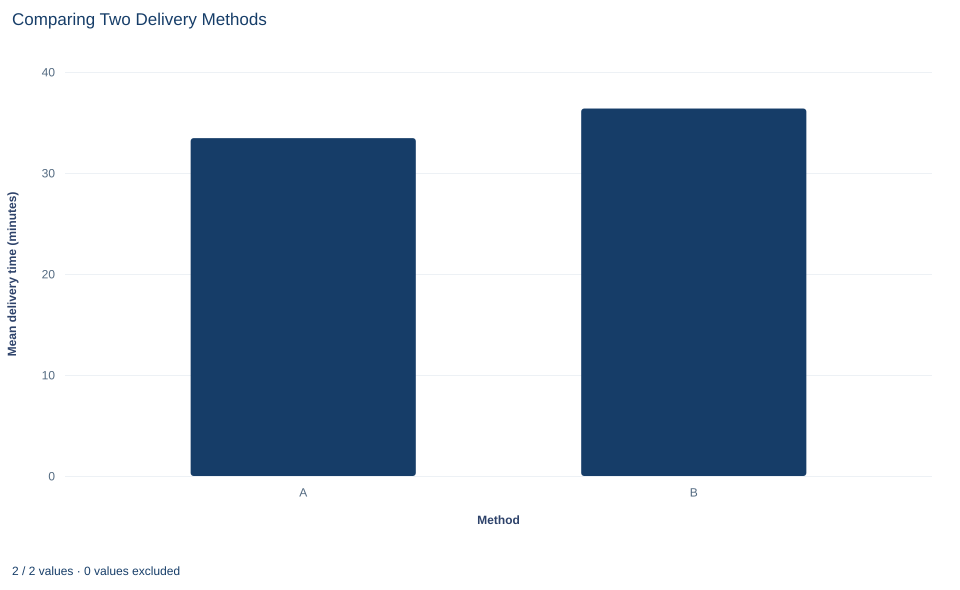

# Lab 12 · Comparing Two Delivery Methods

**Independent samples, Welch's t test and the direction of a difference**

## Start with the supplied workbook

1. Download [delivery_methods.xlsx](delivery_methods.xlsx) and the [Python lab](lab.py). It holds the fixed delivery records for this chapter.
2. Import `delivery_methods.xlsx` into OpenEconometrics and keep that file name as the dataset name. `Data` holds one row per parcel delivery; `Dictionary` explains each column and its unit.
3. Open the complete `lab.py` in a new Python document and run the whole file. It displays the full t-test output, a bar chart of the two group means and the table of reported numbers.

For ordinary Python, keep `lab.py` and the workbook in the same folder and run the script there, or call `from lab import run_lab` and then `run_lab(data_path="/path/to/delivery_methods.xlsx")`. If you want to try a transformation, work on a copy of the loaded table so the distributed workbook stays unchanged.

A courier service has delivery times for two methods, labeled A and B. The 65 deliveries made with method A averaged 33.45 minutes; the 85 made with method B averaged 36.38 minutes. Is a gap of about three minutes larger than two samples of deliveries would show by chance, and how precisely do the data pin it down?

Method B's times are far more variable than A's and the groups differ in size, so the lab uses Welch's t test, which lets each group keep its own variance. The file holds **150 original synthetic deliveries**, each timed in minutes, with no blank cells; they are teaching records, not data from a real courier. The [LaTeX table](table.tex) collects the reported numbers.

## 1. Two separate groups and one direction

Each row is one parcel delivery. `delivery_id` is a label from 1 to 150, `method` records whether the delivery used method A or B, and `minutes` is the elapsed delivery time. Deliveries 1 to 65 used A and 66 to 150 used B; none appears under both methods.

The groups are therefore **independent samples**: two separate sets of deliveries with no natural partner, so there is nothing to subtract row by row. Before computing anything, fix the direction of the contrast. This chapter estimates

$$
\Delta=\mu_A-\mu_B,
$$

where $\mu_A$ and $\mu_B$ are the mean delivery times of the two methods. A negative $\Delta$ means A is faster on average. `oe.ttest` reports first minus second in ascending order of the group labels, so here it reports A − B; with other labels, check the order before reading a sign.

**Pause before running.** If A has the smaller mean, which sign should an A − B contrast have, and which end of a confidence interval would then be closer to zero?

## 2. Describe each group before testing

Every row has a method and a time, so `missing="raise"` only confirms that nothing is dropped:

```python
import openecon as oe

raw = load_data()  # reader defined in the complete lab.py
result = oe.ttest(raw, "minutes", by="method", missing="raise")
display(result["statistics"])
```

| Group | Deliveries | Mean (min) | Standard deviation (min) | Standard error of mean (min) | 95% interval for mean (min) |
|---|---:|---:|---:|---:|---|
| Method A | 65 | 33.45 | 3.59 | 0.445 | 32.56 to 34.34 |
| Method B | 85 | 36.38 | 10.48 | 1.137 | 34.12 to 38.64 |
| Both combined | 150 | 35.11 | 8.34 | 0.681 | 33.77 to 36.46 |

Start with the standard deviations: B's times spread about 2.9 times as widely as A's (10.48 against 3.59 minutes). Each standard error is the standard deviation divided by $\sqrt{n}$, so B's mean is the less precise one despite B's larger sample. The combined row mixes both methods and is not used.

A common misreading starts here. The two single-group intervals overlap by about 0.22 minutes (34.34 against 34.12), but that does not make the difference indistinguishable from zero. Comparing endpoints effectively adds the two standard errors, while the standard error of a difference combines them as the square root of their summed squares, which is smaller.

## 3. The standard error of a difference and Welch's degrees of freedom

The estimate is the difference in sample means, $\hat\Delta=\bar x_A-\bar x_B=33.45-36.38=-2.93$ minutes. Its standard error is

$$
SE(\hat\Delta)=\sqrt{\frac{s_A^2}{n_A}+\frac{s_B^2}{n_B}}=\sqrt{v_A+v_B},
$$

where $s_A$ and $s_B$ are the group standard deviations, $n_A$ and $n_B$ the group sizes, and $v_g=s_g^2/n_g$ is the estimated variance of group $g$'s mean.

The variances add even though the means are subtracted. The variance of a difference is the sum of the two variances minus twice their covariance, and independent groups have no covariance between their means. Each mean brings its own noise, and subtracting cannot cancel it. With the lab's numbers:

$$
v_A=\frac{3.590^2}{65}=0.198,\qquad v_B=\frac{10.48^2}{85}=1.293,\qquad SE=\sqrt{0.198+1.293}=\sqrt{1.491}=1.221\text{ minutes}.
$$

Method B supplies about 87% of the variance of the difference: its larger sample does not offset a standard deviation nearly three times as large, so the noisier group sets the precision of the comparison.

Because $s_A$ and $s_B$ are estimates, the standard error is uncertain too. Welch's test gives the statistic a $t$ distribution with Satterthwaite's approximate degrees of freedom:

$$
\nu=\frac{(v_A+v_B)^2}{\dfrac{v_A^2}{n_A-1}+\dfrac{v_B^2}{n_B-1}}
=\frac{1.491^2}{\dfrac{0.198^2}{64}+\dfrac{1.293^2}{84}}
=\frac{2.2230}{0.02051}=108.4.
$$

The formula matches the spread of the estimated $v_A+v_B$ to a scaled chi-square variable, and nothing forces the match onto a whole number. The value always lies between the smaller of $n_A-1$ and $n_B-1$ and the pooled count $n_A+n_B-2=148$; here one variance term carries most of the weight, which keeps it well below 148.

## 4. Test the difference and build the interval

The Welch row of the test table holds the inference:

```python
welch = result["test"].loc["unequal_variances"]
display(welch)
```

| Quantity | Welch value |
|---|---:|
| Difference, A − B (minutes) | −2.93 |
| Standard error (minutes) | 1.221 |
| Degrees of freedom | 108.4 |
| t statistic | −2.398 |
| Two-sided p value | 0.0182 |
| 95% interval for A − B (minutes) | −5.35 to −0.51 |

The statistic is the estimate measured in standard errors: $t=-2.928/1.221=-2.398$. If $H_0:\mu_A=\mu_B$ and the test's assumptions held, a value at least that far from zero in either direction would occur with probability 0.0182, so a 5% test chosen beforehand rejects equal means.

The interval uses the same pieces. The 97.5th percentile of a $t$ distribution with 108.4 degrees of freedom is 1.982, so

$$
-2.928\pm1.982\times1.221=-2.928\pm2.420=[-5.35,\;-0.51]\text{ minutes}.
$$

In the question's units, A's mean time is estimated to be between about 0.5 and 5.3 minutes shorter than B's. The whole interval is negative, matching the 5% rejection, and it concerns the gap between two means, not any single delivery. A one-sided p value (0.0091 for "A is faster") is appropriate only if that direction was stated in advance.

## 5. Pooled or Welch, and what Levene's test adds

The same call prints a second row that assumes both methods share one population variance:

```python
compare = result["test"][["statistic", "df", "p_value", "std_error", "ci_low", "ci_high"]]
display(compare)
display(result["levene"])
```

| Row | t | df | Two-sided p | Standard error (min) | 95% interval (min) |
|---|---:|---:|---:|---:|---|
| Equal variances (pooled) | −2.156 | 148 | 0.0327 | 1.358 | −5.61 to −0.24 |
| Unequal variances (Welch) | −2.398 | 108.4 | 0.0182 | 1.221 | −5.35 to −0.51 |

Both rows estimate the same −2.93-minute difference and disagree only about its uncertainty. The pooled test combines the two sample variances into

$$
s_p^2=\frac{(n_A-1)s_A^2+(n_B-1)s_B^2}{n_A+n_B-2},
$$

and uses $s_p$ for both groups. Here $s_p=8.24$ minutes, a spread that describes neither method: more than twice A's and below B's.

Levene's test of equal variances gives $F=60.6$ on 1 and 148 degrees of freedom (p about $1.1\times10^{-12}$), confirming what the standard deviations show. Still, choose the row from the design before looking at any p value: different procedures can easily differ in variability, and Welch's test loses little when variances are equal. Picking the row with the smaller p value, or letting a pretest decide afterward, changes the procedure behind the reported error rate.

## 6. How large is a three-minute gap?

A p value says how surprising the gap would be under equal means, not whether the gap matters. Report the size in minutes first: 2.93 minutes is about 8% of method B's mean.

`result["effect_sizes"]` adds standardized sizes: Cohen's $d$ divides by the pooled standard deviation (−0.355), Glass's $\Delta$ by B's standard deviation alone (−0.279). With such unequal spreads the standardized size depends on the chosen denominator; minutes need no such choice.

Means and individual deliveries are different questions. With B's standard deviation above ten minutes, B's times range widely on both sides of its mean, and some B deliveries are quicker than a typical A delivery.

## 7. Read the bar chart



Each bar's height is one method's mean delivery time: 33.45 minutes for A and 36.38 for B. The vertical axis starts at zero, so the 8% gap appears at its true proportion and the bars look close in height.

The chart shows only the two means, with no standard deviations, group sizes or uncertainty, so it cannot show that B is much noisier than A. Interval bars, or the individual delivery times plotted by method, would show what the Welch test uses.

## A case from the literature

Mueller and Oppenheimer (2014) asked a question with the same shape as this lab's: does one way of doing a task, taking lecture notes on a laptop, lead to different outcomes from another, taking notes by hand? In three studies, students who took notes on laptops performed worse on conceptual questions than students who took notes longhand. The authors trace the gap to how the notes were taken: laptop users tended to transcribe lectures word for word instead of restating the material in their own words.

The comparison is between two separate groups of students on one outcome, which is the structure of this lab: a difference in means with a stated direction and an interval in the outcome's units. Two of the lab's cautions carry over. Whether the gap can be read as an effect of the note-taking method depends on how students came to use each method, which a reader has to check in each study's design, not in its test statistics. And one set of studies does not settle a question; Morehead et al. (2019), as their title says, set out to replicate and extend this one.

For the test itself, Welch (1947) treated Student's problem when the population variances differ. Zimmerman (2004) showed by simulation that choosing between the pooled and Welch tests with a preliminary Levene test fails to protect the significance level and usually makes matters worse, and he recommended the separate-variance test, used unconditionally, whenever group sizes are unequal.

## 8. What the comparison supports and what it does not

In these 150 synthetic deliveries, A's mean is lower and Welch's 95% interval for the difference excludes zero. The analysis does not show that method A causes faster deliveries. The dictionary calls `method` the "assigned" delivery method, but the workbook records nothing about how deliveries came to use either method. If A had been used on shorter routes, smaller parcels or quieter hours, the gap would reflect those differences too. A causal claim needs assignment by a known random mechanism or a design that accounts for such factors.

The test also treats deliveries as independent; deliveries sharing a courier, route or day would have correlated times, and the file has no such columns. The synthetic times were drawn from normal distributions, which suits Welch's approximation; real delivery times often have long right tails.

Finally, Welch's test is for separate groups. If the same deliveries or couriers were measured under both conditions, the measurements would come in pairs and the analysis would use within-pair differences, as the next lab does.

## 9. Write the comparison in full

A complete statement for the worked example reads: "In 150 synthetic parcel deliveries, the 65 made with method A averaged 33.45 minutes and the 85 made with method B averaged 36.38 minutes. The difference, A minus B, is −2.93 minutes (Welch standard error 1.22, 108.4 degrees of freedom, two-sided p = 0.018), with a 95% interval from −5.35 to −0.51 minutes. Method B's times were much more variable (standard deviation 10.48 against 3.59 minutes), so unequal variances were allowed. The file does not record how deliveries were allocated to methods, so the difference is descriptive, not causal."

It names the direction, units, uncertainty convention and interpretive limit, and reports the gap rather than only the verdict.

## Student exercises

1. Reverse the contrast to B − A. Write the new estimate, t statistic and 95% interval, and say which reported quantities change sign and which do not.
2. Rerun the test with `alpha=0.01` and report the 99% Welch interval for A − B. Explain why its relation to zero differs from the 95% interval, using the two-sided p value.
3. Suppose method B had 170 deliveries with the same mean and standard deviation. Compute the Welch standard error and t statistic. Then do the same for doubling method A to 130 deliveries instead. Which change helps more, and why?
4. Use Satterthwaite's formula to find the degrees of freedom the Welch test would approach if method A's times had no variance at all. Explain why the reported 108.4 falls between that value and 148.
5. Using the pooled-variance formula, explain why the pooled standard error (1.358) is larger than Welch's (1.221) in this file. Would the pooled standard error be larger or smaller than Welch's if the 65-delivery group had been the noisy one?
6. Count how many of the 85 method B deliveries took less time than method A's mean. Use the count to explain the difference between "A has the lower mean" and "A is faster for a typical delivery," then rewrite "Method A makes deliveries faster (p = 0.018)" as a statement the analysis supports.

## Further reading

- Morehead, K., Dunlosky, J., and Rawson, K. A. (2019). How much mightier is the pen than the keyboard for note-taking? A replication and extension of Mueller and Oppenheimer (2014). *Educational Psychology Review*, 31(3), 753–780. https://doi.org/10.1007/s10648-019-09468-2
- Mueller, P. A., and Oppenheimer, D. M. (2014). The pen is mightier than the keyboard: Advantages of longhand over laptop note taking. *Psychological Science*, 25(6), 1159–1168. https://doi.org/10.1177/0956797614524581
- Welch, B. L. (1947). The generalization of ‘Student's’ problem when several different population variances are involved. *Biometrika*, 34(1–2), 28–35. https://doi.org/10.1093/biomet/34.1-2.28
- Zimmerman, D. W. (2004). A note on preliminary tests of equality of variances. *British Journal of Mathematical and Statistical Psychology*, 57(1), 173–181. https://doi.org/10.1348/000711004849222
