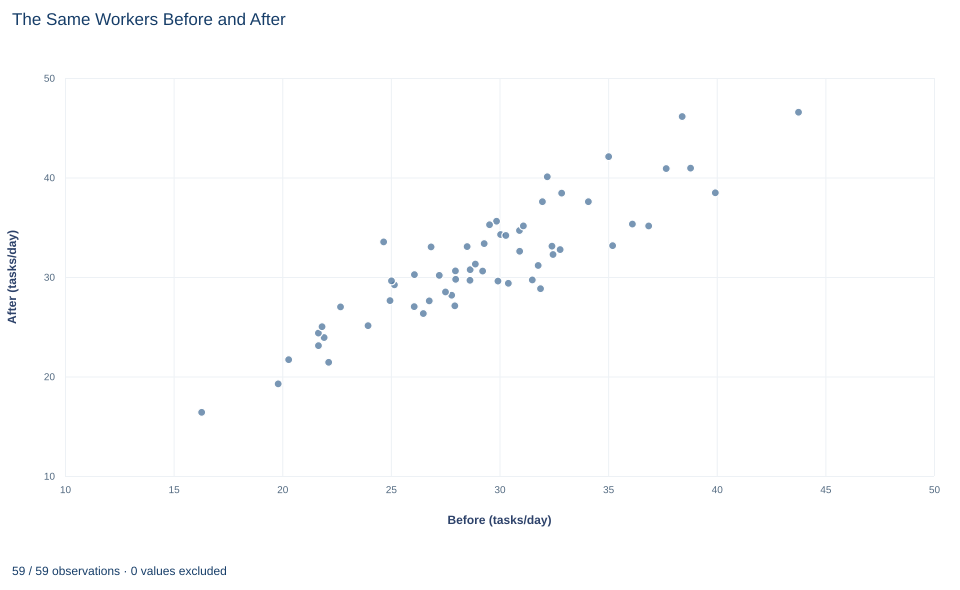

# Lab 13 · The Same Workers Before and After

**Paired measurements, complete pairs and the variance of differences**

## Start with the supplied workbook

1. Download [worker_before_after.xlsx](worker_before_after.xlsx) and the [Python lab](lab.py). It holds the fixed worker records for this chapter.
2. Import `worker_before_after.xlsx` into OpenEconometrics and keep that file name as the dataset name. `Data` holds one row per worker with a baseline and a follow-up measurement; `Dictionary` explains each column, its unit and its blank cell.
3. Open the complete `lab.py` in a new Python document and run the whole file. It displays the full paired t-test output, a scatterplot of each worker's two measurements and the table of reported numbers.

For ordinary Python, keep `lab.py` and the workbook in the same folder and run the script there, or call `from lab import run_lab` and then `run_lab(data_path="/path/to/worker_before_after.xlsx")`. Leave the blank cell blank. If you want to try a transformation, work on a copy of the loaded table so the distributed workbook stays unchanged.

Sixty workers had their completed tasks per day measured twice, once at a baseline and once at a follow-up. Among the 59 workers with both measurements, the follow-up mean is 31.45 tasks a day and the baseline mean is 29.20. How much did output change within the same worker, and how precisely can the data say?

Because each worker appears in both columns, the two sets of numbers are not separate samples. A worker who was quick at baseline tends to be quick at follow-up, and that shared level is exactly what a paired analysis removes. The file holds **60 original synthetic workers** with one blank follow-up cell; they are teaching records, not measurements of real employees. The [LaTeX table](table.tex) collects the reported numbers.

## 1. Two measurements on one worker

Each row is one worker. `worker_id` is a label from 1 to 60, `before` is the worker's completed tasks per day at baseline, and `after` is the same worker's completed tasks per day at follow-up. The worker is the observational unit; the two columns are two measurements of that unit at different times.

That structure is a **pair**. The before and after values in one row belong together, and their link carries information: subtracting them compares each worker with the same worker earlier, so anything stable about that worker, such as skill, job type or habitual pace, cancels out. Workers are still treated as independent of one another; the dependence is within a row, not across rows.

The direction of the change is fixed before anything runs: $d_i=\text{after}_i-\text{before}_i$. A positive $d_i$ means worker $i$ completed more tasks a day at follow-up.

## 2. Keep complete pairs only

Worker 9 has a baseline value but a blank `after` cell. A change cannot be computed for that worker, so the paired analysis uses complete pairs:

- **Raw workers:** 60 rows in the file.
- **Complete pairs:** 59 workers with both measurements.
- **Excluded pairs:** 1 worker, still part of the raw data.

Dropping worker 9 means dropping that worker's baseline value too. Keeping it would make the before mean describe 60 workers and the after mean describe 59, so their difference would mix a change over time with a change in who is being averaged. Every number below uses the same 59 workers.

**Pause before running.** Can the paired sample have 60 before values and 59 after values?

## 3. Compute the changes first

The paired t test is a one-sample t test on the differences. With $n$ complete pairs,

$$
\bar d=\frac{1}{n}\sum_{i=1}^{n}d_i,\qquad SE(\bar d)=\frac{s_d}{\sqrt n},\qquad t=\frac{\bar d-0}{s_d/\sqrt n},\qquad df=n-1,
$$

where $\bar d$ is the mean change, $s_d$ the standard deviation of the 59 individual changes and $n=59$. The null value 0 is "no average change."

The lab keeps the complete pairs explicitly and then runs the paired test, with `after` first so that the reported difference is after minus before:

```python
import openecon as oe

raw = load_data()  # reader defined in the complete lab.py
pairs = raw.dropna(subset=["before", "after"])
print(len(raw), len(pairs))
result = oe.ttest(pairs, "after", paired_with="before", missing="raise")
display(result["statistics"])
```

It prints 60 and 59, and the statistics table reads:

| Row | Workers | Mean (tasks/day) | Standard deviation | Standard error | 95% interval for mean |
|---|---:|---:|---:|---:|---|
| After (follow-up) | 59 | 31.45 | 6.03 | 0.784 | 29.88 to 33.02 |
| Before (baseline) | 59 | 29.20 | 5.37 | 0.699 | 27.80 to 30.60 |
| Difference, after − before | 59 | 2.25 | 2.71 | 0.352 | 1.54 to 2.95 |

Two things stand out. The mean of the differences equals the difference of the two means on the same workers, 31.45 − 29.20 = 2.25 tasks a day; pairing does not change the estimate. But the standard deviation of the differences, 2.71, is only about half of either column's standard deviation. Workers differ a lot in their level of output and much less in how their output changed.

## 4. Why pairing shrinks the uncertainty

For any two measurements,

$$
s_d^2=s_{\text{after}}^2+s_{\text{before}}^2-2\,s_{\text{after,before}},
$$

where $s_{\text{after,before}}$ is the sample covariance of the two columns across workers. When workers with high baseline output also have high follow-up output, the covariance is large and positive, and subtracting it removes the shared part of the variation.

Here the correlation between the two columns is 0.893, which the test reports in `result.attrs["correlation"]`. The covariance is 28.92, and

$$
s_d^2=6.025^2+5.371^2-2(28.92)=36.30+28.85-57.83=7.32,\qquad s_d=\sqrt{7.32}=2.71 .
$$

Without the covariance term the variance would be 65.15; the strong correlation removes almost nine tenths of it. That is the reason to keep the pairs together. An analysis that treats the 59 after values and 59 before values as two unrelated groups would use the column standard deviations, ignore the covariance and badly overstate the uncertainty of the change.

## 5. Test the mean change and build the interval

The test table holds the inference:

```python
display(result["test"])
print(round(result.attrs["correlation"], 3))
```

| Quantity | Value |
|---|---:|
| Mean change, after − before (tasks/day) | 2.25 |
| Standard error (tasks/day) | 0.352 |
| Degrees of freedom | 58 |
| t statistic | 6.37 |
| Two-sided p value | 3.3 × 10⁻⁸ |
| 95% interval (tasks/day) | 1.54 to 2.95 |

The pieces follow from the equations in Section 3. The standard error is $2.706/\sqrt{59}=2.706/7.681=0.352$, the statistic is $2.246/0.352=6.37$, and the 97.5th percentile of a $t$ distribution with 58 degrees of freedom is 2.002, so the interval is

$$
2.246\pm2.002\times0.352=2.246\pm0.705=[1.54,\;2.95]\text{ tasks per day}.
$$

Read it in the question's units: among these workers, the mean follow-up output is estimated to be between about 1.5 and 3.0 tasks a day higher than baseline. The p value is far below any usual threshold, so the data are hard to reconcile with no average change. Report it as a number, or as "below 0.001," rather than as zero.

The size is easier to judge in context. A change of 2.25 tasks a day is about 7.7% of the baseline mean of 29.20. The output's `effect_sizes` table gives a paired Cohen's $d$ of 0.83, which divides the mean change by $s_d$. That standardizer is the spread of changes, not the spread of workers, so a paired $d$ is not comparable with a two-group $d$ computed from column standard deviations.

## 6. Read the scatterplot



Each point is one retained worker, placed at the baseline value on the horizontal axis and the follow-up value on the vertical axis. There are 59 points; worker 9 has no follow-up value and does not appear. Both axes are marked from 15 to 45 tasks a day.

The points form a narrow rising band: workers with high baseline output also had high follow-up output. That band is the 0.893 correlation, and it is why the pairs carry so much information. The chart has no reference line, but the diagonal where after equals before is the line of no change. A point above it is a worker whose output rose, a point below it a worker whose output fell, and its vertical distance from the diagonal is that worker's $d_i$. Most points sit somewhat above the diagonal, and some sit below it.

## A case from the literature

Bloom et al. (2015) studied worker performance with the comparison group this lab lacks. At Ctrip, a Chinese travel agency with about 16,000 employees, call-center employees who volunteered to work from home were randomly assigned either to work from home or to stay in the office for nine months. Home working led to a 13% performance increase, of which about 9% came from working more minutes per shift and 4% from more calls per minute. Home workers also reported higher work satisfaction and their attrition rate halved, but their promotion rate, given their performance, fell.

The design answers the question this lab cannot. A before-and-after average for the home workers alone would mix the effect of working from home with anything else that changed over those nine months, such as workload or experience. A randomly assigned office group working through the same months supplies the comparison. The attrition result also connects with Section 2: when an arrangement changes who stays, the workers still measured at the end can differ from those who started, so a complete-pairs rule must be reported and defended.

For the method, Student (1908) studied the distribution of a sample mean's distance from the population mean divided by the sample standard deviation, for experiments too few to rely on the normal curve; the paired t test applies that reference distribution to the changes. Zimmerman (1997) showed that treating correlated measurements as independent samples can alter the significance level severely, even when the correlation is small.

## 7. What the comparison supports and what it does not

The analysis supports a statement about the 59 complete pairs: on average, these workers completed more tasks a day at follow-up than at baseline, and the 95% interval for the mean change excludes zero.

It does not say why. The workbook records two measurement times and nothing about what happened between them. A before-and-after comparison has no group that went through the same period without whatever changed, so practice, a seasonal workload shift, new equipment or any other event in the interval could produce the same pattern. Attributing the change to a program would need a comparison group of similar workers measured at the same two times, ideally assigned at random.

The excluded worker matters little numerically, but the rule matters in principle. If workers who left before the follow-up were systematically different, the complete pairs would describe a selected group. The test also assumes that workers are independent of one another and that the mean of the changes has an approximately normal sampling distribution; the synthetic changes were generated from a normal model, and 59 pairs is a comfortable size for the t approximation.

## 8. Write the result in full

A complete statement for the worked example reads: "Of 60 synthetic workers, 59 had both a baseline and a follow-up measurement; one worker without a follow-up value was excluded. Among the 59 complete pairs, completed tasks rose by 2.25 tasks per day on average (standard deviation of changes 2.71, standard error 0.352). The paired 95% interval is 1.54 to 2.95 tasks per day (t = 6.37 on 58 degrees of freedom, p < 0.001). Without a comparison group, the change is a before-and-after difference, not an estimated effect of any intervention."

It states the sample rule, the direction, the unit, the uncertainty and the interpretive limit before the reader has to ask.

## Student exercises

1. Compute the mean of all 60 `before` values and the mean of the 59 available `after` values, and subtract. How far is the result from the paired mean change, and what about worker 9's baseline value sets the direction of the gap?
2. Treat the 59 after values and 59 before values as two independent groups and compute the standard error and t statistic for the difference in means with the unpooled formula from Lab 12. Explain why the result is so different from the paired test.
3. Using the column standard deviations in Section 3, compute the paired standard error and t statistic that would result if the correlation between before and after had been 0.5 instead of 0.893.
4. Count how many of the 59 workers have a positive change and how many have a negative change. Use the counts to explain what a positive mean change does and does not say about individual workers.
5. A manager will only consider the change worthwhile if the mean gain is at least 2 tasks per day. Test $H_0:\mu_d=2$ with `oe.ttest(..., mu=2)` and interpret the result alongside the 95% interval.
6. Rewrite "The program raised productivity by 2.2 tasks a day (p < 0.001)" as a statement these data support, and describe the comparison group a study would need before the original sentence could be defended.

## Further reading

- Bloom, N., Liang, J., Roberts, J., and Ying, Z. J. (2015). Does working from home work? Evidence from a Chinese experiment. *The Quarterly Journal of Economics*, 130(1), 165–218. https://doi.org/10.1093/qje/qju032
- Student. (1908). The probable error of a mean. *Biometrika*, 6(1), 1–25. https://doi.org/10.1093/biomet/6.1.1
- Zimmerman, D. W. (1997). Teacher's corner: A note on interpretation of the paired-samples *t* test. *Journal of Educational and Behavioral Statistics*, 22(3), 349–360. https://doi.org/10.3102/10769986022003349
