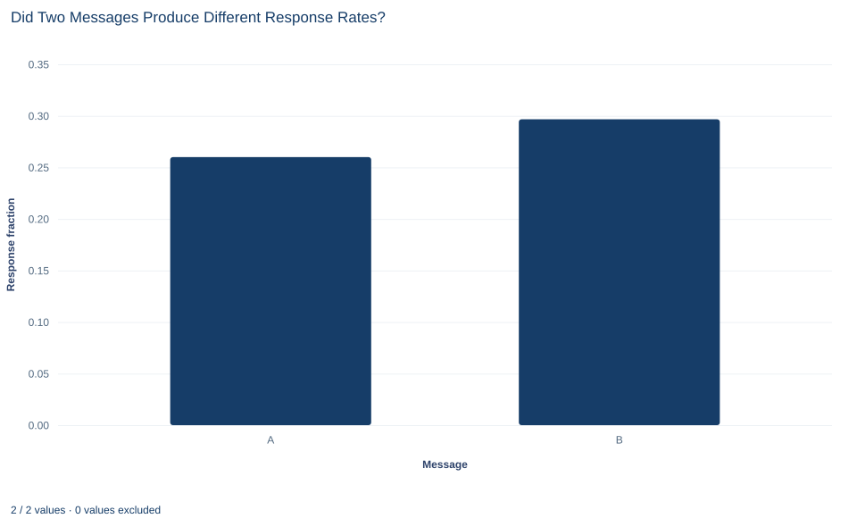

# Lab 14 · Did Two Messages Produce Different Response Rates?

**Comparing two proportions: pooled tests, unpooled intervals and percentage points**

## Start with the supplied workbook

1. Download [message_responses.xlsx](message_responses.xlsx) and the [Python lab](lab.py). It holds the fixed recipient records for this chapter.
2. Import `message_responses.xlsx` into OpenEconometrics and keep that file name as the dataset name. `Data` holds one row per recipient: an identifier, the message sent and whether the recipient responded. `Dictionary` explains each column and its coding.
3. Open the complete `lab.py` in a new Python document and run the whole file. It displays the two-sample proportion test, a bar chart of the two response rates and the table of reported numbers.

For ordinary Python, keep `lab.py` and the workbook in the same folder and run the script there, or call `from lab import run_lab` and then `run_lab(data_path="/path/to/message_responses.xlsx")`. If you want to try a transformation, work on a copy of the loaded table so the distributed workbook stays unchanged.

An organization sent one of two messages, A or B, to 600 recipients, 300 each. Of those who received A, 78 responded; of those who received B, 89 did. The response rates are 26.0% and 29.7%, a gap of about 3.7 percentage points in B's favor. Is that gap larger than chance variation would produce, and what range of differences do the data allow?

A comparison of two rates raises questions that a comparison of two means does not. The size of a difference can be stated in two ways that sound alike and are not, and the test and the interval use different standard errors. This lab works through both. The file holds **600 original synthetic recipients** with no blank cells; they are teaching records, not results of a real campaign. The [LaTeX table](table.tex) collects the reported numbers.

## 1. One recipient, one message, one yes-or-no outcome

Each row is one recipient. `recipient_id` is a label from 1 to 600, `message` records which message the recipient was sent (A or B), and `response` is coded 1 if the recipient responded and 0 if not. Every recipient received exactly one message, so the two groups are independent samples of different people.

Because the outcome is coded 0 and 1, the mean of `response` within a group is the share of that group who responded. A proportion is a mean of a 0/1 variable, and the group rates below are $\hat p_A=78/300$ and $\hat p_B=89/300$.

The contrast is fixed as A minus B,

$$
\Delta=p_A-p_B,
$$

where $p_A$ and $p_B$ are the response probabilities for the two messages. A negative $\Delta$ means A drew fewer responses. `oe.prtest` reports the first group minus the second in label order, so it reports A − B here.

## 2. Rates, differences and percentage points

The proportion test is a single call. `positive=1` names the value counted as a response:

```python
import openecon as oe

raw = load_data()  # reader defined in the complete lab.py
result = oe.prtest(raw, "response", by="message", positive=1, missing="raise")
display(result)
```

The output has one row per message and one for the difference:

| Row | Recipients | Proportion | Standard error | 95% interval | z | Two-sided p |
|---|---:|---:|---:|---|---:|---:|
| Message A | 300 | 0.260 | 0.0253 | 0.210 to 0.310 | | |
| Message B | 300 | 0.297 | 0.0264 | 0.245 to 0.348 | | |
| Difference, A − B | 600 | −0.0367 | 0.0366 | −0.108 to 0.035 | −1.002 | 0.316 |

The difference is −0.0367 on the probability scale. Multiplying by 100 gives **−3.67 percentage points**: B's response rate is 3.67 points higher than A's. A percentage-point difference is a plain subtraction of two rates.

A *percent* difference is something else. It divides the gap by one of the rates, so it states the change relative to a baseline, and its value depends on which message is the baseline. Saying that A's rate is "3.7 percent lower" confuses the two scales. Report percentage points as the primary measure for a difference in rates, and add a relative change only with its baseline named.

## 3. Two standard errors for two different jobs

**Pause before running.** If the two observed rates differ, will the standard error used by the test equal the standard error used by the interval?

The test asks how unusual the observed gap would be if both messages had the same response probability. Under that null hypothesis there is one common rate, and its best estimate pools the two groups:

$$
\hat p_{\text{pool}}=\frac{78+89}{300+300}=\frac{167}{600}=0.2783,\qquad
SE_0=\sqrt{\hat p_{\text{pool}}(1-\hat p_{\text{pool}})\left(\frac{1}{n_A}+\frac{1}{n_B}\right)}.
$$

Here $n_A=n_B=300$ are the group sizes, and $SE_0=\sqrt{0.2783\times0.7217\times(2/300)}=0.03659$.

The interval answers a different question, a range for $p_A-p_B$ without assuming the two rates are equal. It therefore uses each group's own rate:

$$
SE_1=\sqrt{\frac{\hat p_A(1-\hat p_A)}{n_A}+\frac{\hat p_B(1-\hat p_B)}{n_B}}
=\sqrt{0.000641+0.000696}=0.03656.
$$

As with two means, the variances add because the groups are independent. The two standard errors differ only in the fifth decimal place in this file. They are still different quantities, and the test statistic is not the difference divided by the interval's standard error.

## 4. Test equal response rates

The test quantities are stored with the result:

```python
pooled = result.attrs["pooled"]
null_se = result.attrs["std_error_null"]
print(round(pooled, 4), round(null_se, 5), round(result.attrs["z"], 3), round(result.attrs["p_value"], 3))
```

| Quantity | Value |
|---|---:|
| Pooled response rate | 0.2783 |
| Standard error under the null | 0.03659 |
| z statistic | −1.002 |
| Two-sided p value | 0.316 |

The statistic is $z=-0.03667/0.03659=-1.002$: the observed gap is about one null standard error below zero. If the two messages had the same response probability, a gap at least this large in either direction would arise with probability of about 0.32. At a 5% level, the data do not reject equal rates.

The reference distribution is the standard normal, a large-sample approximation. It is reasonable here because each group has many responses and many non-responses: 78 and 222 for A, 89 and 211 for B.

## 5. Build the interval for the difference

The 95% interval uses the unpooled standard error and the normal critical value 1.960:

$$
-0.0367\pm1.960\times0.03656=-0.0367\pm0.0717=[-0.108,\;0.035].
$$

In percentage points, the data are consistent with A's response rate being anywhere from about 10.8 points below B's to about 3.5 points above it. The interval contains zero, which matches the non-rejection, but it also contains differences that could matter for a decision, from a 10-point shortfall to a 3-point advantage.

Because the interval and the test use different standard errors, they need not agree exactly at the 5% boundary. When an estimate falls far from that boundary, as here, they give the same answer.

## 6. "Not significant" is not "the same"

A p value of 0.316 says that the data are compatible with equal rates. It does not say that the rates are equal, and it does not say that the messages are interchangeable. The interval shows why: it is wide enough to include no difference, a moderate advantage for A and a large advantage for B.

Showing that two messages are practically equivalent needs two things this analysis does not have: a margin that defines "close enough," chosen from the decision at hand, and an interval that falls entirely inside that margin. With 300 recipients per message, the estimate is not precise enough to rule out differences of several percentage points in either direction.

## 7. Read the bar chart



Each bar is one message's response fraction: 0.26 for A and about 0.30 for B. The vertical axis is the probability scale, marked from 0.00 to 0.30, and the bars start at zero, so their heights compare the rates in proportion.

The chart shows the two rates and nothing about their uncertainty. Both bars rest on 300 recipients, but the chart does not say so, and a reader cannot tell from it whether a gap of 0.037 is large relative to sampling variation. Adding the single-group intervals from Section 2 as error bars would help, though overlap between two such bars is not itself the test of a difference.

## A case from the literature

Bertrand and Mullainathan (2004) compared two response rates in a field experiment on hiring. They sent fictitious résumés to help-wanted advertisements in Boston and Chicago newspapers, and each résumé was randomly assigned an African-American-sounding or a White-sounding name. The outcome had the form this lab studies, a yes-or-no response: whether the employer called back for an interview. Résumés with White names received 50 percent more callbacks. Callbacks were also more responsive to résumé quality for White names, and the gap was uniform across occupation, industry and employer size.

Two points from this lab apply directly. "50 percent more" is a relative comparison of two callback rates. The same gap stated as a difference is a number of percentage points, and moving between the two needs both base rates, so a report should give counts and rates, not only a ratio. And random assignment of names is what lets the gap be read as an effect of the name, the step that this lab's alternating assignment cannot fully support.

For the interval, Newcombe (1998) compared eleven methods for the difference between independent proportions; computationally simpler methods showed aberrations and poor coverage, while a method combining Wilson score intervals for the two groups performed well. For the non-significant result in this lab, Altman and Bland (1995) explain why a p value above 5% does not show that a study found nothing of importance, and Lakens (2017) describes equivalence tests whose bounds are set in advance from the smallest effect size of interest.

## 8. What the comparison supports and what it does not

The analysis supports a statement about these 600 synthetic recipients: B's observed response rate is 3.67 percentage points higher than A's, the difference is not statistically distinguishable from zero at the 5% level, and the 95% interval runs from −10.8 to +3.5 points.

Whether a difference would reflect the messages themselves depends on how recipients were assigned. The dictionary calls `message` a randomized label, but the workbook itself shows an alternating pattern: every odd-numbered recipient received A and every even-numbered recipient received B. Alternation is not random assignment. It produces comparable groups only if the order of recipient numbers is unrelated to how likely people are to respond, which the file cannot confirm.

The dictionary defines `response` as a response "within the stated follow-up," but no follow-up window is stated in these materials. Both groups must be followed for the same period for the rates to be comparable. The test also assumes that recipients respond independently of one another.

## 9. Write the result in full

A complete statement for the worked example reads: "Of 600 synthetic recipients, 78 of 300 sent message A responded (26.0%) and 89 of 300 sent message B responded (29.7%). The difference, A minus B, is −3.67 percentage points, with a 95% unpooled interval from −10.8 to +3.5 points. A pooled two-proportion z test does not reject equal response rates (z = −1.00, two-sided p = 0.32). The data are too imprecise to show that the messages perform the same."

It gives the counts behind each rate, uses percentage points, names both standard-error conventions and avoids turning a non-rejection into a claim of equality.

## Student exercises

1. Compute A's response rate as a percent change relative to B's, and B's as a percent change relative to A's. Explain why the two percents differ and why "A's response rate was 3.7 percent lower" is the wrong sentence.
2. Divide the difference by the unpooled standard error instead of the pooled one. How much does the statistic change, and what features of this file keep the two versions so close? Describe group sizes and rates for which they would differ more.
3. Suppose each message had gone to 1,200 recipients with the same two response rates. Compute the pooled standard error, the z statistic, the two-sided p value and the 95% interval. Which conclusion changes, and which quantities stay the same?
4. Rerun `oe.prtest` with `positive=0`, so the counted event is "no response." Which reported numbers change, which stay the same, and why?
5. A team will treat the two messages as interchangeable if their response rates differ by less than 2 percentage points. Use `alpha=0.10` to obtain the 90% interval for A − B and decide whether these data show the messages are interchangeable. What would the interval need to look like?
6. Rewrite "There is no difference between the two messages (p = 0.32)" as a statement the analysis supports.

## Further reading

- Altman, D. G., and Bland, J. M. (1995). Statistics notes: Absence of evidence is not evidence of absence. *BMJ*, 311(7003), 485. https://doi.org/10.1136/bmj.311.7003.485
- Bertrand, M., and Mullainathan, S. (2004). Are Emily and Greg more employable than Lakisha and Jamal? A field experiment on labor market discrimination. *American Economic Review*, 94(4), 991–1013. https://doi.org/10.1257/0002828042002561
- Lakens, D. (2017). Equivalence tests: A practical primer for *t* tests, correlations, and meta-analyses. *Social Psychological and Personality Science*, 8(4), 355–362. https://doi.org/10.1177/1948550617697177
- Newcombe, R. G. (1998). Interval estimation for the difference between independent proportions: Comparison of eleven methods. *Statistics in Medicine*, 17(8), 873–890. https://doi.org/10.1002/(SICI)1097-0258(19980430)17:8%3C873::AID-SIM779%3E3.0.CO;2-I
