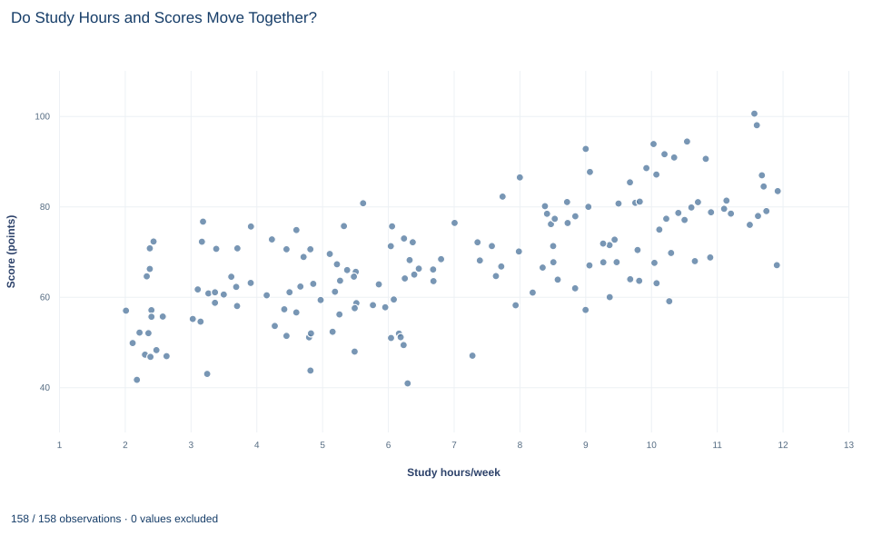

# Lab 15 · Do Study Hours and Scores Move Together?

**Pearson correlation, a common sample and association without causation**

## Start with the supplied workbook

1. Download [study_hours_scores.xlsx](study_hours_scores.xlsx) and the [Python lab](lab.py). It holds the fixed student records for this chapter.
2. Import `study_hours_scores.xlsx` into OpenEconometrics and keep that file name as the dataset name. `Data` holds one row per student; `Dictionary` explains each column, its unit and its blank cells.
3. Open the complete `lab.py` in a new Python document and run the whole file. It displays the correlation output, a scatterplot of scores against study hours and the table of reported numbers.

For ordinary Python, keep `lab.py` and the workbook in the same folder and run the script there, or call `from lab import run_lab` and then `run_lab(data_path="/path/to/study_hours_scores.xlsx")`. Leave blank cells blank. If you want to try a transformation, work on a copy of the loaded table so the distributed workbook stays unchanged.

Students who report more weekly study time tend to have higher assessment scores in this file. The Pearson correlation between the two is 0.65 across 158 students. How strong is that linear association, how precisely is it estimated, and what does it allow us to say about studying?

A single number cannot answer all of that. A correlation compresses a whole scatterplot into one value between −1 and 1, and it is easy to read more into it than it holds: a cause, a slope or a share of scores "explained" by hours. The file holds **160 original synthetic students**, two of them without a score; they are teaching records, not a study of real students. The [LaTeX table](table.tex) collects the reported numbers.

## 1. Two measurements on each student

Each row is one student. `student_id` is a label from 1 to 160, `hours` is the student's weekly study time in hours per week, and `score` is the student's assessment score in points. The dictionary does not state a maximum score; one student scores slightly above 100, so the scores should not be read as percentages.

Students 21 and 81 have a study time but a blank `score`. A correlation needs both values for every student it uses, so the analysis keeps the **158 complete pairs**: 160 rows minus 2 incomplete. Both variables are summarized on those same 158 students. Computing the mean of hours over all 160 and the mean of scores over 158 would quietly describe two different groups.

## 2. Look at the scatterplot first



Each point is one complete student, with weekly study hours on the horizontal axis (about 2 to 12 hours) and score on the vertical axis (about 41 to 101 points). The cloud rises from lower left to upper right: students who study more tend to score higher. It is also wide: students with similar study hours have very different scores, so hours leave much of the variation in scores unaccounted for.

Check three things before trusting any single summary of a scatterplot. Is the pattern roughly a straight line, or does it bend? Are there isolated points far from the rest that could pull the summary? Is the spread similar across the range? Here the cloud looks broadly linear, with no point standing far apart from the others. That is what makes a Pearson correlation a reasonable summary for this file; it would not be for a curved or clustered pattern.

## 3. From covariance to correlation

**Pause before running.** If study time were recorded in minutes instead of hours, would the correlation change? Would the slope of a line predicting score from study time change?

The descriptive statistics on the common sample are:

```python
import openecon as oe

raw = load_data()  # reader defined in the complete lab.py
data = raw.dropna(subset=["hours", "score"])
print(len(raw), len(data))
display(oe.describe(data, ["hours", "score"], stats=["n", "mean", "std_dev", "min", "max"]))
```

| Variable | n | Mean | Standard deviation | Minimum | Maximum |
|---|---:|---:|---:|---:|---:|
| `hours` (hours/week) | 158 | 6.87 | 2.92 | 2.02 | 11.93 |
| `score` (points) | 158 | 67.70 | 12.28 | 40.85 | 100.53 |

The Pearson correlation is

$$
r=\frac{\sum_i(x_i-\bar x)(y_i-\bar y)}{\sqrt{\sum_i(x_i-\bar x)^2\,\sum_i(y_i-\bar y)^2}}=\frac{s_{xy}}{s_x\,s_y},
$$

where $x_i$ is student $i$'s hours, $y_i$ the score, $\bar x$ and $\bar y$ the means, $s_{xy}$ the sample covariance and $s_x$, $s_y$ the standard deviations. The numerator adds up products of deviations: a student above average on both, or below average on both, contributes a positive product; a student above on one and below on the other contributes a negative one.

The covariance here is 23.35, in hours times points, a unit with no natural meaning. Dividing by both standard deviations cancels the units:

$$
r=\frac{23.35}{2.917\times12.28}=0.652 .
$$

The result has no unit, lies between −1 and 1, and does not depend on which variable is called $x$. Swapping hours and score leaves $r$ unchanged.

## 4. Run the correlation

```python
result = oe.correlate(data, ["hours", "score"], method="pearson", pairwise=False, ci=True)
display(result["intervals"])
```

`pairwise=False` enforces the common sample: only rows complete on both columns are used. The interval table reads:

| Pair | Pearson r | 95% interval | Students |
|---|---:|---|---:|
| Hours and score | 0.652 | 0.552 to 0.733 | 158 |

The `p_values` table in the same result gives a two-sided p value of $1.7\times10^{-20}$ for the null hypothesis of zero correlation.

A correlation of 0.65 describes a clear, moderately strong positive linear association, not a tight one: the scatter in Section 2 shows how much variation remains. The interval is the more useful summary of precision. Correlations as low as about 0.55 and as high as about 0.73 are consistent with these data.

## 5. Test and interval for a correlation

The test of $H_0:\rho=0$, where $\rho$ is the population correlation, uses

$$
t=r\sqrt{\frac{n-2}{1-r^2}},\qquad df=n-2 .
$$

With $n=158$, $t=0.652\sqrt{156/(1-0.425)}=0.652\times16.47=10.74$ on 156 degrees of freedom, which gives the tiny p value above. The test is exact when the two variables are jointly normal and is a good approximation for a sample of this size when the scatter has no extreme points.

Notice what drives $t$: both $r$ and $n$. With 158 students, even a weak correlation would be statistically distinguishable from zero. A small p value says that the association is unlikely to be exactly zero; the size of $r$ and its interval say how strong it is.

The interval cannot simply be $r$ plus or minus a margin, because $r$ is bounded by −1 and 1. The Fisher transformation $z=\tanh^{-1}(r)$ maps $r$ onto an unbounded scale where its standard error is approximately $1/\sqrt{n-3}$:

$$
z=\tanh^{-1}(0.652)=0.779,\qquad SE=\frac{1}{\sqrt{155}}=0.0803,\qquad 0.779\pm1.960\times0.0803=[0.621,\;0.936].
$$

Transforming the endpoints back with $\tanh$ gives 0.552 and 0.733. The interval is not symmetric around 0.652; it stretches farther toward zero than toward 1.

## 6. What r squared and a slope add

Squaring the correlation gives $r^2=0.425$. In a straight-line fit of score on hours with an intercept, the fitted line accounts for 42.5% of the sample variance of scores, and 57.5% remains around the line. That is a description of fit in this sample. It is not the share of each student's score caused by studying.

A correlation is also not a slope. The least-squares slope of score on hours is

$$
b=r\,\frac{s_y}{s_x},
$$

which carries units (points per weekly hour) and a direction: the slope of hours on score is a different number. The correlation is symmetric and unit-free; the slope is neither. Report a slope when the question is "how many points per extra hour, on average," and a correlation when the question is how tightly the two move together.

## A case from the literature

Two published studies show why a correlation between study time and grades cannot settle whether studying raises grades. The title of Plant et al. (2005) states their starting point: study time does not predict grade point average across college students. Their subtitle points to the implications of deliberate practice for academic performance.

Stinebrickner and Stinebrickner (2008) took up the causal question directly. They note that little is known about the causal impact of a student's study effort, which they call the most fundamental input in the education production function, and they examine the causal effect of studying on grades using new data collected specifically for that purpose. Their results suggest that the skills students build in college are far from predetermined when they enter.

Read together, the two papers make this lab's point. A correlation across students, whether clearly positive as in this file or absent as in the first title, mixes any effect of studying with everything else that differs between students who study more and those who study less, such as preparation, motivation or course choice. A weak correlation does not show that studying is useless, and a strong one does not show that it works. Estimating an effect needs variation in study time that is unrelated to those differences, which an observational scatterplot does not supply. On the method, Fisher (1915) studied the sampling distribution of the correlation coefficient, the problem behind this lab's interval, and Anscombe (1973) wrote on graphs in statistical analysis.

## 7. What the correlation supports and what it does not

The analysis supports a descriptive statement: in these 158 synthetic students, weekly study hours and assessment scores have a positive linear correlation of 0.65, with a 95% interval from 0.55 to 0.73.

It does not show that studying more raises scores. The file records no other student characteristics. Prior preparation, motivation, course difficulty or available free time could raise both study hours and scores, and the direction could run the other way for some students, who might study more because a course is going well. A causal claim needs a design, such as an assigned change in study time, that breaks those links.

Pearson's $r$ measures only *linear* association. A strong curved relationship can produce a small $r$, and $r=0$ does not rule out a dependence that is not a straight line. A single extreme point can move $r$ substantially, which is why the scatterplot comes first. The correlation also describes only the observed range, about 2 to 12 hours a week; it says nothing about students who study far more. Finally, the two students without scores are excluded, and the result describes the 158 who have one.

## 8. Write the result in full

A complete statement for the worked example reads: "Among 158 of 160 synthetic students with both measurements, weekly study hours and assessment scores have a Pearson correlation of 0.65 (95% Fisher interval 0.55 to 0.73; t = 10.7 on 156 degrees of freedom, p < 0.001). A straight-line fit of score on hours accounts for 42.5% of the sample variance in scores. The data are observational and record no other student characteristics, so the association does not establish that additional study causes higher scores."

It states the common sample, the strength with its uncertainty, and the limit on interpretation before anyone asks.

## Student exercises

1. Using $r$ and the two standard deviations from Section 3, compute the slope of score on hours and the slope of hours on score. Explain why the second is not the reciprocal of the first. Then convert `hours` to minutes on a copy of the data and state what happens to $r$ and to the first slope.
2. Suppose the same $r=0.652$ had come from only 20 students. Compute the t statistic and two-sided p value. Then find the smallest positive correlation that would be significant at the 5% level with 158 students, and explain what the two results show about p values and strength.
3. Use the Fisher transformation to compute a 99% interval for the correlation by hand, then check it with `oe.correlate(..., alpha=0.01)`. Why is it wider, and how far does each endpoint lie from 0.652?
4. On a copy of the complete data, add one hypothetical student with 25 study hours a week and a score of 45 points. Recompute $r$ and explain why one row out of 159 moves it so much.
5. Rerun `oe.correlate` with `method="spearman"`. Compare the rank correlation with Pearson's $r$ and explain what the comparison suggests about linearity and outliers in this file. Describe a pattern for which the two would differ substantially.
6. Rewrite "Studying causes higher scores: 42.5% of a student's score is due to study hours (r = 0.65)" as a statement the analysis supports, and name one variable that could produce the association without any effect of studying.

## Further reading

- Anscombe, F. J. (1973). Graphs in statistical analysis. *The American Statistician*, 27(1), 17–21. https://doi.org/10.1080/00031305.1973.10478966
- Fisher, R. A. (1915). Frequency distribution of the values of the correlation coefficient in samples from an indefinitely large population. *Biometrika*, 10(4), 507–521. https://doi.org/10.1093/biomet/10.4.507
- Plant, E. A., Ericsson, K. A., Hill, L., and Asberg, K. (2005). Why study time does not predict grade point average across college students: Implications of deliberate practice for academic performance. *Contemporary Educational Psychology*, 30(1), 96–116. https://doi.org/10.1016/j.cedpsych.2004.06.001
- Stinebrickner, R., and Stinebrickner, T. R. (2008). The causal effect of studying on academic performance. *The B.E. Journal of Economic Analysis & Policy*, 8(1). https://doi.org/10.2202/1935-1682.1868
