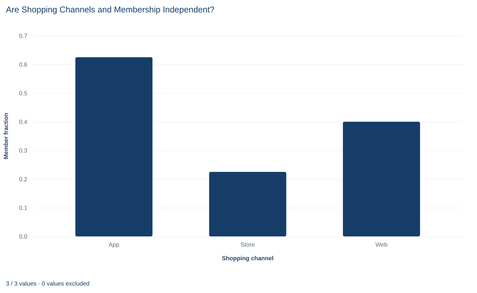

# Lab 16 · Are Shopping Channels and Membership Independent?

**Contingency tables, expected counts, Pearson's chi-square test and Cramér's V**

## Start with the supplied workbook

1. Download [shopping_channels.xlsx](shopping_channels.xlsx) and the [Python lab](lab.py). It holds the fixed transaction records for this chapter.
2. Import `shopping_channels.xlsx` into OpenEconometrics and keep that file name as the dataset name. `Data` holds one row per transaction: an identifier, the channel used and whether the shopper was a member. `Dictionary` explains each column and its coding.
3. Open the complete `lab.py` in a new Python document and run the whole file. It displays the cross-tabulation with its tests and association measures, a bar chart of the member share in each channel and the table of reported numbers.

For ordinary Python, keep `lab.py` and the workbook in the same folder and run the script there, or call `from lab import run_lab` and then `run_lab(data_path="/path/to/shopping_channels.xlsx")`. If you want to try a transformation, work on a copy of the loaded table so the distributed workbook stays unchanged.

A retailer records how each purchase was made, in a store, on the website or in the app, and whether the shopper was a loyalty member at the time. In this file, 62.5% of app transactions were made by members, against 40.0% on the web and 22.5% in stores. Are channel and membership related, or could shares this different arise if channel had nothing to do with membership?

Both variables are categories, so there are no means to compare. The evidence is a table of counts, and the question becomes how far those counts sit from what independence would predict. The file holds **360 original synthetic transactions** with no blank cells; they are teaching records, not sales data from a real retailer. The [LaTeX table](table.tex) collects the reported numbers.

## 1. One transaction, two categories

Each row is one transaction. `transaction_id` is a label from 1 to 360, `channel` records where the purchase was made (Store, Web or App), and `member` is coded 1 if the shopper was a loyalty member at the time of purchase and 0 if not. The unit is the transaction, not the shopper: the file has no shopper identifier, so a person who bought several times could appear in several rows.

The channels repeat in a fixed order down the file, Store, Web, App, Store, Web, App, so each channel has exactly 120 transactions. The channel totals are a feature of how the file was built, not something learned from the data.

Two variables are **independent** when the distribution of one is the same at every level of the other. Here that means the member share would be the same in every channel, or equivalently, the channel mix would be the same for members and non-members.

**Pause before running.** If the channels were recoded as 1, 2 and 3, should the mean of those codes play any part in a test of independence?

## 2. Build the contingency table

The cross-tabulation is one call:

```python
import openecon as oe

raw = load_data()  # reader defined in the complete lab.py
result = oe.crosstab(raw, "channel", "member", expected=True, exact=False)
display(result["counts"])
```

| Channel | Non-members (0) | Members (1) | Total | Member share |
|---|---:|---:|---:|---:|
| App | 45 | 75 | 120 | 62.5% |
| Store | 93 | 27 | 120 | 22.5% |
| Web | 72 | 48 | 120 | 40.0% |
| Total | 210 | 150 | 360 | 41.7% |

The first four columns are the output; the member share is each row's member count divided by its total. The table keeps both **margins**, the row totals (120 per channel) and the column totals (210 non-members and 150 members), along with the six joint counts. The software orders the channels alphabetically, which carries no meaning.

Reading across rows answers "among transactions in this channel, what share were by members?" Reading down columns answers "among member transactions, how were they spread across channels?" Both describe the same table and the same association.

## 3. What independence predicts

If channel and membership were independent, every channel would have the overall member share, 150/360 = 41.7%. The expected count in row $r$ and column $c$ is

$$
E_{rc}=\frac{n_{r+}\,n_{+c}}{n},
$$

where $n_{r+}$ is the row total, $n_{+c}$ the column total and $n=360$ the grand total. For app transactions by members,

$$
E_{\text{App},1}=\frac{120\times150}{360}=50,\qquad E_{\text{App},0}=\frac{120\times210}{360}=70 .
$$

Because every channel has 120 transactions, all three rows have the same expected counts, 70 non-members and 50 members. The expected table has exactly the same margins as the observed one; it redistributes the counts inside the table as independence would. Expected counts need not be whole numbers in general; they are averages, not possible observations.

## 4. Pearson's chi-square statistic

Pearson's statistic adds up a standardized squared gap for every cell:

$$
X^2=\sum_{r,c}\frac{(O_{rc}-E_{rc})^2}{E_{rc}},\qquad df=(R-1)(C-1),
$$

where $O_{rc}$ is the observed count, $R=3$ the number of channels and $C=2$ the number of membership states. Dividing by $E_{rc}$ scales each gap by the size of the count expected in that cell, so a gap of 10 counts for more in a cell expected to hold 20 than in one expected to hold 200.

For the app row,

$$
\frac{(45-70)^2}{70}=8.93,\qquad \frac{(75-50)^2}{50}=12.50 .
$$

The remaining four cells add their own contributions, and the six together give $X^2=39.70$. The store and app rows supply nearly all of it; the web row, whose counts of 72 and 48 are close to 70 and 50, adds very little.

The degrees of freedom count how many cells can vary once the margins are fixed. With three channel totals and two membership totals given, choosing the member count for two channels determines every other cell, so $df=(3-1)(2-1)=2$.

```python
display(result["expected"])
display(result["tests"])
```

| Test | Statistic | df | p value |
|---|---:|---:|---:|
| Pearson chi-square | 39.70 | 2 | 2.4 × 10⁻⁹ |
| Likelihood ratio | 40.76 | 2 | 1.4 × 10⁻⁹ |
| Linear-by-linear | 12.46 | 1 | 0.0004 |

The Pearson row is the test of this lab. Under independence, $X^2$ approximately follows a chi-square distribution with 2 degrees of freedom, whose 95th percentile is 5.99. The observed 39.70 is far beyond it, and the p value is about $2.4\times10^{-9}$, so the data reject independence. The likelihood-ratio test measures the same departure in a different way and agrees.

Ignore the linear-by-linear row. It treats the categories as ordered and scores them by position, here the alphabetical order App, Store, Web. That order has no meaning for shopping channels, so the statistic answers no sensible question. The same warning applies to the ordinal measures, such as gamma, Kendall's tau and the Pearson and Spearman correlations, in the `measures` table.

## 5. Is the chi-square approximation adequate?

The chi-square distribution is a large-sample approximation to the distribution of $X^2$. A common working rule asks that expected counts not be too small, often at least 5 in every cell. Here the smallest expected count is 50 and no cell falls below 5, so the approximation is comfortable. With small expected counts, an exact test (`exact=True`) would be the safer choice.

## 6. How strong is the association?

A p value says how incompatible the table is with independence; it grows more extreme as the sample grows even when the pattern stays the same. To describe strength, use the member shares directly and a scale-free summary.

Cramér's V rescales $X^2$ by the sample size and table shape:

$$
V=\sqrt{\frac{X^2}{n\,\min(R-1,\,C-1)}}=\sqrt{\frac{39.70}{360\times1}}=\sqrt{0.1103}=0.332 .
$$

V runs from 0 (independence in the sample) to 1 (each channel's transactions all one membership type). A value of 0.33 describes a clear but far from complete association: every channel contains both members and non-members. For a table with two columns, V equals the phi coefficient, which is why the `measures` table reports the same 0.332 for both.

The most direct description is still the member shares: 62.5% for the app against 22.5% in stores, a gap of 40 percentage points, with the web in between at 40.0%.

## 7. Read the bar chart



Each bar is the fraction of a channel's transactions made by members: 0.625 for App, 0.225 for Store and 0.400 for Web, on an axis marked from 0.0 to 0.6. These are the row shares from Section 2.

Under independence, all three bars would sit at the overall share of 0.417. The chart has no line at that level, but the departure is easy to see: the app bar is well above it, the store bar well below, and the web bar close to it, matching where the chi-square contributions came from. The chart shows no counts or uncertainty, and each bar rests on 120 transactions.

## A case from the literature

Bickel et al. (1975) faced a contingency-table question: were graduate admissions at the University of California, Berkeley, for fall 1973 related to the applicant's sex? The aggregate data showed what the authors call a clear but misleading pattern of bias against female applicants. Department by department, few decision-making units showed statistically significant departures from the expected frequencies of female admissions, and about as many appeared to favor women as men. Pooling the data in a way that respected each department's autonomy gave a small but statistically significant bias in favor of women. The aggregate pattern arose because women tended to apply to departments that were harder for applicants of either sex to enter.

The study illustrates the next section. A test of independence can establish that two categories are associated; it cannot say why. At Berkeley a third variable, the department, was related both to sex and to admission, and combining across it produced an association that misdescribed the admissions committees. In this lab's file, how often a person shops could play a similar role.

Cochran (1954) made a related point about the test itself: a significant chi-square does not show how the data disagree with the null hypothesis, so it should be supplemented by analyses that reveal the pattern. Cochran (1952) reviewed research on the minimum expected number per class, the question behind Section 5, and Pearson (1900) set out a criterion for judging whether deviations from expected values could have arisen from random sampling.

## 8. What the test supports and what it does not

The analysis supports a statement about these 360 synthetic transactions: membership and channel are not independent, and the member share differs considerably between channels.

The chi-square test is a test of the whole table. It does not say which channel differs from which, or whether the web differs from either of the others. Comparing particular channels is a separate set of tests, each needing its own interval, and making several comparisons calls for a plan that controls the overall error rate.

Nor does an association reveal a direction. The app may attract members, membership may encourage use of the app, or both may follow from something else, such as how frequently a person shops. The test also treats transactions as independent. Because the file has no shopper identifier, frequent shoppers may contribute many rows each, and if they tend to be members using one channel, the effective amount of independent information is smaller than 360 rows suggest. Finally, the equal channel totals reflect how the file was built and say nothing about how often each channel is used.

## 9. Write the result in full

A complete statement for the worked example reads: "In 360 synthetic transactions, 120 per channel, the share made by loyalty members was 62.5% in the app, 40.0% on the web and 22.5% in stores. Pearson's chi-square test rejects independence of channel and membership ($X^2 = 39.70$, 2 degrees of freedom, p < 0.001; smallest expected count 50). Cramér's V is 0.33. The unit is the transaction, not the shopper, and the association does not show that any channel causes membership."

It reports the shares that show the pattern, the test with its approximation check, the strength and the limits of the unit and design.

## Student exercises

1. Compute the chi-square contributions of the four store and web cells. Confirm that all six contributions sum to 39.70, and rank the cells by contribution. Which two cells drive the result?
2. On a copy of the data, rename `Web` to `Online` and rerun `oe.crosstab`. Which rows of the `tests` table change, which do not, and why? What does this show about the linear-by-linear test for these channels?
3. Compare app and store member shares with the two-proportion interval from Lab 14. Then explain how the interval would change if you planned all three pairwise channel comparisons and wanted an overall 95% confidence level.
4. Suppose every count in the table were halved, keeping the same shares. Compute $X^2$, its p value and Cramér's V. Which numbers depend on the sample size and which do not?
5. Compute the channel mix among member transactions and among non-member transactions (column shares). Explain why "members prefer the app" and "app transactions are more often by members" describe the same association but are different statements.
6. Rewrite "Using the app makes customers join the loyalty program (p < 0.001)" as a statement these data support, addressing both the direction of the association and the unit of observation.

## Further reading

- Bickel, P. J., Hammel, E. A., and O'Connell, J. W. (1975). Sex bias in graduate admissions: Data from Berkeley. *Science*, 187(4175), 398–404. https://doi.org/10.1126/science.187.4175.398
- Cochran, W. G. (1952). The χ² test of goodness of fit. *The Annals of Mathematical Statistics*, 23(3), 315–345. https://doi.org/10.1214/aoms/1177729380
- Cochran, W. G. (1954). Some methods for strengthening the common χ² tests. *Biometrics*, 10(4), 417. https://doi.org/10.2307/3001616
- Pearson, K. (1900). On the criterion that a given system of deviations from the probable in the case of a correlated system of variables is such that it can be reasonably supposed to have arisen from random sampling. *The London, Edinburgh, and Dublin Philosophical Magazine and Journal of Science*, 50(302), 157–175. https://doi.org/10.1080/14786440009463897
