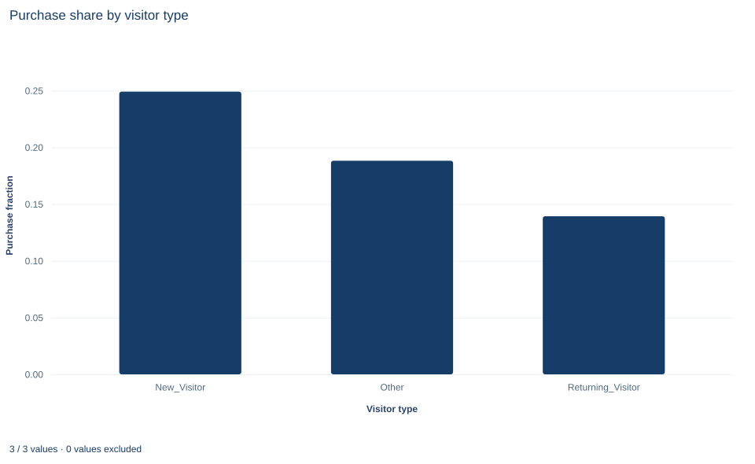

# Lab 16 · Are Visitor Type and Purchase Independent?

**Contingency tables, expected counts, Pearson's chi-square test and Cramér's V**

## Start with the supplied workbook

1. Download [visitor_purchases.xlsx](visitor_purchases.xlsx) and the [Python lab](lab.py). It holds the published website sessions for this chapter.
2. Import `visitor_purchases.xlsx` into OpenEconometrics and keep that file name as the dataset name. `Data` holds one row per browsing session: a session number, the visitor type, the month and whether the session ended in a purchase. `Dictionary` explains each column and its coding and gives the source and licence.
3. Open the complete `lab.py` in a new Python document and run the whole file. It displays the cross-tabulation with its tests and association measures, a bar chart of the purchase share for each visitor type and the table of reported numbers.

For ordinary Python, keep `lab.py` and the workbook in the same folder and run the script there, or call `from lab import run_lab` and then `run_lab(data_path="/path/to/visitor_purchases.xlsx")`. If you want to try a transformation, work on a copy of the loaded table so the distributed workbook stays unchanged.

An online retailer's analytics classify each browsing session by visitor type, new, returning or other, and record whether it ended in a purchase. In this file, 24.9% of new visitors' sessions ended in a purchase, against 18.8% for `Other` and 13.9% for returning visitors. Are visitor type and purchase related, or could shares this different arise if visitor type had nothing to do with buying?

Both variables are categories, so there are no means to compare. The evidence is a table of counts, and the question becomes how far those counts sit from what independence would predict. The file holds **12,330 sessions** from the UCI Machine Learning Repository's Online Shoppers Purchasing Intention Dataset, with no blank cells. The [LaTeX table](table.tex) collects the reported numbers. With this many sessions the test will be decisive, so the lab's second question is how strong the association is.

## Data source and licence

- **Data:** Sakar, C., and Kastro, Y. (2018). *Online Shoppers Purchasing Intention Dataset* [Dataset]. UCI Machine Learning Repository. https://doi.org/10.24432/C5F88Q
- **Article:** Sakar, C. O., Polat, S. O., Katircioglu, M., and Kastro, Y. (2019). Real-time prediction of online shoppers' purchasing intention using multilayer perceptron and LSTM recurrent neural networks. *Neural Computing and Applications*, 31(10), 6893–6908. https://doi.org/10.1007/s00521-018-3523-0
- **Licence:** Creative Commons Attribution 4.0 International (CC BY 4.0), https://creativecommons.org/licenses/by/4.0/. The workbook is an adapted copy; the changes are listed below.
- **Preparation:** all 12,330 sessions of the published file are kept in file order, including 125 rows that repeat another row exactly. `session` numbers them, because the source has no session identifier. `VisitorType` and `Month` keep the publisher's labels (`Month` has ten values, no January or April, and spells June in full); `Revenue` codes the publisher's TRUE/FALSE as 1/0. The other 14 columns are left out.

## 1. One session, two categories

Each row is one session. `session` is a label from 1 to 12,330, `VisitorType` records the retailer's classification (`New_Visitor`, `Other` or `Returning_Visitor`), `Month` records when the session took place, and `Revenue` is coded 1 if the session ended in a purchase and 0 if not. The unit is the session, not the person: the file has no visitor identifier, so someone who browsed several times could appear in several rows.

The three visitor types are very unequal in size: 10,551 returning sessions, 1,694 new and only 85 `Other`. The source does not say what `Other` means, and the label appears almost only in November and December.

Two variables are **independent** when the distribution of one is the same at every level of the other. Here that means the purchase share would be the same for every visitor type, or equivalently, the mix of visitor types would be the same among purchase and non-purchase sessions.

**Pause before running.** If the visitor types were recoded as 1, 2 and 3, should the mean of those codes play any part in a test of independence?

## 2. Build the contingency table

The cross-tabulation is one call:

```python
import openecon as oe

raw = load_data()  # reader defined in the complete lab.py
result = oe.crosstab(raw, "VisitorType", "Revenue", expected=True, exact=False)
display(result["counts"])
```

| Visitor type | No purchase (0) | Purchase (1) | Total | Purchase share |
|---|---:|---:|---:|---:|
| `New_Visitor` | 1,272 | 422 | 1,694 | 24.9% |
| `Other` | 69 | 16 | 85 | 18.8% |
| `Returning_Visitor` | 9,081 | 1,470 | 10,551 | 13.9% |
| Total | 10,422 | 1,908 | 12,330 | 15.5% |

The first four columns are the output; the purchase share is each row's purchase count divided by its total. The table keeps both **margins**, the row totals and the column totals (10,422 sessions without and 1,908 with a purchase), along with the six joint counts. The software orders the visitor types alphabetically, which carries no meaning.

Reading across rows answers "among sessions of this visitor type, what share ended in a purchase?" Reading down columns answers "among purchase sessions, how were they spread across visitor types?" Both describe the same table and the same association.

## 3. What independence predicts

If visitor type and purchase were independent, every visitor type would have the overall purchase share, 1,908/12,330 = 15.5%. The expected count in row $r$ and column $c$ is

$$
E_{rc}=\frac{n_{r+}\,n_{+c}}{n},
$$

where $n_{r+}$ is the row total, $n_{+c}$ the column total and $n=12{,}330$ the grand total. For new visitors' sessions,

$$
E_{\text{New},1}=\frac{1{,}694\times1{,}908}{12{,}330}=262.1,\qquad E_{\text{New},0}=\frac{1{,}694\times10{,}422}{12{,}330}=1{,}431.9 .
$$

The same rule gives 13.2 and 71.8 for `Other` and 1,632.7 and 8,918.3 for returning visitors. The expected table has exactly the same margins as the observed one; it redistributes the counts inside the table as independence would. Expected counts need not be whole numbers; they are averages, not possible observations.

## 4. Pearson's chi-square statistic

Pearson's statistic adds up a standardized squared gap for every cell:

$$
X^2=\sum_{r,c}\frac{(O_{rc}-E_{rc})^2}{E_{rc}},\qquad df=(R-1)(C-1),
$$

where $O_{rc}$ is the observed count, $R=3$ the number of visitor types and $C=2$ the number of purchase states. Dividing by $E_{rc}$ scales each gap by the size of the count expected in that cell, so a gap of 100 counts for more in a cell expected to hold 260 than in one expected to hold 9,000.

For the new-visitor row,

$$
\frac{(1{,}272-1{,}431.9)^2}{1{,}431.9}=17.85,\qquad \frac{(422-262.1)^2}{262.1}=97.49 .
$$

The remaining four cells add their own contributions, and the six together give $X^2=135.25$. New visitors who bought, 160 more than independence predicts, supply most of it. The returning row adds about 19 more, and the 85 `Other` sessions, whose counts sit close to their expected values, add less than 1.

The degrees of freedom count how many cells can vary once the margins are fixed. With three row totals and two column totals given, choosing the purchase count for two visitor types determines every other cell, so $df=(3-1)(2-1)=2$.

```python
display(result["expected"])
display(result["tests"])
```

| Test | Statistic | df | p value |
|---|---:|---:|---:|
| Pearson chi-square | 135.25 | 2 | 4.3 × 10⁻³⁰ |
| Likelihood ratio | 121.11 | 2 | < 10⁻²⁰ |
| Linear-by-linear | 135.22 | 1 | < 10⁻²⁰ |

The Pearson row is the test of this lab. Under independence, $X^2$ approximately follows a chi-square distribution with 2 degrees of freedom, whose 95th percentile is 5.99. The observed 135.25 is far beyond it, and the p value is about $4.3\times10^{-30}$, so the data reject independence. The likelihood-ratio test measures the same departure in a different way and agrees. The output rounds p values this small to 0.

Ignore the linear-by-linear row. It treats the categories as ordered and scores them by position, here the alphabetical order `New_Visitor`, `Other`, `Returning_Visitor`. That order has no meaning for visitor types, so the statistic answers no sensible question. The same warning applies to the ordinal measures, such as gamma, Kendall's tau and the Pearson and Spearman correlations, in the `measures` table.

## 5. Is the chi-square approximation adequate?

The chi-square distribution is a large-sample approximation to the distribution of $X^2$. A common working rule asks that expected counts not be too small, often at least 5 in every cell. Here the smallest expected count is 13.2, for `Other` sessions with a purchase; every other cell expects far more. The approximation is adequate, but the small `Other` row is the place to look first. With small expected counts, an exact test (`exact=True`) would be the safer choice, and Exercise 5 finds a month where it is needed.

## 6. How strong is the association?

A p value says how incompatible the table is with independence; it grows more extreme as the sample grows even when the pattern stays the same. To describe strength, use the purchase shares directly and a scale-free summary.

Cramér's V rescales $X^2$ by the sample size and table shape:

$$
V=\sqrt{\frac{X^2}{n\,\min(R-1,\,C-1)}}=\sqrt{\frac{135.25}{12{,}330\times1}}=\sqrt{0.0110}=0.105 .
$$

V runs from 0 (independence in the sample) to 1 (each visitor type's sessions all bought or all did not). A value of 0.105 describes a weak association: every visitor type mostly did not buy, and knowing the type changes the purchase share by at most about 11 percentage points. For a table with two columns, V equals the phi coefficient, which is why the `measures` table reports 0.105 for both.

This is the main lesson of the lab with real data. A p value of $10^{-30}$ sits beside a weak association, because 12,330 sessions make even a small departure from independence unmistakable. The most direct description is still the purchase shares: 24.9% for new visitors against 13.9% for returning visitors, a gap of 11.0 percentage points, with `Other` in between at 18.8%.

## 7. Read the bar chart



Each bar is the fraction of a visitor type's sessions that ended in a purchase: 0.249 for `New_Visitor`, 0.188 for `Other` and 0.139 for `Returning_Visitor`, on an axis marked from 0.00 to 0.25. These are the row shares from Section 2.

Under independence, all three bars would sit at the overall share of 0.155. The chart has no line at that level, but the departure is easy to see: the new-visitor bar is well above it, the returning bar a little below, and the `Other` bar a little above. The chart shows no counts or uncertainty, and the bars rest on very different numbers of sessions: 1,694, 85 and 10,551.

## A case from the literature

Bickel et al. (1975) faced a contingency-table question: were graduate admissions at the University of California, Berkeley, for fall 1973 related to the applicant's sex? The aggregate data showed what the authors call a clear but misleading pattern of bias against female applicants. Department by department, few decision-making units showed statistically significant departures from the expected frequencies of female admissions, and about as many appeared to favour women as men. Pooling the data in a way that respected each department's autonomy gave a small but statistically significant bias in favour of women. The aggregate pattern arose because women tended to apply to departments that were harder for applicants of either sex to enter.

The study illustrates the next section. A test of independence can establish that two categories are associated; it cannot say why. At Berkeley a third variable, the department, was related both to sex and to admission, and combining across it produced an association that misdescribed the admissions committees. In this file the month could play such a role: purchase shares range from 1.6% of February sessions to 25.4% of November sessions, and the mix of visitor types changes from month to month. Exercise 5 checks the association within months.

Cochran (1954) made a related point about the test itself: a significant chi-square does not show how the data disagree with the null hypothesis, so it should be supplemented by analyses that reveal the pattern. Cochran (1952) reviewed research on the minimum expected number per class, the question behind Section 5, and Pearson (1900) set out a criterion for judging whether deviations from expected values could have arisen from random sampling.

## 8. What the test supports and what it does not

The analysis supports a statement about these 12,330 sessions: visitor type and purchase are not independent, and new visitors' sessions end in a purchase more often than returning visitors' sessions. The association is weak.

The chi-square test is a test of the whole table. It does not say which visitor type differs from which. Comparing particular types is a separate set of tests, each needing its own interval, and making several comparisons calls for a plan that controls the overall error rate.

Nor does an association reveal a direction or a cause. Returning visitors may come back for reasons that rarely end in a purchase, such as checking an order, and new visitors may arrive from an advertisement for a product they already want; the file records neither. The test also treats sessions as independent. Because the file has no visitor identifier, frequent visitors may contribute many rows each, and if they behave alike, the effective amount of independent information is smaller than 12,330 rows suggest. The p value is therefore too small to be taken literally, even though the direction of the shares is clear. Finally, `Other` is an unexplained label used almost only in two months; it is safer to report it than to interpret it.

## 9. Write the result in full

A complete statement for the worked example reads: "In 12,330 browsing sessions on one retailer's website, 24.9% of new visitors' sessions ended in a purchase, against 18.8% for sessions labelled Other and 13.9% for returning visitors. Pearson's chi-square test rejects independence of visitor type and purchase ($X^2 = 135.3$, 2 degrees of freedom, p < 0.001; smallest expected count 13.2), but the association is weak (Cramér's V = 0.10). The unit is the session, not the visitor, and the association does not show that returning to the site makes a visitor less likely to buy."

It reports the shares that show the pattern, the test with its approximation check, the strength and the limits of the unit and design.

## Student exercises

1. Compute the chi-square contributions of all six cells. Confirm that they sum to 135.25, rank them, and say which two cells drive the result and why the `Other` row contributes so little.
2. On a copy of the data, rename `Other` to `Unknown` and rerun `oe.crosstab`. Which rows of the `tests` table change, which do not, and why? What does this show about the linear-by-linear test for visitor types?
3. Compare the purchase shares of new and returning visitors with the two-proportion interval from Lab 14. Then explain how the interval would change if you planned all three pairwise comparisons and wanted an overall 95% confidence level.
4. Suppose every count in the table were halved, keeping the same shares. Compute $X^2$, its p value and Cramér's V. Which numbers depend on the sample size and which do not?
5. Repeat the test within November sessions only and then within June sessions only. For each month report the purchase shares, $X^2$, its degrees of freedom and the smallest expected count. Does new visitors' higher purchase share survive within a month, and in which month is the chi-square approximation not adequate?
6. Rewrite "Returning to the site makes customers less likely to buy (p < 0.001)" as a statement these data support, addressing the direction of the association, its strength and the unit of observation.

## Further reading

- Bickel, P. J., Hammel, E. A., and O'Connell, J. W. (1975). Sex bias in graduate admissions: Data from Berkeley. *Science*, 187(4175), 398–404. https://doi.org/10.1126/science.187.4175.398
- Cochran, W. G. (1952). The χ² test of goodness of fit. *The Annals of Mathematical Statistics*, 23(3), 315–345. https://doi.org/10.1214/aoms/1177729380
- Cochran, W. G. (1954). Some methods for strengthening the common χ² tests. *Biometrics*, 10(4), 417. https://doi.org/10.2307/3001616
- Pearson, K. (1900). On the criterion that a given system of deviations from the probable in the case of a correlated system of variables is such that it can be reasonably supposed to have arisen from random sampling. *The London, Edinburgh, and Dublin Philosophical Magazine and Journal of Science*, 50(302), 157–175. https://doi.org/10.1080/14786440009463897
- Sakar, C. O., Polat, S. O., Katircioglu, M., and Kastro, Y. (2019). Real-time prediction of online shoppers' purchasing intention using multilayer perceptron and LSTM recurrent neural networks. *Neural Computing and Applications*, 31(10), 6893–6908. https://doi.org/10.1007/s00521-018-3523-0
