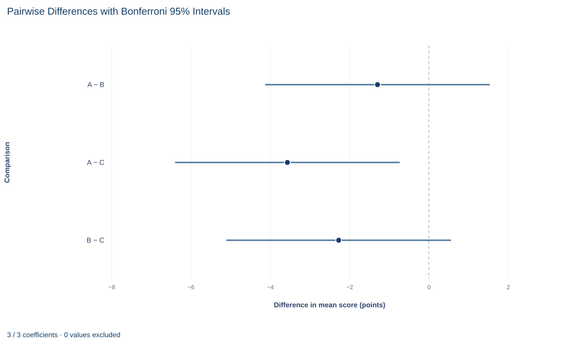

# Lab 17 · Comparing Three Training Formats

**One-way analysis of variance, effect size and adjusted pairwise comparisons**

## Start with the supplied workbook

1. Download [training_formats.xlsx](training_formats.xlsx) and the [Python lab](lab.py). The workbook holds the fixed trainee records used throughout this chapter.
2. Import `training_formats.xlsx` into OpenEconometrics and keep that file name as the dataset name. The `Data` sheet holds one row per trainee; the `Dictionary` sheet explains each column, its unit and its coding.
3. Open the complete `lab.py` in a new Python document and run the whole file. It reads the imported dataset and displays the full one-way ANOVA output, from group descriptives to Bonferroni pairwise comparisons, a chart of the three Bonferroni pairwise differences with their intervals and a table of the reported numbers.

For ordinary Python, keep `lab.py` and the workbook in the same folder and run the script there, or call `from lab import run_lab` and then `run_lab(data_path="/path/to/training_formats.xlsx")`. To try a change to the scores, work on a copy of the loaded table so the distributed workbook stays unchanged.

A company has tried three training formats, A, B and C, and tested every trainee afterward. Mean scores are 66.51 points for A, 67.80 for B and 70.07 for C, so C leads A by 3.56 points. Yet scores within format A alone run from 54.44 to 77.37. Is a gap of a few points a real difference between formats, or what three groups of 45 people would show by chance if the formats were equally effective?

One-way analysis of variance (ANOVA) asks whether the spread *between* the format means is large relative to the spread *within* formats. If it is, a second question follows: which formats differ? That needs pairwise comparisons, adjusted because there are several of them.

This lab uses **135 original synthetic trainees**, 45 per format, with scores in test points. They are teaching records, not results from a real training program. The [LaTeX table](table.tex) collects the reported numbers.

## 1. Define the groups and the null hypothesis

Each row of `Data` is one trainee, assigned to one format and tested once. There are no blank cells.

| Column | What it records | Kind of variable |
|---|---|---|
| `trainee_id` | Label from 1 to 135 | Identifier |
| `format` | Training format the trainee was assigned to: A, B or C | Nominal grouping factor |
| `score` | Post-training test score, in points | Measured outcome |

Formats rotate with the identifier (trainee 1 in A, 2 in B, 3 in C, 4 in A again), which gives a balanced design. Write $\mu_A$, $\mu_B$ and $\mu_C$ for the mean score each format would produce in the population the trainees stand for. The omnibus hypotheses are

$$
H_0:\ \mu_A=\mu_B=\mu_C
\qquad\text{versus}\qquad
H_1:\ \text{not all three means are equal.}
$$

The alternative holds under any pattern of inequality. ANOVA tests the null as a whole; it does not say which pattern is present.

## 2. Split the variation into two parts

Let $y_{gi}$ be the score of trainee $i$ in format $g$, $\bar y_g$ the format mean, $n_g$ the format size and $\bar y$ the grand mean of all 135 scores. Squaring and summing the identity $y_{gi}-\bar y=(\bar y_g-\bar y)+(y_{gi}-\bar y_g)$ over all trainees gives

$$
\underbrace{\sum_{g}\sum_{i}(y_{gi}-\bar y)^2}_{SS_T}
=\underbrace{\sum_{g}n_g(\bar y_g-\bar y)^2}_{SS_B}
+\underbrace{\sum_{g}\sum_{i}(y_{gi}-\bar y_g)^2}_{SS_W}.
$$

The cross-product term vanishes because deviations from a group's own mean sum to zero. $SS_B$ measures how far the format means sit from the grand mean, weighted by group size; $SS_W$ measures how far trainees sit from their own format's mean.

The grand mean is 68.13 points. The squared distances of the three format means from it are 2.620, 0.106 and 3.782 squared points, so

$$
SS_B=45\times(2.620+0.106+3.782)=117.90+4.78+170.17=292.86 .
$$

Format B contributes almost nothing because its mean is close to the grand mean. The within-group sum, built from the group standard deviations as $SS_W=\sum_g(n_g-1)s_g^2$, is 4,051.27. Their total, 4,344.12, equals $SS_T$, and the lab checks that identity on every run.

## 3. Turn the sums of squares into an F ratio

Each sum of squares is divided by its degrees of freedom. With $G=3$ groups and $n=135$ trainees,

$$
MS_B=\frac{SS_B}{G-1}=\frac{292.86}{2}=146.43,
\qquad
MS_W=\frac{SS_W}{n-G}=\frac{4051.27}{132}=30.69,
\qquad
F=\frac{MS_B}{MS_W}=4.77 .
$$

$MS_W$ estimates the common within-format variance $\sigma^2$ whether or not the means differ, because it uses only deviations from each group's own mean. $MS_B$ also estimates $\sigma^2$ when the null is true, but when the population means differ it picks up that extra spread and tends to exceed $MS_W$. So F near 1 is what equal means typically produce, and large values count against the null.

With independent trainees, normal scores within each format and a common variance, F follows an $F(2, 132)$ distribution under the null. Its 95th percentile is about 3.06; the observed 4.77 lies beyond it, with p = 0.0100. F has no sign: it says the means are spread out, not which format is ahead.

**Pause before running.** Can the omnibus null be rejected even when not every pairwise comparison is significant?

## 4. Run the procedure

The complete file loads the workbook with `load_data()` and passes all 135 rows to the native one-way procedure:

```python
import openecon as oe

raw = load_data()  # reader defined in the complete lab.py
result = oe.oneway(raw, "score", "format", posthoc=["bonferroni"], welch=True)
display(result["descriptives"])
display(result["anova"])
```

`result` is a set of named tables. The descriptives and the ANOVA table read:

| Format | Trainees | Mean score (points) | Standard deviation (points) |
|---|---:|---:|---:|
| A | 45 | 66.51 | 4.53 |
| B | 45 | 67.80 | 5.33 |
| C | 45 | 70.07 | 6.57 |
| All trainees | 135 | 68.13 | 5.69 |

| Source of variation | Sum of squares | Degrees of freedom | Mean square | F | p value |
|---|---:|---:|---:|---:|---:|
| Between formats | 292.86 | 2 | 146.43 | 4.77 | 0.0100 |
| Within formats | 4,051.27 | 132 | 30.69 | | |
| Total | 4,344.12 | 134 | | | |

Check the counts first: 45 per format and 135 in all, so no rows were dropped. Degrees of freedom add up like the sums of squares, 2 + 132 = 134 = n − 1. Then read F and its p value together: at a 5% level fixed in advance, the data reject the hypothesis that the three formats share one mean.

The descriptives also report each format's range, and the ranges overlap heavily: the lowest score in the file, 52.35, belongs to format C. A difference in means is about averages, not a claim that every C trainee outscored every A trainee.

## 5. Measure how large the difference is

A p value does not say how much of the variation goes with the formats. The simplest effect size is

$$
\eta^2=\frac{SS_B}{SS_T}=\frac{292.86}{4344.12}=0.067 .
$$

About 6.7% of the sample variation in scores lies between format means; the other 93% is variation among trainees in the same format. That is modest, and it matches gaps of a few points against within-format standard deviations of 4.5 to 6.6 points.

As an estimate of the population share, $\eta^2$ is biased upward, because $SS_B$ is positive even when population means are equal. The `effect_sizes` table also reports epsilon squared and omega squared, which subtract an estimate of the chance part of $SS_B$ and come out a little smaller. None of these is a causal "share of performance due to training."

## 6. Ask which formats differ

Three formats give three pairs, each tested with the pooled within-format variance:

$$
t_{gh}=\frac{\bar y_g-\bar y_h}{\sqrt{MS_W\,(1/n_g+1/n_h)}} .
$$

With 45 trainees in every format, all three pairs share one standard error, $\sqrt{30.69\times 2/45}=1.17$ points, and 132 degrees of freedom. Testing three pairs at 5% each raises the chance of at least one false difference above 5%. Bonferroni controls that familywise error rate by multiplying each unadjusted p value by the number of comparisons, here 3, capped at 1. Its intervals widen to match, using the $t_{132}$ critical value for a two-sided level of $0.05/3$, about 2.42, rather than 1.98.

```python
pairs = result["posthoc_bonferroni"]
display(pairs[["group_i", "group_j", "mean_difference", "std_error", "p_value", "ci_low", "ci_high"]])
```

| Comparison | Difference in means (points) | Standard error | Bonferroni p value | Adjusted 95% interval (points) |
|---|---:|---:|---:|---|
| A minus B | −1.29 | 1.17 | 0.81 | −4.12 to 1.54 |
| A minus C | −3.56 | 1.17 | 0.0083 | −6.40 to −0.73 |
| B minus C | −2.27 | 1.17 | 0.16 | −5.10 to 0.56 |

Each row is the first format minus the second, so a negative value means the second format scores higher. Only A and C are distinguishable after adjustment: C's mean is 3.56 points higher and the adjusted interval excludes zero. The other two intervals include zero.

That answers the pause question. The omnibus test rejects equality, yet only one pair of three is significant. There is no contradiction: F uses all the between-group variation at once, while each pairwise test asks a narrower question at a stricter threshold. F can even reject while no adjusted pair does.

## 7. Check the equal-variance assumption

The classical F test assumes a common variance, but the sample standard deviations are 4.53, 5.33 and 6.57 points; format C's variance is roughly twice format A's. These records were drawn with a common variance, so the gap is sampling variation, but with real data you would not know that.

```python
display(result["homogeneity"])
display(result["robust"])
```

| Check | Statistic | Degrees of freedom | p value |
|---|---:|---|---:|
| Levene test, mean-centered | 2.72 | 2 and 132 | 0.069 |
| Bartlett test | 6.06 | 2 | 0.048 |
| Welch F for equal means | 4.46 | 2 and 86.16 | 0.014 |
| Brown–Forsythe F for equal means | 4.77 | 2 and 120.72 | 0.010 |

Levene's test, which compares absolute deviations from each group mean, does not reject equal variances at 5%. Bartlett's test rejects narrowly, but it reacts to heavy tails as well as unequal variances. The Welch and Brown–Forsythe rows test equal means without assuming equal variances, estimating the denominator degrees of freedom from the data. Both agree with the classical test at 5%. Had they disagreed, the report would need to name its primary test, chosen before seeing results.

The pairwise table still uses the pooled variance. Because C is the most variable format, separate-variance comparisons would give the A–C and B–C differences somewhat larger standard errors.

## 8. Read the pairwise interval chart



Each row is one pairwise comparison from the Bonferroni table: the dot is the difference in mean score and the bar is its Bonferroni-adjusted 95% interval, in points. The dashed vertical line is zero, no difference. A − B is −1.29 points, with an interval from −4.12 to 1.54; A − C is −3.56, from −6.40 to −0.73; B − C is −2.27, from −5.10 to 0.56.

Only the A − C interval lies entirely on one side of zero, which matches the Bonferroni p values: only that pair is distinguishable at the 5% family-wise level. The chart shows something the F test alone does not: which pair drives the overall result and how large the gap could plausibly be. Even the A − C interval reaches down to 0.73 points, under 15% of the within-format standard deviation of about 5.5 points, so the data are consistent with a very small effect as well as a moderate one. The intervals are wider than unadjusted ones because each uses the Bonferroni critical value for three comparisons.

## A case from the literature

Alpert et al. (2016) faced this lab's question. In a principles of microeconomics course, students were randomly assigned across three sections taught with different models: traditional face-to-face instruction, a blend of face-to-face and online instruction with reduced instructor contact time, and a purely online format. The outcome was a cumulative final exam. Students in the purely online section scored 5 to 10 points lower than those in the face-to-face section, while the blended section showed no statistically significant difference from face-to-face.

The design matches this lab: one factor with three levels, an outcome in exam points and random assignment, which is what lets a difference between formats be read as an effect of the format. The result also has the shape of Section 6: a clear difference for one pair and none detected for another, so the three formats are not fully ranked. And the blended result is a non-rejection, not a demonstration that blended and face-to-face teaching are equally effective.

On the methods, Dunn (1961) considered choosing a number of contrasts in advance and estimating them with t-based intervals whose overall confidence level is at least a preassigned value, which is what this lab's Bonferroni intervals do. Brown and Forsythe (1974) compared the ANOVA F statistic with a modified F that keeps its numerator but alters its denominator and with statistics proposed by Welch and James; Welch's statistic and the modified F were robust to unequal variances. Welch (1951) set out an alternative approach to comparing several means.

## 9. Decide what the evidence supports

The analysis supports a statement about these 135 synthetic trainees: the format means are not all equal at 5%, and the clear difference is between A and C. Because trainees were assigned to formats, that difference can be read as a difference between formats in this teaching setup. Where people choose their format, the same F would mix the format's effect with differences between the people who chose it.

The evidence does not rank the formats. B sits between A and C, but neither of its comparisons survives adjustment, so "C beats B beats A" is not established. The p values also rest on stated conventions: independent trainees, a classical F reference and Bonferroni adjustment over exactly three planned comparisons. Adding comparisons after seeing the data, or switching between classical and Welch tests to get a preferred answer, changes what the p values mean.

## 10. Write the conclusion in full

A complete statement reads: "In 135 synthetic trainees, 45 per format, mean post-training scores were 66.51 points for format A, 67.80 for B and 70.07 for C. A one-way ANOVA rejects equal format means, F(2, 132) = 4.77, p = 0.010, η² = 0.067; Welch's test, which does not assume equal variances, agrees (p = 0.014). After Bonferroni adjustment for three pairwise comparisons, only A and C differ: C's mean is 3.56 points higher (adjusted 95% interval 0.73 to 6.40 points)."

It names the sample, test, variance convention and adjustment, and gives the key difference in points, not only as a p value.

## Student exercises

1. The Bonferroni table reports adjusted p values. Recover the unadjusted two-sided p value for each pair. Which pairs fall below 0.05 without adjustment, and does the adjustment change any conclusion here?
2. Compute epsilon squared, $(SS_B-(G-1)MS_W)/SS_T$, and omega squared, $(SS_B-(G-1)MS_W)/(SS_T+MS_W)$, from the ANOVA table. Compare both with η² and explain why they are smaller.
3. On a copy of the data, add 2 points to every format C score. First predict which of $SS_B$, $SS_W$ and F change and in which direction. Then rerun `oe.oneway` on the copy and report the new F, p value and η².
4. The Brown–Forsythe statistic equals the classical F, 4.77, in this lab, yet its denominator degrees of freedom are 120.72 rather than 132. Explain why the statistics coincide here, and what would change if the formats had 30, 45 and 60 trainees.
5. A follow-up study compares five formats. How many pairwise comparisons are there? Below what unadjusted p value must a pair fall to stay under 0.05 after Bonferroni adjustment, and what adjusted p value corresponds to an unadjusted 0.008?
6. Rewrite this sentence so that it matches the analysis: "The ANOVA proves that format C is the best training format (p = 0.01)."

## Further reading

- Alpert, W. T., Couch, K. A., and Harmon, O. R. (2016). A randomized assessment of online learning. *American Economic Review*, 106(5), 378–382. https://doi.org/10.1257/aer.p20161057
- Brown, M. B., and Forsythe, A. B. (1974). The small sample behavior of some statistics which test the equality of several means. *Technometrics*, 16(1), 129–132. https://doi.org/10.1080/00401706.1974.10489158
- Dunn, O. J. (1961). Multiple comparisons among means. *Journal of the American Statistical Association*, 56(293), 52–64. https://doi.org/10.1080/01621459.1961.10482090
- Welch, B. L. (1951). On the comparison of several mean values: An alternative approach. *Biometrika*, 38(3–4), 330–336. https://doi.org/10.1093/biomet/38.3-4.330
