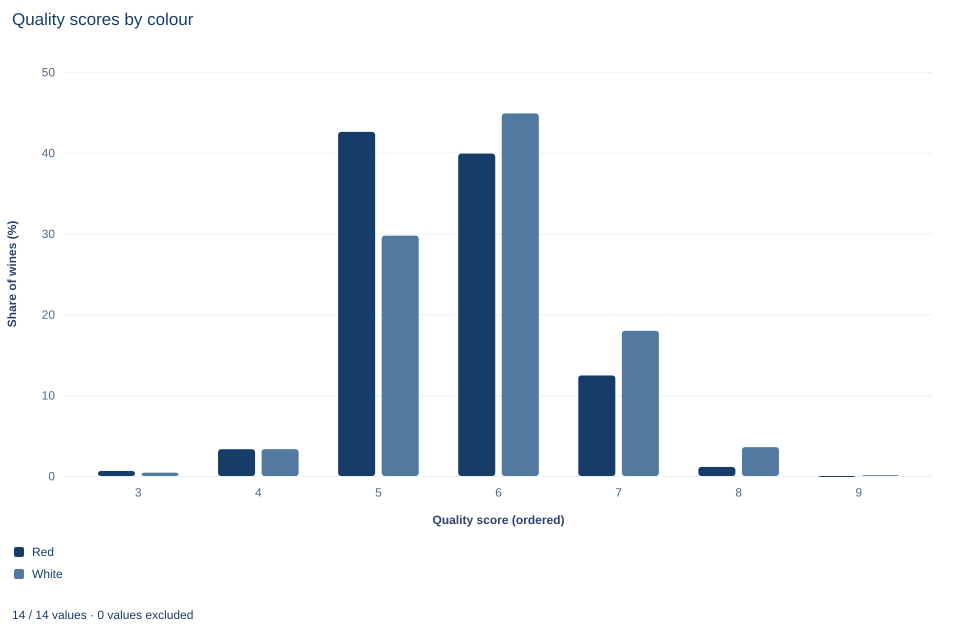

# Lab 18 · Comparing Ordinal Quality Scores

**Rank-sum comparisons, midranks and ties for ordered scores**

## Start with the supplied workbook

1. Download [wine_quality.xlsx](wine_quality.xlsx) and the [Python lab](lab.py). The workbook holds the published wine quality scores used throughout this chapter.
2. Import `wine_quality.xlsx` into OpenEconometrics and keep that file name as the dataset name. The `Data` sheet holds one row per wine; the `Dictionary` sheet explains each column and its coding and gives the source and licence.
3. Open the complete `lab.py` in a new Python document and run the whole file. It reads the imported dataset and displays the rank-sum test output (rank sums by colour and the large-sample tests), a grouped bar chart of the share of red and white wines at each quality score and a table of the reported numbers.

For ordinary Python, keep `lab.py` and the workbook in the same folder and run the script there, or call `from lab import run_lab` and then `run_lab(data_path="/path/to/wine_quality.xlsx")`. To try a recoding of the scores, work on a copy of the loaded table so the distributed workbook stays unchanged.

A wine study scored 1,599 red and 4,898 white Portuguese *vinho verde* wines for quality on a scale from 0 to 10. Do white wines tend to score higher than red ones? Both colours have the same median score, 6, and even the same lower and upper quartiles, 5 and 6. Comparing average scores would quietly assume that the step from 5 to 6 is worth the same as the step from 8 to 9, while a quality score promises only an order. And with seven scores in use for 6,497 wines, ties are everywhere: in a third of all pairs of a red and a white wine, both received the same score.

The rank-sum test, also called the Mann–Whitney or Wilcoxon rank-sum test, uses only the order of the scores. It asks how often a red wine outscores a white wine, with ties counted fairly, and whether that frequency is far from what two identical score distributions would produce. This lab uses **6,497 published wine scores** from the UCI Machine Learning Repository's Wine Quality dataset. The [LaTeX table](table.tex) collects the reported numbers.

## Data source and licence

- **Data:** Cortez, P., Cerdeira, A., Almeida, F., Matos, T., and Reis, J. (2009). *Wine Quality* [Dataset]. UCI Machine Learning Repository. https://doi.org/10.24432/C56S3T
- **Article:** Cortez, P., Cerdeira, A., Almeida, F., Matos, T., and Reis, J. (2009). Modeling wine preferences by data mining from physicochemical properties. *Decision Support Systems*, 47(4), 547–553. https://doi.org/10.1016/j.dss.2009.05.016. The dataset's description asks users to cite this article.
- **Licence:** Creative Commons Attribution 4.0 International (CC BY 4.0), https://creativecommons.org/licenses/by/4.0/. The workbook is an adapted copy; the changes are listed below.
- **Preparation:** the 1,599 rows of the red-wine file are placed above the 4,898 rows of the white-wine file, each in file order and including rows that repeat another row exactly. `wine` numbers the rows in that order, because the source has no identifier; `colour` records which file a row came from. The 11 laboratory measurements in the source are left out.

## 1. Look at what the wines scored

Each row of `Data` is one wine with one quality score. There are no blank cells.

| Column | What it records | Kind of variable |
|---|---|---|
| `wine` | Label from 1 to 6,497: red wines first, then white | Identifier |
| `colour` | `red` or `white` | Nominal group |
| `quality` | Sensory quality score: the median of at least three assessments by wine experts, each grading from 0 (very bad) to 10 (excellent) | Ordinal category stored as an integer |

Counting wines at each score gives the whole data set in one table:

| Score | 3 | 4 | 5 | 6 | 7 | 8 | 9 | Total |
|---|---:|---:|---:|---:|---:|---:|---:|---:|
| Red | 10 | 53 | 681 | 638 | 199 | 18 | 0 | 1,599 |
| White | 20 | 163 | 1,457 | 2,198 | 880 | 175 | 5 | 4,898 |
| Both colours | 30 | 216 | 2,138 | 2,836 | 1,079 | 193 | 5 | 6,497 |

Scores 0–2 and 10 were never given. The two groups differ greatly in size, so compare shares rather than counts: 42.6% of red wines scored 5 against 29.7% of white wines, while 18.0% of white wines scored 7 against 12.4% of red. The whites lean towards the higher scores, but the two distributions overlap heavily.

## 2. Respect the ordinal scale

The quality codes are integers, so software will happily average them. The average treats the codes as distances, as if moving a wine from 8 to 9 were the same improvement as moving one from 4 to 5. Nothing in an expert panel's grade guarantees that. The codes 3 to 9 could just as honestly have been 3, 4, 5, 6, 7, 10, 12, or any other increasing sequence; each version keeps every wine in the same order but gives a different mean.

A rank method sidesteps the problem by using only comparisons: is this score higher than, equal to or lower than that one? Those comparisons are the information an ordinal scale actually contains.

## 3. Count wins across pairs

Pair every red wine with every white wine. That makes $n_R n_W = 1{,}599\times 4{,}898 = 7{,}831{,}902$ cross-colour pairs. In each pair the red wine either wins (higher score), loses or ties. The Mann–Whitney statistic for red counts wins plus half the ties:

$$
U_R=\sum_{i\in R}\sum_{j\in W}\Big[\mathbf 1(x_i>x_j)+\tfrac12\,\mathbf 1(x_i=x_j)\Big],
\qquad
\hat P=\frac{U_R}{n_R n_W}.
$$

Here $x_i$ is a red wine's score, $x_j$ a white wine's score and $\mathbf 1(\cdot)$ equals 1 when its condition holds and 0 otherwise. $\hat P$ estimates the probability that a randomly chosen red wine scores higher than a randomly chosen white wine, with a tie counted as half. If the two colours had identical score distributions, that probability would be exactly 0.5.

**Pause before running.** Why should a tied red/white pair contribute one half, rather than zero or one?

## 4. Get the same count from ranks

Listing almost eight million pairs is slow. Ranks give the same answer. Pool all 6,497 scores, sort them and number them 1 to 6,497. Tied scores share the average of the positions they occupy, called the **midrank**:

| Score | 3 | 4 | 5 | 6 | 7 | 8 | 9 |
|---|---:|---:|---:|---:|---:|---:|---:|
| Wines | 30 | 216 | 2,138 | 2,836 | 1,079 | 193 | 5 |
| Positions occupied | 1–30 | 31–246 | 247–2,384 | 2,385–5,220 | 5,221–6,299 | 6,300–6,492 | 6,493–6,497 |
| Midrank | 15.5 | 138.5 | 1,315.5 | 3,802.5 | 5,760 | 6,396 | 6,495 |

Add up the midranks of the 1,599 red wines, using the counts in Section 1:

$$
W_R=10(15.5)+53(138.5)+681(1{,}315.5)+638(3{,}802.5)+199(5{,}760)+18(6{,}396)=4{,}590{,}714 .
$$

The smallest value $W_R$ could take is $1+2+\dots+1{,}599=n_R(n_R+1)/2=1{,}279{,}200$, reached if every red wine ranked below every white wine. Subtracting that floor gives the pair count:

$$
U_R=W_R-\frac{n_R(n_R+1)}{2}=4{,}590{,}714-1{,}279{,}200=3{,}311{,}514 .
$$

If scores did not depend on colour, each red wine's expected midrank would be the overall average, $(N+1)/2=3{,}249$, so the expected rank sum is $1{,}599\times3{,}249=5{,}195{,}151$. Red's observed 4,590,714 sits well below that.

## 5. Run the test

The complete file loads the workbook with `load_data()` and calls the native rank-sum procedure with large-sample inference:

```python
import openecon as oe

raw = load_data()  # reader defined in the complete lab.py
result = oe.ranksum(raw, "quality", "colour", exact=False)
display(result["ranks"])
display(result["tests"])
print(result.attrs["u1"], result.attrs["porder"])
```

The two tables and the printed attributes read:

| Colour | Wines | Rank sum | Mean rank | Expected rank sum if no difference |
|---|---:|---:|---:|---:|
| red | 1,599 | 4,590,714 | 2,870.99 | 5,195,151 |
| white | 4,898 | 16,518,039 | 3,372.40 | 15,913,602 |

| Test | z | Two-sided p value |
|---|---:|---:|
| Normal approximation, tie-corrected | −9.914 | 3.6 × 10⁻²³ |
| Same, with continuity correction | −9.914 | 3.6 × 10⁻²³ |

The printed line shows $U_R=3{,}311{,}514$ and $\hat P=0.423$. Read the ranks table first: the two rank sums add to $6{,}497\times 6{,}498/2=21{,}108{,}753$, the total of all positions. Red's mean rank, 2,871, is below the middle; white's, 3,372, is above. Then read $\hat P$ on its scale: a random red wine outscores a random white wine, counting ties as half, about 42% of the time. The z statistic and p value say how unusual that departure from 50% would be if the two colours had the same score distribution. The output rounds p values this small to 0.

A direct count from the score table confirms the pair formula from Section 3 without listing every pair:

```python
counts = raw.groupby(["colour", "quality"]).size().unstack(fill_value=0)
red, white = counts.loc["red"], counts.loc["white"]
wins = sum(red[x] * white[y] for x in counts.columns for y in counts.columns if x > y)
ties = sum(red[x] * white[x] for x in counts.columns)
print(wins, ties, wins + 0.5 * ties)
```

It prints 2,020,689 wins and 2,581,650 ties, so $U_R=2{,}020{,}689+0.5\times 2{,}581{,}650=3{,}311{,}514$. The ties are 33.0% of all 7,831,902 pairs.

## 6. From U to a p value, with ties

Under the null hypothesis that red and white scores come from the same distribution, $U_R$ has mean $n_Rn_W/2=3{,}915{,}951$. Its variance must account for ties, because tied scores shrink the spread of possible rank sums:

$$
\operatorname{Var}(U_R)=\frac{n_Rn_W}{12}\left[(N+1)-\frac{\sum_k (t_k^3-t_k)}{N(N-1)}\right].
$$

Here $N=6{,}497$ and $t_k$ is the number of wines tied at score $k$, the counts 30, 216, 2,138, 2,836, 1,079, 193 and 5. The two large ties at scores 5 and 6 contribute most of the correction. With these ties the variance is $3.717\times10^9$, so the standard deviation of $U_R$ is about 60,971 and

$$
z=\frac{U_R-n_Rn_W/2}{\sqrt{\operatorname{Var}(U_R)}}=\frac{3{,}311{,}514-3{,}915{,}951}{60{,}971}=-9.91 .
$$

The two-sided p value from the standard normal distribution is $3.6\times10^{-23}$. A continuity correction, which moves $U_R$ half a unit toward its mean, changes z only in the sixth significant digit when $U$ is in the millions, but a report should still say which convention it used. The lab uses no continuity correction.

Why not an exact test? The standard exact distribution of $U$ assumes no ties. With a third of the pairs tied it describes the wrong reference distribution, and with thousands of wines per group the tie-corrected normal approximation is very accurate. The lab therefore sets `exact=False`.

## 7. Read the bar chart



The chart shows, for each score, the percentage of red wines and of white wines that received it, side by side. Shares rather than counts make the two colours comparable despite their different sizes. Red wines peak at 5 (42.6%) with 6 close behind (39.9%); white wines peak at 6 (44.9%). Above 6 the white bars are taller: 18.0% against 12.4% at 7 and 3.6% against 1.1% at 8, and only white wines reached 9. That shift towards higher scores is what $\hat P=0.423$ summarizes.

The chart also shows why ties dominate this lab. More than three wines in four scored 5 or 6, so many red/white pairs land in the same category. The bars sit at equal horizontal intervals because the categories are drawn in order, not because the scale has equal steps; do not read the spacing as evidence that the distance from 5 to 6 equals the distance from 8 to 9.

## A case from the literature

This file is a direct example of the point made by Divine et al. (2018): the Wilcoxon–Mann–Whitney procedure fails as a test of medians, and requiring continuous data is a misconception. What it tests is the probability that one group's value exceeds the other's plus half the probability of a tie, the quantity this lab estimates. Here the medians are equal, and so are both quartiles, yet the rank-sum test rejects decisively, because the whites place more of their mass at 7 and above. Mann and Whitney (1947) framed the test as asking whether one of two random variables is stochastically larger than the other, and Fay and Proschan (2010) collect the sets of assumptions under which the same decision rule can be interpreted.

Ordinal scales raise a further problem in published research. Happiness surveys ask people to choose an ordered answer such as very, pretty or not too happy, and Bond and Lang (2019) asked when such answers can show which of two groups is happier on average. Applying standard statistical results, they found that the conditions for ranking two groups without assuming a particular scale are strong and unlikely ever to hold. Standard parametric approaches cannot identify the ranking unless the groups' variances are exactly equal; otherwise, ordered probit findings can be reversed by lognormal transformations. For nine prominent areas of happiness research, they rejected the conditions for nonparametric identification and reversed standard parametric results with plausible transformations. The rank-sum statistic avoids that problem, because any increasing recoding of the scores leaves it unchanged. The price is a narrower question: it compares the two colours' scores pair by pair rather than their averages.

## 8. Decide what the evidence supports

The rank-sum comparison supports a statement about these 6,497 wines: red wines' scores tend to fall below white wines' scores. A random red wine outscores a random white wine, counting ties as half, with estimated probability 0.423, and a departure that large from 0.5 would almost never arise from two identical distributions with this many wines (p = $3.6\times10^{-23}$).

The p value is tiny mostly because the samples are large. The native output's effect size $r=z/\sqrt{N}=-0.12$ and $\hat P=0.423$ both describe a modest shift: the colours share their medians and quartiles, and most pairs are ties or narrow wins either way. A report should lead with $\hat P$ and the score shares, not with the p value.

The test is not a comparison of medians; the medians are equal here. It responds to any difference that makes one colour's scores tend to rank higher. Nor is the comparison a causal one. Red and white wines are made differently and were assessed as two separate datasets; nothing was randomized, and the scores are medians of expert panels for wines from one Portuguese region, not consumer ratings. Finally, the file contains rows that exactly repeat another row (240 red and 937 white); they are kept as published, because the source does not say whether they are distinct wines.

## 9. Write the conclusion in full

A complete statement for the worked example reads: "Among 1,599 red and 4,898 white vinho verde wines scored by expert panels on a 0–10 scale, a random red wine scored higher than a random white wine with estimated probability 0.423, counting tied scores as half ($U_R=3{,}311{,}514$ of 7,831,902 pairs; 33.0% of pairs tied). A tie-corrected Mann–Whitney test without continuity correction rejects equal score distributions (z = −9.91, two-sided p < 0.001). Both colours have median score 6; the difference is a modest shift of white wines towards scores of 7 and above, not a difference in medians, and it is not a causal comparison."

The statement names the sample, the effect scale, the treatment of ties and the inference convention before drawing a conclusion, and it keeps the effect size in front of the p value.

## Student exercises

1. Find the median and both quartiles of the scores for each colour from the count table in Section 1. Explain how equal medians and quartiles can coexist with $\hat P\neq 0.5$, and why the rank-sum test should not be described as a median test here.
2. Use white's rank sum from the ranks table to compute $U_W$. Check that $U_R+U_W=n_Rn_W$, and state the estimated probability that a random white wine outscores a random red wine, counting ties as half.
3. Compute the variance of $U_R$ without the tie correction, $n_Rn_W(N+1)/12$, and the resulting z and two-sided p value. Which way does the tie correction move z, and why?
4. Suppose a colleague scored every tied pair as a loss for red instead of half a win. Using the direct count from Section 5, compute the probability they would report, and the one they would get by scoring ties as wins for red. Explain why one half is the right weight.
5. On a copy of the data, recode 8 as 10 and 9 as 12, keeping every other code. Compare the difference in mean scores (white minus red) before and after the recode, and rerun `oe.ranksum` on the copy. Explain which result changed and why.
6. A reader says: "Both colours have a median score of 6, so the significant rank-sum test must be a mistake." Explain what the test detected, and rewrite the conclusion so that it states the effect size before the p value.

## Further reading

- Bond, T. N., and Lang, K. (2019). The sad truth about happiness scales. *Journal of Political Economy*, 127(4), 1629–1640. https://doi.org/10.1086/701679
- Cortez, P., Cerdeira, A., Almeida, F., Matos, T., and Reis, J. (2009). Modeling wine preferences by data mining from physicochemical properties. *Decision Support Systems*, 47(4), 547–553. https://doi.org/10.1016/j.dss.2009.05.016
- Divine, G. W., Norton, H. J., Barón, A. E., and Juarez-Colunga, E. (2018). The Wilcoxon–Mann–Whitney procedure fails as a test of medians. *The American Statistician*, 72(3), 278–286. https://doi.org/10.1080/00031305.2017.1305291
- Fay, M. P., and Proschan, M. A. (2010). Wilcoxon-Mann-Whitney or t-test? On assumptions for hypothesis tests and multiple interpretations of decision rules. *Statistics Surveys*, 4, 1–39. https://doi.org/10.1214/09-SS051
- Mann, H. B., and Whitney, D. R. (1947). On a test of whether one of two random variables is stochastically larger than the other. *The Annals of Mathematical Statistics*, 18(1), 50–60. https://doi.org/10.1214/aoms/1177730491
