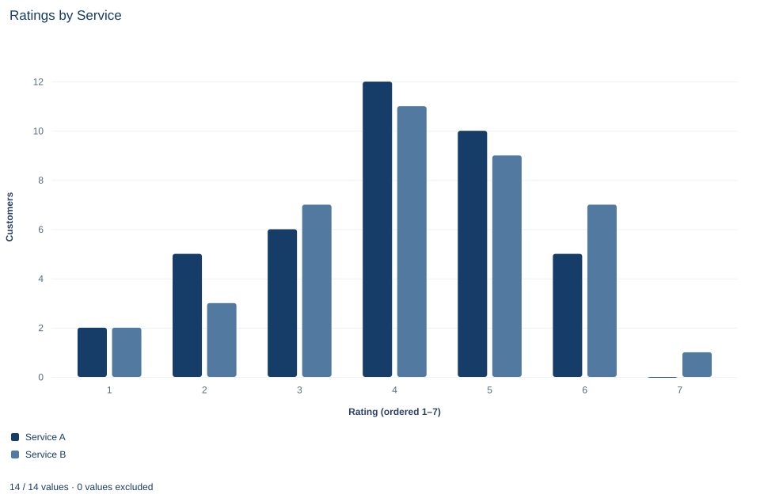

# Lab 18 · Comparing Ordinal Customer Ratings

**Rank-sum comparisons, midranks and ties for ordered ratings**

## Start with the supplied workbook

1. Download [customer_ratings.xlsx](customer_ratings.xlsx) and the [Python lab](lab.py). The workbook holds the fixed customer ratings used throughout this chapter.
2. Import `customer_ratings.xlsx` into OpenEconometrics and keep that file name as the dataset name. The `Data` sheet holds one row per customer; the `Dictionary` sheet explains each column and its coding.
3. Open the complete `lab.py` in a new Python document and run the whole file. It reads the imported dataset and displays the rank-sum test output (rank sums by service and the large-sample tests), a grouped bar chart of how many customers of each service chose each rating and a table of the reported numbers.

For ordinary Python, keep `lab.py` and the workbook in the same folder and run the script there, or call `from lab import run_lab` and then `run_lab(data_path="/path/to/customer_ratings.xlsx")`. To try a recoding of the ratings, work on a copy of the loaded table so the distributed workbook stays unchanged.

Forty customers of service A and forty of service B each rated their satisfaction on a scale from 1 to 7. Do customers of one service tend to give higher ratings? The usual first move, comparing average ratings, quietly assumes that the step from 2 to 3 is worth the same as the step from 6 to 7. A satisfaction scale promises only an order. And with seven possible answers for 80 customers, ties are everywhere: in almost one of every five pairs of an A customer and a B customer, both gave the same rating.

The rank-sum test, also called the Mann–Whitney or Wilcoxon rank-sum test, uses only the order of the ratings. It asks how often an A rating beats a B rating, with ties counted fairly, and whether that frequency is far from what two identical rating distributions would produce.

This lab uses **80 original synthetic customer ratings**, one per customer, on an ordered 1–7 scale. They are teaching records, not a survey of real customers. The [LaTeX table](table.tex) collects the reported numbers.

## 1. Look at what the customers answered

Each row of `Data` is one customer who used one service and gave one rating. There are no blank cells.

| Column | What it records | Kind of variable |
|---|---|---|
| `customer_id` | Label from 1 to 80 | Identifier |
| `service` | Service the customer used: A (odd identifiers) or B (even identifiers) | Nominal group |
| `rating` | Satisfaction response, 1 (lowest) to 7 (highest) | Ordinal category stored as an integer |

Counting customers at each rating gives the whole data set in one table:

| Rating | 1 | 2 | 3 | 4 | 5 | 6 | 7 | Total |
|---|---:|---:|---:|---:|---:|---:|---:|---:|
| Service A | 2 | 5 | 6 | 12 | 10 | 5 | 0 | 40 |
| Service B | 2 | 3 | 7 | 11 | 9 | 7 | 1 | 40 |
| Both services | 4 | 8 | 13 | 23 | 19 | 12 | 1 | 80 |

The two rows look similar. B has slightly fewer customers at 2 and slightly more at 6 and 7, but the differences are one or two customers per category.

## 2. Respect the ordinal scale

The rating codes are integers, so software will happily average them. The average treats the codes as distances, as if moving a customer from 6 to 7 were the same improvement as moving one from 1 to 2. Nothing in a satisfaction question guarantees that. The codes 1 to 7 could just as honestly have been 1, 2, 3, 4, 5, 6, 10, or any other increasing sequence; each version keeps every customer in the same order but gives a different mean.

A rank method sidesteps the problem by using only comparisons: is this rating higher than, equal to or lower than that one? Those comparisons are the information an ordinal scale actually contains.

## 3. Count wins across pairs

Pair every A customer with every B customer. That makes $n_A n_B = 40\times 40 = 1600$ cross-service pairs. In each pair, A either wins (higher rating), loses or ties. The Mann–Whitney statistic for A counts wins plus half the ties:

$$
U_A=\sum_{i\in A}\sum_{j\in B}\Big[\mathbf 1(x_i>x_j)+\tfrac12\,\mathbf 1(x_i=x_j)\Big],
\qquad
\hat P=\frac{U_A}{n_A n_B}.
$$

Here $x_i$ is a rating from service A, $x_j$ a rating from service B and $\mathbf 1(\cdot)$ equals 1 when its condition holds and 0 otherwise. $\hat P$ estimates the probability that a randomly chosen A customer rates higher than a randomly chosen B customer, with a tie counted as half. If the two services had identical rating distributions, that probability would be exactly 0.5.

**Pause before running.** Why should a tied A/B pair contribute one half, rather than zero or one?

## 4. Get the same count from ranks

Counting 1,600 pairs by hand is slow. Ranks give the same answer. Pool all 80 ratings, sort them and number them 1 to 80. Tied ratings share the average of the positions they occupy, called the **midrank**:

| Rating | 1 | 2 | 3 | 4 | 5 | 6 | 7 |
|---|---:|---:|---:|---:|---:|---:|---:|
| Customers | 4 | 8 | 13 | 23 | 19 | 12 | 1 |
| Positions occupied | 1–4 | 5–12 | 13–25 | 26–48 | 49–67 | 68–79 | 80 |
| Midrank | 2.5 | 8.5 | 19 | 37 | 58 | 73.5 | 80 |

Add up the midranks of the 40 A customers, using the counts in Section 1:

$$
W_A=2(2.5)+5(8.5)+6(19)+12(37)+10(58)+5(73.5)+0(80)=1553 .
$$

The smallest value $W_A$ could take is $1+2+\dots+40=n_A(n_A+1)/2=820$, reached if every A customer ranked below every B customer. Subtracting that floor gives the pair count:

$$
U_A=W_A-\frac{n_A(n_A+1)}{2}=1553-820=733 .
$$

If ratings did not depend on service, each A customer's expected midrank would be the overall average, $(N+1)/2=40.5$, so the expected rank sum is $40\times 40.5=1620$. A's observed 1,553 sits below that.

## 5. Run the test

The complete file loads the workbook with `load_data()` and calls the native rank-sum procedure with large-sample inference:

```python
import openecon as oe

raw = load_data()  # reader defined in the complete lab.py
result = oe.ranksum(raw, "rating", "service", exact=False)
display(result["ranks"])
display(result["tests"])
print(result.attrs["u1"], result.attrs["porder"])
```

The two tables and the printed attributes read:

| Service | Customers | Rank sum | Mean rank | Expected rank sum if no difference |
|---|---:|---:|---:|---:|
| A | 40 | 1,553 | 38.83 | 1,620 |
| B | 40 | 1,687 | 42.18 | 1,620 |

| Test | z | Two-sided p value |
|---|---:|---:|
| Normal approximation, tie-corrected | −0.660 | 0.509 |
| Same, with continuity correction | −0.655 | 0.512 |

The printed line shows $U_A=733$ and $\hat P=0.458$. Read the ranks table first: both services have 40 customers and the two rank sums add to $80\times 81/2=3240$, the total of all positions. A's mean rank, 38.83, is a little below the middle; B's, 42.18, a little above. Then read $\hat P$ on its scale: a random A customer outrates a random B customer, counting ties as half, about 46% of the time. The z statistic and p value say how unusual that departure from 50% would be if the two services had the same rating distribution.

A direct count confirms the pair formula from Section 3:

```python
a = raw.loc[raw.service == "A", "rating"].tolist()
b = raw.loc[raw.service == "B", "rating"].tolist()
wins = sum(x > y for x in a for y in b)
ties = sum(x == y for x in a for y in b)
print(wins, ties, wins + 0.5 * ties)
```

It prints 574 wins and 318 ties, so $U_A=574+0.5\times 318=733$. The 318 ties are 19.9% of all 1,600 pairs.

## 6. From U to a p value, with ties

Under the null hypothesis that A and B ratings come from the same distribution, $U_A$ has mean $n_An_B/2=800$. Its variance must account for ties, because tied ratings shrink the spread of possible rank sums:

$$
\operatorname{Var}(U_A)=\frac{n_An_B}{12}\left[(N+1)-\frac{\sum_k (t_k^3-t_k)}{N(N-1)}\right].
$$

Here $N=80$ and $t_k$ is the number of customers tied at rating $k$, the counts 4, 8, 13, 23, 19, 12 and 1. The large tie at rating 4 contributes most of the correction. With these ties the variance is 10,305.3, so the standard deviation of $U_A$ is about 101.5 and

$$
z=\frac{U_A-n_An_B/2}{\sqrt{\operatorname{Var}(U_A)}}=\frac{733-800}{101.5}=-0.66 .
$$

The two-sided p value from the standard normal distribution is 0.509. A continuity correction, which moves $U_A$ half a unit toward its mean, changes z to −0.655 and p to 0.512, so the convention hardly matters here, but a report should still say which one it used. The lab uses no continuity correction.

Why not an exact test? The standard exact distribution of $U$ assumes no ties. With a fifth of the pairs tied, it describes the wrong reference distribution, so the lab sets `exact=False` and relies on the tie-corrected normal approximation, which is reasonable with 40 customers per service.

## 7. Read the bar chart



The chart counts customers at each rating separately for the two services, side by side. Service A's counts for ratings 1 through 7 are 2, 5, 6, 12, 10, 5 and 0; service B's are 2, 3, 7, 11, 9, 7 and 1. The two distributions overlap almost completely: both peak at 4. B has slightly more customers at 6 and 7 and A slightly more at 2, which is why $\hat P$ is a little below one half, at 0.458; a gap that small is well within chance, as the p value of 0.51 says.

The chart also shows why ties dominate this lab. More than two customers in three rated 3, 4 or 5, and only one customer chose 7. With answers that concentrated, many A/B pairs land in the same category, which is why the tie correction and the half-credit rule matter here.

The bars sit at equal horizontal intervals because the categories are drawn in order, not because the scale has equal steps. Do not read the spacing as evidence that the distance from 4 to 5 equals the distance from 6 to 7.

## A case from the literature

Happiness surveys ask people to choose an ordered answer such as very, pretty or not too happy. Bond and Lang (2019) asked when such answers can show which of two groups is happier on average. Applying standard statistical results, they found that the conditions for ranking two groups without assuming a particular scale are strong and unlikely ever to hold. Standard parametric approaches cannot identify the ranking unless the groups' variances are exactly equal; otherwise, ordered probit findings can be reversed by lognormal transformations. For nine prominent areas of happiness research, they rejected the conditions for nonparametric identification and reversed standard parametric results with plausible transformations.

This is the problem of Section 2 in published research: when the distances between categories are unknown, a conclusion about which group is higher on average can depend on an arbitrary choice of scale. The rank-sum statistic uses only the order of the answers, so any increasing recoding leaves it unchanged. The price is a narrower question. Mann and Whitney (1947) framed the test as asking whether one of two random variables is stochastically larger than the other. Divine et al. (2018) showed that the procedure fails as a test of medians and that requiring continuous data is a misconception; what it tests is the probability that one group's value exceeds the other's plus half the probability of a tie, the quantity this lab estimates. Fay and Proschan (2010) collect the sets of assumptions under which the same decision rule can be interpreted.

## 8. Decide what the evidence supports

The rank-sum comparison supports a narrow statement about these 80 synthetic customers: service A ratings tend to fall slightly below service B ratings, with $\hat P=0.458$, but the departure from 0.5 is well within what two identical distributions would often produce (p = 0.509). The native output's effect size $r=z/\sqrt{N}=-0.074$ says the same: the ordering of A relative to B is very weak.

Failing to reject is not evidence that the services are rated identically. Forty customers per service leave room for a real difference of moderate size to go undetected. The test is also not automatically a comparison of medians. It responds to any difference that makes one service's ratings tend to rank higher, whether in location, spread or shape. Reading it as a median test needs an extra assumption that the two distributions have the same shape, which tied ordinal data rarely justify.

Finally, a difference in ratings would not by itself show that a service causes higher satisfaction. Customers may have chosen their service, and the kinds of customers who choose each one may rate differently.

## 9. Write the conclusion in full

A complete statement for the worked example reads: "Among 80 synthetic customers, 40 per service, a random service A customer rated higher than a random service B customer with estimated probability 0.458, counting tied ratings as half ($U_A=733$ of 1,600 pairs; 19.9% of pairs tied). A tie-corrected Mann–Whitney test without continuity correction does not reject equal rating distributions (z = −0.66, two-sided p = 0.51). The data do not show that either service is rated higher, and they do not establish that the services are rated the same."

The statement names the sample, the effect scale, the treatment of ties and the inference convention before drawing a conclusion, and it does not turn non-rejection into a claim of equality.

## Student exercises

1. Find the median rating for each service from the count table in Section 1. Explain how equal medians can coexist with $\hat P\neq 0.5$, and why the rank-sum test should not be described as a median test here.
2. Use B's rank sum from the ranks table to compute $U_B$. Check that $U_A+U_B=n_An_B$, and state the estimated probability that a random B customer outrates a random A customer, counting ties as half.
3. Compute the variance of $U_A$ without the tie correction, $n_An_B(N+1)/12$, and the resulting z and two-sided p value. Which way does the tie correction move z, and why?
4. Suppose a colleague scored every tied pair as a loss for A instead of half a win. Using the direct count from Section 5, compute the probability they would report, and the one they would get by scoring ties as wins for A. Explain why one half is the right weight.
5. On a copy of the data, recode rating 7 as 10, keeping every other code. Compare the difference in mean ratings (B minus A) before and after the recode, and rerun `oe.ranksum` on the copy. Explain which result changed and why.
6. Rewrite this sentence so that it matches the analysis: "Services A and B are rated the same (p = 0.51)."

## Further reading

- Bond, T. N., and Lang, K. (2019). The sad truth about happiness scales. *Journal of Political Economy*, 127(4), 1629–1640. https://doi.org/10.1086/701679
- Divine, G. W., Norton, H. J., Barón, A. E., and Juarez-Colunga, E. (2018). The Wilcoxon–Mann–Whitney procedure fails as a test of medians. *The American Statistician*, 72(3), 278–286. https://doi.org/10.1080/00031305.2017.1305291
- Fay, M. P., and Proschan, M. A. (2010). Wilcoxon-Mann-Whitney or t-test? On assumptions for hypothesis tests and multiple interpretations of decision rules. *Statistics Surveys*, 4, 1–39. https://doi.org/10.1214/09-SS051
- Mann, H. B., and Whitney, D. R. (1947). On a test of whether one of two random variables is stochastically larger than the other. *The Annals of Mathematical Statistics*, 18(1), 50–60. https://doi.org/10.1214/aoms/1177730491
