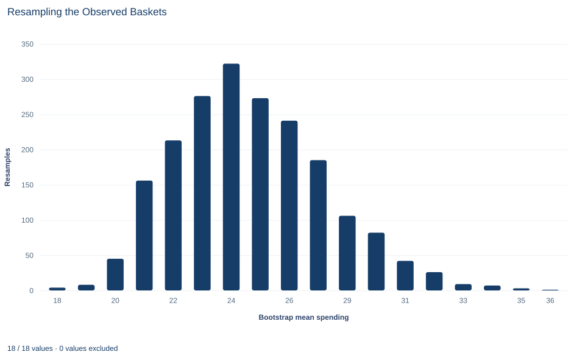

# Lab 19 · Resampling the Observed Baskets

**The nonparametric bootstrap for the standard error and interval of a mean**

## Start with the supplied workbook

1. Download [bootstrap_baskets.xlsx](bootstrap_baskets.xlsx) and the [Python lab](lab.py). The workbook holds the fixed basket records used throughout this chapter.
2. Import `bootstrap_baskets.xlsx` into OpenEconometrics and keep that file name as the dataset name. The `Data` sheet holds one row per shopping basket; the `Dictionary` sheet explains each column and its unit.
3. Open the complete `lab.py` in a new Python document and run the whole file. It reads the imported dataset, resamples the baskets 1,999 times and displays the one-sample t output that supplies the comparison interval, a histogram of the 1,999 resampled means and a table of the reported numbers.

For ordinary Python, keep `lab.py` and the workbook in the same folder and run the script there, or call `from lab import run_lab` and then `run_lab(data_path="/path/to/bootstrap_baskets.xlsx")`. If you want to drop or change a basket, work on a copy of the loaded table so the distributed workbook stays unchanged.

Ninety shopping baskets have a mean value of 24.93 currency units. How precise is that mean? The usual answer divides the standard deviation by $\sqrt n$ and builds a symmetric interval from the $t$ distribution. That recipe leans on the sampling distribution of the mean being close to normal. These baskets make the assumption worth checking: half of them are below 17.74, the standard deviation of 27.61 is larger than the mean itself, and one basket alone is worth 229.88, more than twice the next largest.

The bootstrap takes a different route. Instead of assuming a shape for the sampling distribution, it imitates the act of sampling, using the 90 observed baskets as a stand-in for the population they came from. This lab builds that imitation step by step and compares its standard error and interval with the familiar $t$ results.

This lab uses **90 original synthetic shopping baskets**, with spending in a hypothetical currency per basket. They are teaching records, not a retailer's transactions. The [LaTeX table](table.tex) collects the reported numbers.

## 1. Look at the baskets

Each row of `Data` is one shopping basket. There are two columns and no blank cells.

| Column | What it records | Kind of variable |
|---|---|---|
| `basket_id` | Label from 1 to 90 | Identifier |
| `spending` | Total value of the basket, hypothetical currency per basket | Measured quantity, always positive |

Spending is strongly right-skewed. The smallest basket is 3.65 and the median is 17.74, so a typical basket is well below the mean of 24.93; only 28 of the 90 baskets exceed the mean. A long upper tail pulls the mean up, and its extreme is basket 7 at 229.88. The next largest baskets are 90.34 and 80.83.

With 90 observations the central limit theorem pushes the sampling distribution of the mean toward normal, but a heavy tail slows that push. The bootstrap lets us look at that distribution rather than assume it.

## 2. State the target: the standard error of the mean

Imagine drawing many samples of 90 baskets from the same population and computing the mean of each. Those means would vary. Their standard deviation is the **standard error** of the mean, $\sigma/\sqrt n$, where $\sigma$ is the population standard deviation of basket spending and $n=90$.

We see only one sample, so the usual estimate replaces $\sigma$ with the sample standard deviation $s$:

$$
\widehat{SE}_t=\frac{s}{\sqrt n}=\frac{27.61}{\sqrt{90}}=2.91 .
$$

The 95% $t$ interval is then $\bar x\pm t_{0.975,\,89}\,\widehat{SE}_t=24.93\pm 1.987\times 2.91$, which gives 19.14 to 30.71. It is symmetric around the mean by construction: whatever the data look like, it reaches the same distance up and down.

## 3. Resample the observed baskets

The bootstrap rests on the **plug-in principle**: the population is unknown, but the sample is our best picture of it. The **empirical distribution** puts probability $1/n$ on each observed basket, so drawing from it means picking one of the 90 baskets at random.

One bootstrap replication draws $n=90$ baskets from the empirical distribution *with replacement* and records their mean:

$$
\bar x_b^{*}=\frac1n\sum_{i=1}^{n}x_{I_{bi}},
\qquad I_{bi}\ \text{uniform on}\ \{1,\dots,n\},\qquad b=1,\dots,B .
$$

Here $x_j$ is the spending of basket $j$, $I_{bi}$ is the $i$th randomly chosen basket number in replication $b$, and $B=1999$ is the number of replications. The spread of the $B$ resampled means estimates the spread of the sample mean across real samples.

**Pause before running.** Would sampling 90 baskets *without* replacement from these 90 observations generate useful variation in the mean?

Replacement is what makes each resample different. A basket can be picked twice or more, and others are left out. With $n=90$, each basket has probability $1-(1-1/90)^{90}=0.634$ of appearing at least once, so a typical resample contains about 57 distinct baskets, some repeated. Resample whole baskets: the row is the sampling unit, so if the file had several columns per basket, a draw would take all of them together.

## 4. Know what the bootstrap is estimating

For the mean, the bootstrap target has an exact formula. The empirical distribution's variance uses denominator $n$ rather than $n-1$, so the standard deviation of $\bar x^{*}$ across *all possible* resamples is

$$
SE_{\text{emp}}=\sqrt{\frac{n-1}{n}}\;\frac{s}{\sqrt n}=0.9944\times 2.910=2.894 .
$$

That is the ideal bootstrap standard error, the answer infinitely many replications would give; the lab's 1,999 replications approximate it by simulation. It runs slightly below $s/\sqrt n$ because it treats the 90 baskets as the whole population. Most statistics, such as a median or a regression coefficient, have no such formula, which is why the bootstrap is useful. The mean is a good place to learn it because the answer can be checked.

## 5. Run the resampling

The complete file runs the resampling inside `analyze`. The core steps are:

```python
import math
import torch

raw = load_data()  # reader defined in the complete lab.py
spending = torch.tensor(raw.spending.tolist(), dtype=torch.float64)
generator = torch.Generator().manual_seed(991019)
indices = torch.randint(len(spending), (1999, len(spending)), generator=generator)
boot_means = spending[indices].mean(1)
limits = torch.quantile(boot_means, torch.tensor([0.025, 0.975], dtype=torch.float64))
exact_se = spending.std(correction=0).item() / math.sqrt(len(spending))
print(boot_means.mean().item(), boot_means.std().item(), exact_se, limits.tolist())
```

Each row of `indices` is one resample: 90 basket positions drawn with replacement. The fixed seed makes every run produce the same 1,999 resamples, and `torch.quantile` uses linear interpolation between ordered values. The results, alongside the $t$ quantities from Section 2, are:

| Quantity | Value (currency per basket) |
|---|---:|
| Sample mean of the 90 baskets | 24.93 |
| Mean of the 1,999 bootstrap means | 24.89 |
| Bootstrap standard error (standard deviation of the bootstrap means) | 2.865 |
| Exact empirical-distribution standard error | 2.894 |
| Standard error $s/\sqrt n$ used by the t interval | 2.910 |
| 95% percentile interval | 20.25 to 31.17 |
| 95% t interval | 19.14 to 30.71 |

Read the standard errors first. All three measure the same thing, the typical distance between a sample mean and the population mean, and they agree to within about 2%. The bootstrap estimate of 2.865 sits a little below its exact target of 2.894 only because 1,999 replications are finite. The mean of the bootstrap means, 24.89, likewise differs from 24.93 by simulation noise; in expectation over resamples it equals the sample mean exactly.

## 6. Compare the percentile and t intervals

The **percentile interval** takes the 2.5th and 97.5th percentiles of the 1,999 bootstrap means as its limits: 20.25 to 31.17. It makes no symmetry assumption. If resampled means stretch further above the sample mean than below it, so does the interval.

Compare the two intervals. The $t$ interval runs from 19.14 to 30.71. The percentile interval is shifted upward at both ends and is slightly narrower. The shift is the skewness of the baskets showing through: resamples that happen to include basket 7 once or twice produce high means, while no basket is small enough to drag a resample mean far down.

The $t$ interval comes from the native one-sample procedure, which the complete file also runs:

```python
summary, native, panels, checks, models = analyze(raw)
display(native["statistics"])
```

That table reports the 90 baskets, their mean and standard deviation, the standard error 2.91 and the interval limits. The same output also contains a test of whether mean spending equals zero. Ignore it: no one doubts that baskets cost something, and the lab runs the procedure only for its interval.

Neither interval is guaranteed to be right. Percentile intervals can undercover in small samples or when the statistic is biased, and refinements such as the bias-corrected and accelerated interval exist for that reason. What the comparison shows is that the symmetric $t$ recipe and the data-driven percentile recipe disagree by 1.10 currency units at the lower limit and 0.46 at the upper limit, a useful warning that skewness affects this mean's uncertainty.

## 7. Separate sampling variation from simulation noise

Two different kinds of randomness are present, and they should not be confused.

- **Sampling variation** comes from the fact that these 90 baskets are one sample of many possible ones. The standard error measures it. Only new data can reduce it.
- **Monte Carlo variation** comes from using 1,999 random resamples instead of all possible ones. It makes the bootstrap estimate wobble around $SE_{\text{emp}}$. More replications reduce it, and a different seed gives a different wobble.

The lab fixes the seed at 991019 and the count at 1,999 so every student sees the same resamples. Changing the seed changes the bootstrap standard error and percentile limits slightly. Changing the baskets changes what is being estimated.

## 8. Read the histogram



The histogram counts resamples, not baskets. Each of its 18 bars covers about 1.1 currency units of *resampled mean* spending, and the bar heights add up to 1,999. The resampled means run from about 17 to about 37, with the tallest bar, 322 resamples, just below the sample mean of 24.93.

The shape is the point. The left side falls off quickly, while the right side trails off over a longer distance, with 20 resamples above about 32.4. That right skew is the sampling distribution of the mean inheriting the skew of the baskets, much weaker than the skew in the raw data but still visible. A normal curve centered at 24.93 would put equal tails on both sides; the percentile interval in Section 6 follows the histogram instead.

Do not read it as a picture of basket values: its spread, about 2.9, is far narrower than the baskets' own spread of about 27.6.

## A case from the literature

Barber and Thompson (2000) faced this lab's problem with medical costs. Randomized trials increasingly collect cost data, and the authors argue that health-policy decisions need the arithmetic mean cost, because the mean reflects the total cost of treating all patients with the disease. Cost data are often highly skewed, yet for this reason they judge standard non-parametric methods and normalizing transformations inappropriate, and they note that standard parametric methods for means may be robust to non-normality for some data sets but are not guaranteed to be. They showed how the non-parametric bootstrap can compare mean costs between randomized groups, applied several bootstrap tests and intervals to cost data from two randomized trials, and preferred the bootstrap-t, its variance-stabilized version and the bias-corrected and accelerated percentile method. They concluded that such methods can serve as a check on standard parametric results or as the primary analysis for moderately sized samples of highly skewed data.

The baskets in this lab share those features: strong right skew, a mean that matters because totals matter, and uncertainty that stretches further above the estimate than below it. One of the study's preferred intervals, the bias-corrected and accelerated method, is the refinement mentioned in Section 6; Efron (1987) presented bootstrap intervals that build in bias and transformation corrections automatically. The bootstrap itself was introduced by Efron (1979), and Efron and Tibshirani (1986) review bootstrap standard errors and confidence intervals.

## 9. Decide what the evidence supports

The bootstrap supports a statement about the precision of the mean of these 90 synthetic baskets, *if* they behave like independent draws from the population of interest. Under that model, the mean is known to within a standard error of about 2.9 currency units, and the uncertainty is somewhat larger above the estimate than below it.

It cannot do more than the sample allows. Resampling can only recombine observed baskets, so it cannot produce a basket larger than 229.88 or represent rare, very large purchases that this sample happened to miss. One basket has a large influence on both the mean and the upper bootstrap tail. If the baskets were chosen in a biased way, for example only on weekdays, every resample would inherit the same bias. If baskets were dependent, for example several from the same household, resampling single baskets would understate the uncertainty; the resampling unit must match how the data were collected.

## 10. Write the conclusion in full

A complete statement for the worked example reads: "In 90 synthetic shopping baskets, mean spending is 24.93 currency units per basket (median 17.74; the distribution is strongly right-skewed). Resampling the baskets with replacement 1,999 times gives a bootstrap standard error of 2.87, close to the exact empirical-distribution value of 2.89, and a 95% percentile interval of 20.25 to 31.17. The conventional t interval is 19.14 to 30.71. Both treat the baskets as independent draws; neither can account for large purchases the sample did not observe."

It names the sample, the resampling scheme, both intervals and their shared assumptions, rather than presenting one interval as the only possible answer.

## Student exercises

1. Using the `indices` tensor from Section 5, count how many distinct baskets appear in the first resample and how many times its most repeated basket appears. Compare the distinct count with the expected share from Section 3.
2. Compute the Monte Carlo standard error of the bootstrap mean, $SE_{\text{emp}}/\sqrt B$. Use it to judge whether the gap between 24.89 and 24.93 should worry you.
3. Rerun the resampling with seed 1 instead of 991019, keeping 1,999 replications. Report the new bootstrap standard error and percentile limits, and explain which kind of variation the change shows.
4. Compute the distance from the sample mean to each limit of the percentile interval and the ratio of the upper distance to the lower one. Do the same for the t interval, and connect the difference to the baskets.
5. On a copy of the data, remove basket 7 and rerun the resampling with the same seed and count. Report the new mean, bootstrap standard error and percentile interval, and explain what the change says about how the bootstrap depends on extreme observations.
6. Rewrite this sentence so that it matches the analysis: "The bootstrap proves there is a 95% probability that the true mean basket is between 20.25 and 31.17."

## Further reading

- Barber, J. A., and Thompson, S. G. (2000). Analysis of cost data in randomized trials: An application of the non-parametric bootstrap. *Statistics in Medicine*, 19(23), 3219–3236. https://doi.org/10.1002/1097-0258(20001215)19:23%3C3219::AID-SIM623%3E3.0.CO;2-P
- Efron, B. (1979). Bootstrap methods: Another look at the jackknife. *The Annals of Statistics*, 7(1), 1–26. https://doi.org/10.1214/aos/1176344552
- Efron, B. (1987). Better bootstrap confidence intervals. *Journal of the American Statistical Association*, 82(397), 171–185. https://doi.org/10.1080/01621459.1987.10478410
- Efron, B., and Tibshirani, R. (1986). Bootstrap methods for standard errors, confidence intervals, and other measures of statistical accuracy. *Statistical Science*, 1(1), 54–75. https://doi.org/10.1214/ss/1177013815
