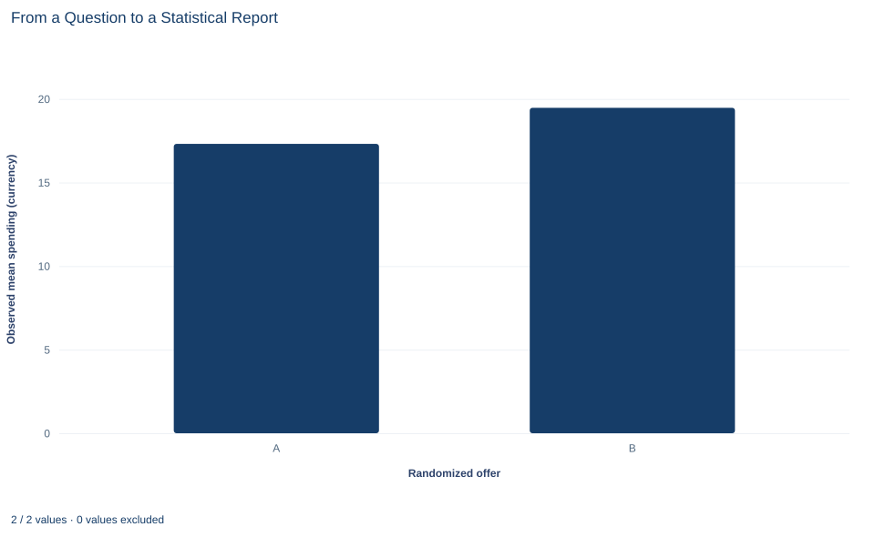

# Lab 20 · From a Question to a Statistical Report

**Primary and secondary outcomes, missing responses, multiplicity and a complete written result**

## Start with the supplied workbook

1. Download [campus_cafe_offer.xlsx](campus_cafe_offer.xlsx) and the [Python lab](lab.py). The workbook holds the fixed customer records used throughout this chapter.
2. Import `campus_cafe_offer.xlsx` into OpenEconometrics and keep that file name as the dataset name. The `Data` sheet holds one row per customer; the `Dictionary` sheet explains each column, its coding and its blank cells.
3. Open the complete `lab.py` in a new Python document and run the whole file. It reads the imported dataset and displays the two-sample comparison of spending (group statistics, t tests, a variance check and effect sizes), a bar chart of observed mean spending by offer and a table of the reported numbers, including the secondary return-visit test and the Holm-adjusted p values.

For ordinary Python, keep `lab.py` and the workbook in the same folder and run the script there, or call `from lab import run_lab` and then `run_lab(data_path="/path/to/campus_cafe_offer.xlsx")`. Leave blank cells blank. If you want to try filling them in, work on a copy of the loaded table so the distributed workbook stays unchanged.

A campus cafe randomly gave 240 customers one of two offers, the standard offer (A) or a discount (B), 120 customers each. It then followed every customer once and recorded two outcomes: how much they spent and whether they came back. Observed mean spending is 17.31 currency units under A and 19.47 under B. Return rates are 31.7% under A and 29.2% under B.

Those four numbers are not yet a report. A reader needs to know which question was the main one, decided before anyone looked at p values. They need to know which customers each number describes, because six discount customers have no spending recorded. And they need to know how the second outcome was treated, so that two tests are not quietly read as if only the favorable one had been run. This final lab turns the analysis into a statement that answers all of those questions.

This lab uses **240 original synthetic customers**, with spending in a hypothetical currency per customer. They are teaching records, not results from a real cafe. The [LaTeX table](table.tex) collects the reported numbers.

## 1. Write the question before the numbers

Each row of `Data` is one customer, assigned an offer and followed once.

| Column | What it records | Coding or unit |
|---|---|---|
| `customer_id` | Label from 1 to 240 | Identifier |
| `offer` | Offer assigned at random | A = standard, B = discount |
| `spending` | Spending at the follow-up visit; six blank cells | Hypothetical currency per customer |
| `returned` | Whether a return visit was observed; complete for all customers | 0 = no, 1 = yes |

A report starts with an analysis plan written before the data are examined. For this study the plan is:

- **Primary outcome:** follow-up spending, compared as the mean under A minus the mean under B, with Welch's two-sample t test and a 95% interval.
- **Secondary outcome:** return visit, compared as the return rate under A minus the rate under B, with a two-sample test of proportions.
- **Family:** these two outcomes and no others. The lab reports raw p values and, as a separate family-level analysis, Holm-adjusted p values for the two.

Fixing the plan first matters because the alternative, running several analyses and then featuring whichever looks best, makes nominal p values too small. The contrast direction matters too. Every difference below is A minus B, so a negative spending difference means discount customers spent more.

## 2. Account for every customer

Different outcomes use different customers, and a report should say so.

| Count | Offer A | Offer B | Total |
|---|---:|---:|---:|
| Customers randomized | 120 | 120 | 240 |
| Spending recorded | 120 | 114 | 234 |
| Spending missing | 0 | 6 | 6 |
| Return visit recorded | 120 | 120 | 240 |

All six blanks are in the discount group: customers 6, 36, 66, 96, 126 and 156. Their return outcome is recorded, and three of the six came back. The spending comparison therefore uses 234 customers and the return comparison uses all 240. A single sentence saying "n = 240" for both outcomes would hide the missing data.

**Pause before running.** Random assignment made the two groups comparable when the offers were handed out. Does it guarantee that the 114 discount customers with recorded spending are still comparable to the 120 standard-offer customers?

## 3. Run the primary comparison

Write $\bar C_A$ and $\bar C_B$ for mean observed spending, $s_A$ and $s_B$ for the standard deviations and $n_A$, $n_B$ for the numbers of customers with recorded spending. Welch's comparison does not assume the two groups share a variance:

$$
\hat\Delta_C=\bar C_A-\bar C_B,
\qquad
SE_C=\sqrt{\frac{s_A^2}{n_A}+\frac{s_B^2}{n_B}},
\qquad
t=\frac{\hat\Delta_C}{SE_C}.
$$

Its degrees of freedom come from the Welch–Satterthwaite formula and need not be a whole number. The complete file drops the six blank spending rows explicitly and then runs the native test:

```python
import openecon as oe

raw = load_data()  # reader defined in the complete lab.py
spending = raw.dropna(subset=["spending"])
primary = oe.ttest(spending, "spending", by="offer", missing="raise")
display(primary["statistics"])
display(primary["test"])
```

Setting `missing="raise"` makes the test stop if any blank slipped through, so the sample rule is the one written in the code, not an unstated default. The two tables read:

| Offer | Customers with spending | Mean spending | Standard deviation |
|---|---:|---:|---:|
| A (standard) | 120 | 17.31 | 5.42 |
| B (discount) | 114 | 19.47 | 6.07 |

| Test | Difference A − B | Standard error | t | df | p value | 95% interval |
|---|---:|---:|---:|---:|---:|---|
| Welch (unequal variances), primary | −2.158 | 0.754 | −2.862 | 225.9 | 0.0046 | −3.643 to −0.672 |
| Student (equal variances) | −2.158 | 0.752 | −2.870 | 232 | 0.0045 | −3.639 to −0.677 |

With the numbers in the formula, $SE_C=\sqrt{5.42^2/120+6.07^2/114}=\sqrt{0.245+0.323}=0.754$, and $t=-2.158/0.754=-2.86$. Discount customers with recorded spending spent 2.16 currency units more on average. The 95% interval runs from 0.67 to 3.64 units more under the discount, and the two-sided p value is 0.0046.

The Student row is shown only for comparison. With similar standard deviations and group sizes, the two versions agree closely, and the output's Levene test (p = 0.318) gives no strong sign of unequal variances. The primary result stays the Welch test because the plan named it in advance, not because it gave a preferred answer.

## 4. Run the secondary comparison

Return visits are recorded for all 240 customers. The return rate is 38 of 120 under A and 35 of 120 under B:

```python
secondary = oe.prtest(raw, "returned", by="offer", positive=1)
display(secondary)
```

| Offer | Customers | Returned | Return rate |
|---|---:|---:|---:|
| A (standard) | 120 | 38 | 31.7% |
| B (discount) | 120 | 35 | 29.2% |

The difference A − B is 0.025, or 2.5 percentage points, with a two-sided p value of 0.674. The direction is the opposite of what a discount might be expected to do: slightly more standard-offer customers came back. The difference is small and well within what chance assignment alone often produces. Notice that `prtest` runs on `raw`, not on `spending`: the return outcome has no blanks, so dropping the six customers without spending would throw away valid data.

A non-significant secondary result does not show that the discount has no effect on returns. It shows that these 240 customers do not provide clear evidence either way.

## 5. Adjust for two outcomes with Holm

Testing two outcomes gives two chances to declare a difference. Holm's procedure controls the familywise error rate, the probability of at least one false rejection, across the family. Sort the $m$ p values from smallest to largest, $p_{(1)}\le\dots\le p_{(m)}$, and set

$$
p^{\text{Holm}}_{(j)}=\min\Big\{1,\ \max_{k\le j}\,(m-k+1)\,p_{(k)}\Big\}.
$$

The smallest p value is multiplied by $m$, the next by $m-1$, and so on. The running maximum keeps the adjusted values in the same order as the raw ones. With $m=2$:

- Primary, $p_{(1)}=0.0046$: adjusted to $2\times 0.0046=0.0092$.
- Secondary, $p_{(2)}=0.674$: multiplied by 1, then compared with 0.0092; it stays 0.674.

After adjustment, the spending comparison is still below 0.05 and the return comparison is still far above it. The simpler Bonferroni rule, which multiplies every p value by $m$, controls the same error rate.

Report both versions and label them. The primary outcome was named in advance, so its raw p value answers the primary question; the Holm values answer a different question about the two-outcome family. Neither should be swapped in silently for the other.

## 6. Ask what the missing spending can do

Randomization protects the comparison of all 240 customers as assigned. The spending comparison does not use all 240. If whether spending went unrecorded is related to how much a customer spent, the 114 discount customers with spending may differ systematically from the 120 standard-offer customers, and the observed difference could be too large or too small.

The data cannot say which. Six of 120 discount customers is 5% of the group, so the possible distortion is limited, but not negligible when the interval's lower end is 0.67 units. A careful report states the assumption the complete-case result needs, for example that the six missing values are missing for reasons unrelated to spending. It then checks how sensitive the result is: fill the blanks with low and high plausible values and see whether the conclusion survives. Exercise 2 asks you to do exactly that.

The return outcome has no such problem. Its comparison uses every randomized customer, so random assignment still supports reading it as a comparison of offers.

## 7. Read the bar chart



The chart shows two bars, observed mean spending of 17.31 under the standard offer and 19.47 under the discount, on an axis that starts at zero. It describes only customers with recorded spending: 120 under A and 114 under B. The six missing discount customers are not in the B bar, and the return outcome does not appear at all.

The bars carry no uncertainty. The 2.16-unit gap looks clear, but the chart alone cannot tell you whether it is distinguishable from chance; the interval from Section 3 does that. A version with 95% interval bars, and a caption giving each bar's denominator, would let the chart stand on its own in a report.

## A case from the literature

Kaplan and Irvin (2015) asked whether null results had become more common in large clinical trials funded by the US National Heart, Lung, and Blood Institute. They identified the 55 large trials from 1970 to 2012 that evaluated drugs or dietary supplements for treating or preventing cardiovascular disease and recorded whether each reported a significant benefit on its primary outcome. Of 30 trials published before 2000, 17 (57%) did; of 25 published after 2000, only 2 (8%) did. Registration in ClinicalTrials.gov before publication was strongly associated with the trend toward null findings, and the authors suggest that prospective declaration of outcomes and transparent reporting standards may have contributed to it.

Chan et al. (2004) document the practice that an analysis plan guards against. Comparing the protocols and published articles of 102 randomized trials, they found that statistically significant outcomes were more likely to be fully reported than nonsignificant ones, and that 62% of trials had at least one primary outcome changed, introduced or omitted.

Both studies concern the habits this lab builds: a primary outcome named before the data are seen, every outcome in the family reported, and a multiplicity adjustment such as Holm's, which Aickin and Gensler (1996) describe as uniformly better than Bonferroni's and present in terms of adjusted p values. Missing outcomes need their own stated assumption. Rubin (1976) gave the conditions, missing at random among them, under which the process that causes missing data can be ignored.

## 8. Decide what the evidence supports

Under the assumption that the six missing spending values are unrelated to spending, the evidence supports this: among customers in this synthetic study, the discount offer was associated with higher follow-up spending, by about 2.16 currency units, and the result holds after Holm adjustment for the two outcomes. Because the offers were randomized, that difference can be read as an effect of the offer if the missingness assumption holds.

The evidence does not support a claim that the discount increases return visits; the observed difference points the other way and is far from significant. It does not support "the discount works" as a general claim about real cafes, because these are synthetic customers followed once. And it does not justify ignoring the missing spending, switching the primary outcome after seeing the results, or reading the non-significant return comparison as proof of no effect.

## 9. Write the report

A complete result paragraph reads:

"We randomized 240 synthetic cafe customers equally to a standard offer (A) or a discount (B). The prespecified primary outcome was follow-up spending; the secondary outcome was a return visit. Spending was recorded for 234 customers (120 A, 114 B); all six missing values were in the discount group, and the complete-case analysis assumes they are unrelated to spending. Mean spending was 17.31 currency units under A and 19.47 under B, a difference (A − B) of −2.16 (Welch 95% interval −3.64 to −0.67; p = 0.0046; Holm-adjusted p = 0.0092 across both outcomes). Return rates, recorded for all 240 customers, were 31.7% under A and 29.2% under B (difference 0.025; p = 0.674; Holm-adjusted p = 0.674). The data indicate higher spending under the discount but provide no clear evidence about return visits."

Check it against the plan. The paragraph names the design, both outcomes and which one is primary, the denominator for each, the missing data and the assumption it requires, the contrast direction, an interval in the outcome's units, raw and adjusted p values with their labels, and a conclusion that goes no further than the evidence.

## Student exercises

1. Compute a 95% interval for the return-rate difference (A − B) from the counts 38 of 120 and 35 of 120, using the unpooled standard error and the normal critical value 1.96. Compare it with the interval in the `prtest` output and say what range of return-rate effects the data allow.
2. On a copy of the data, fill the six blank spending values first with the lowest observed spending in group B and then with the highest. Rerun the Welch test each time and report the difference, interval and p value. Does the primary conclusion survive both cases?
3. Compute Bonferroni-adjusted p values for the two outcomes and compare them with the Holm values. Explain why Holm can never give a larger adjusted p value than Bonferroni.
4. Express the spending difference as a percentage of mean spending under offer A. Then compute Cohen's d from the two standard deviations using a pooled standard deviation, and check it against the `effect_sizes` table.
5. Suppose the team had named return visits as the primary outcome before collecting data. Rewrite the last sentence of the report paragraph for that plan, and explain what would be wrong with switching the primary outcome after seeing these results.
6. Find at least three problems in this draft sentence and rewrite it: "The discount raised spending by 2.16 (p = 0.0046, n = 240) and also increased return visits, though not significantly."

## Further reading

- Aickin, M., and Gensler, H. (1996). Adjusting for multiple testing when reporting research results: The Bonferroni vs Holm methods. *American Journal of Public Health*, 86(5), 726–728. https://doi.org/10.2105/AJPH.86.5.726
- Chan, A.-W., Hróbjartsson, A., Haahr, M. T., Gøtzsche, P. C., and Altman, D. G. (2004). Empirical evidence for selective reporting of outcomes in randomized trials: Comparison of protocols to published articles. *JAMA*, 291(20), 2457. https://doi.org/10.1001/jama.291.20.2457
- Kaplan, R. M., and Irvin, V. L. (2015). Likelihood of null effects of large NHLBI clinical trials has increased over time. *PLOS ONE*, 10(8), e0132382. https://doi.org/10.1371/journal.pone.0132382
- Rubin, D. B. (1976). Inference and missing data. *Biometrika*, 63(3), 581–592. https://doi.org/10.1093/biomet/63.3.581
